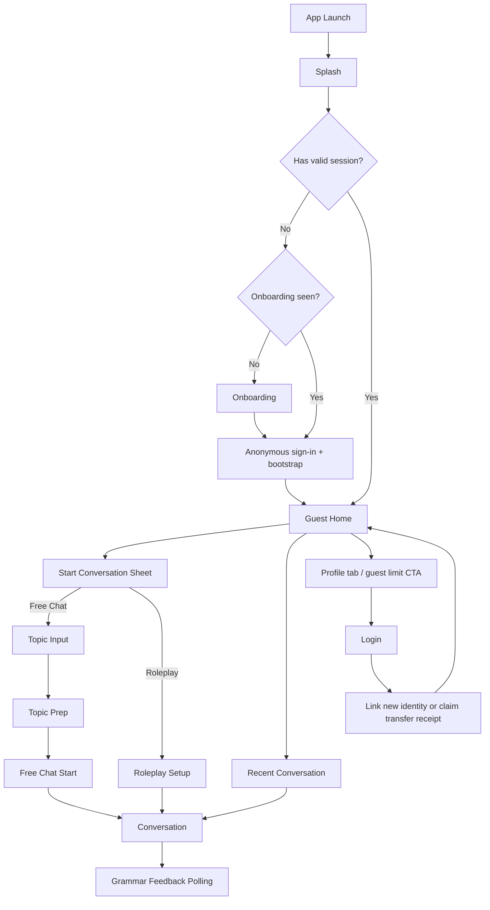

# 모바일 화면별 UX Flow / Wireframe

> 기준일: 2026-06-11  
> 최종 갱신: 2026-11-25
> 대상: Flutter v1 모바일 앱  
> 범위: 화면 구조, 사용자 흐름, API 연결 지점, low-fi wireframe

## 1. v1 제품 방향

모바일 v1은 사용자가 원하는 주제나 상황으로 영어 대화를 시작하고, 대화 중 문법 피드백을 부담 없이 확인하는 경험에 집중해요.

확정된 방향:

- 온보딩 뒤 Supabase 익명 게스트로 Home에 진입하고 Google·iOS Apple로 회원 전환할 수 있어요.
- 게스트는 스낵·주간 추천·최근 대화를 보고 활성 대화 1개에서 계정 누적 5회 발화할 수 있어요.
- 온보딩은 앱 언어·학습 언어·관심사·주제 준비·피드백의 5장으로 구성해요.
- Home에는 최근 대화 목록과 `대화 시작` 단일 CTA를 보여줘요.
- `대화 시작`을 누르면 자유 대화와 롤플레이 중 선택해요.
- 자유 대화는 `주제 입력 → 주제 준비 카드 → 방향 선택 → 첫 질문 선택 → 사용자 답변 → 대화 시작` 흐름을 사용해요.
- 롤플레이는 `상황 카드 선택 → 대화 시작`을 기본으로 하고, 원하는 상황이 없으면 custom 입력을 제공해요.
- 문법 피드백은 메시지 바로 아래에 표시해요.

## 2. 전체 화면 목록

| 화면 | 역할 | 주요 API |
|------|------|----------|
| Splash | Supabase 세션 복구, 게스트 초기화 | `POST /api/auth/bootstrap` |
| Onboarding | 서비스 가치 소개 | 없음 |
| Login | Google·Apple 회원 전환, 게스트 삭제 | `/api/auth/bootstrap`, `/api/auth/guest-transfer/*`, `DELETE /api/auth/me` |
| Home | 스낵·주간 추천·시작 진입점·최근 대화 | `GET /api/conversations/`, `GET /api/conversation-topics/weekly/` |
| Conversation Start Sheet | 자유 대화/롤플레이 선택 | 없음 |
| Topic Input | 자유 대화 주제 입력 | 없음 |
| Topic Prep | 주제 준비 카드 확인 | `POST /api/search/topic-prep/` |
| Free Chat Start | 첫 질문 선택 후 답변 | `POST /api/conversations/start/free-chat/` |
| Roleplay Setup | 롤플레이 상황 선택 | 없음 |
| Conversation | 채팅, 문법 피드백 polling | `POST /api/conversations/{id}/message/`, `GET /api/grammar/message/{message_id}/` |
| Profile | 닉네임·계정 잔액·학습 언어·계정 관리 | `GET /api/auth/me`, `PUT /api/auth/me/nickname`, `PUT /api/auth/me/language-preferences` |

## 3. 글로벌 UX Flow



## 4. 공통 네비게이션 원칙

- Splash 이후 저장된 회원·게스트 세션을 복원하고, 온보딩 완료 기기에 세션이 없으면 익명 게스트를 초기화해 Home으로 이동해요.
- 첫 방문자는 Onboarding을 마친 뒤 로그인 화면을 거치지 않고 Home으로 이동해요.
- Home은 앱의 기준 화면이에요.
- 게스트의 두 번째 탭도 `내 정보`이며 탭하면 Login을 push하고 뒤로가기는 Home 상태를 복원해요.
- Home의 `대화 시작` CTA는 자유 대화/롤플레이 선택 sheet를 열어요.
- 자유 대화와 롤플레이는 모두 Conversation 화면으로 합류해요.
- Conversation에서 뒤로 가면 Home으로 돌아가요.
- Profile은 Home의 `내 정보` 탭에서 접근해요.

## 5. 화면별 Wireframe

### 5.1 Splash

**목적**

- 저장된 token을 복구해 로그인 상태를 판단해요.
- access token이 만료되었으면 refresh를 시도해요.

**상태**

- `checking`
- `authenticated`
- `unauthenticated`
- `refreshFailed`

**Wireframe**

```text
┌─────────────────────────┐
│                         │
│        tomatalk         │
│   Speak about anything  │
│                         │
│        Loading...       │
│                         │
└─────────────────────────┘
```

**동작**

- Supabase SDK의 현재 세션을 확인하고 `POST /api/auth/bootstrap`으로 프로필을 복원해요.
- 온보딩 완료 상태인데 세션이 없으면 익명 로그인 뒤 같은 bootstrap을 호출해요.
- 네트워크 초기화 실패는 Login으로 보내지 않고 재시도 가능한 상태를 보여줘요.

### 5.2 Onboarding

**목적**

- 사용자가 앱의 핵심 가치를 빠르게 이해하게 해요.
- 영어 공부 앱처럼 딱딱하게 느껴지기보다 “관심사로 대화하는 앱”이라는 첫 인상을 줘요.

**페이지 구성**

- 앱 언어, 학습 언어, 관심사, 주제 준비, 피드백의 5장을 사용해요.
- 마지막 페이지 전까지 CTA는 `다음`, 마지막 페이지 CTA는 `시작`이에요.

**Wireframe**

```text
┌─────────────────────────┐
│              Skip       │
│                         │
│   [Illustration area]   │
│                         │
│ Talk about what you     │
│ actually care about.    │
│                         │
│ Practice English with   │
│ news, hobbies, sports,  │
│ travel, or anything.    │
│                         │
│      ● ○ ○ ○ ○          │
│        [ Next ]         │
└─────────────────────────┘
```

**페이지 역할**

1. 앱에서 사용할 한국어·영어를 선택해 나머지 온보딩에 즉시 적용해요.
2. 지원하는 학습 언어쌍을 선택해 첫 bootstrap 기본값으로 저장해요.
3. 관심사 기반 대화의 가치를 소개해요.
4. 주제 준비와 첫 질문 흐름을 소개해요.
5. 대화 중 피드백 경험을 소개해요.

**동작**

- `Skip` 또는 마지막 `시작`을 누르면 선택 언어를 pending으로 저장하고 익명 bootstrap 뒤 Home으로 이동해요.
- onboarding 완료 여부는 local storage에 저장해요.

### 5.3 Login

**목적**

- 게스트를 Google 또는 iOS Apple 회원으로 전환하고, 게스트 데이터 삭제 진입점도 제공해요.

**Wireframe**

```text
┌─────────────────────────┐
│                         │
│  Talk about what you    │
│  actually care about.   │
│                         │
│  Practice English with  │
│  your own topics.       │
│                         │
│ [ Continue with Google ]│
│                         │
└─────────────────────────┘
```

**동작**

- 새 신원이면 Supabase 익명 사용자에 Google·Apple identity를 연결해 사용자 ID와 데이터를 유지해요.
- 이미 존재하는 신원이면 게스트 세션에서 일회용 이전 영수증을 발급한 뒤 회원 세션에서 claim해 대화·동의·사용 기록을 옮겨요.
- 게스트 상태의 뒤로가기와 `게스트로 계속`은 Home으로 돌아가요.
- `계정 삭제`는 확인 뒤 공통 계정 삭제 API를 호출하고 완료 직후 새 익명 계정을 자동 생성하지 않아요.

**오류 처리**

- Google·Apple 취소: Login 화면 유지
- 회원 전환 실패: 원래 게스트 세션 또는 저장된 이전 영수증으로 복구하고 다시 시도 안내
- 서버 `400/401`: 다시 시도 안내

### 5.4 Home

**목적**

- 앱의 시작 허브예요.
- 최근 대화 재진입과 새 대화 시작을 제공해요.

**Wireframe**

```text
┌─────────────────────────┐
│ Hi, User          ⚙     │
│ Pick up where you left  │
│ off, or start fresh.    │
│                         │
│ [ + Start Conversation ]│
│                         │
│ Recent Conversations    │
│ - Lotte Giants game  >  │
│ - Osaka restaurants  >  │
│ - Coffee order       >  │
└─────────────────────────┘
```

**상태**

- `loadingRecent`
- `recentLoaded`
- `recentEmpty`
- `recentError`

**동작**

- 진입 시 `GET /api/conversations/?limit=5&offset=0`을 호출해요.
- `대화 시작` 선택 시 Conversation Start Sheet를 열어요.
- 최근 대화 선택 시 Conversation으로 이동하고 메시지 목록을 불러와요.

### 5.5 Conversation Start Sheet

**목적**

- 새 대화 시작 시 자유 대화와 롤플레이를 명확히 분리해요.

**Wireframe**

```text
┌─────────────────────────┐
│                         │
│ Start a conversation    │
│                         │
│ ┌─────────────────────┐ │
│ │ Free Chat           │ │
│ │ Bring your own topic│ │
│ └─────────────────────┘ │
│ ┌─────────────────────┐ │
│ │ Roleplay            │ │
│ │ Practice a situation│ │
│ └─────────────────────┘ │
│                         │
│          Cancel         │
└─────────────────────────┘
```

**동작**

- Free Chat 선택 시 Topic Input으로 이동해요.
- Roleplay 선택 시 Roleplay Setup으로 이동해요.

### 5.6 Topic Input

**목적**

- 사용자가 자유 대화의 관심 주제를 입력해요.

**Wireframe**

```text
┌─────────────────────────┐
│ ← Free Chat             │
│                         │
│ What topic do you want  │
│ to talk about?          │
│                         │
│ ┌─────────────────────┐ │
│ │ 최근 롯데 경기       │ │
│ └─────────────────────┘ │
│                         │
│ Examples                │
│ [Apple WWDC] [Osaka]    │
│ [Baseball] [AI news]    │
│                         │
│        [ Prepare ]      │
└─────────────────────────┘
```

**입력 규칙**

- 최소 2자 이상 입력해요.
- 사용자가 너무 넓은 주제를 입력해도 서버 quality gate가 retry guidance를 제공할 수 있어요.

**동작**

- Prepare 선택 시 Topic Prep으로 이동하고 `POST /api/search/topic-prep/`를 호출해요.

### 5.7 Topic Prep

**목적**

- 검색 컨텍스트를 바탕으로 대화 시작을 쉽게 만들어요.
- 사용자가 대화 방향과 첫 질문을 고르게 해요.

**Wireframe**

```text
┌─────────────────────────┐
│ ← Topic Prep            │
│                         │
│ Recent Lotte Giants game│
│ ┌─────────────────────┐ │
│ │ Summary             │ │
│ │ Lotte won/lost...   │ │
│ └─────────────────────┘ │
│ Sources                 │
│ [1] Sports News         │
│ [2] KBO                 │
│                         │
│ Choose direction        │
│ [Casual] [Debate]       │
│ [Interview] [Explain]   │
│                         │
│ Pick a first question   │
│ ○ What surprised you?   │
│ ○ Which player stood out│
│ ○ Do you follow KBO?    │
│                         │
│ [Start answering]       │
└─────────────────────────┘
```

**상태**

- `loading`
- `ready`
- `lowQuality`
- `error`

**동작**

- `ready=true`이면 요약, 출처, 방향 4개, 선택 방향의 질문 3개를 보여줘요.
- 사용자는 방향 1개와 질문 1개를 선택해요.
- `ready=false`이면 `retry_guidance`와 `example_topics`를 보여주고 Topic Input으로 돌아가게 해요.

### 5.8 Free Chat Start

**목적**

- 사용자가 선택한 첫 질문에 답하며 자연스럽게 대화를 시작해요.

**Wireframe**

```text
┌─────────────────────────┐
│ ← First Answer          │
│                         │
│ AI will ask:            │
│ “What surprised you     │
│  about the game?”       │
│                         │
│ Your answer             │
│ ┌─────────────────────┐ │
│ │ I was surprised by… │ │
│ │                     │ │
│ └─────────────────────┘ │
│                         │
│ [ Start Conversation ]  │
└─────────────────────────┘
```

**동작**

- `POST /api/conversations/start/free-chat/`로 대화를 생성해요.
- 요청에는 `first_message`, `search_context`, `topic`, `conversation_direction`, `selected_question`을 포함해요.
- 성공하면 Conversation 화면으로 이동해요.

### 5.9 Roleplay Setup

**목적**

- 사용자가 상황을 고른 뒤 롤플레이 대화를 시작해요.

**Wireframe**

```text
┌─────────────────────────┐
│ ← Roleplay              │
│                         │
│ Choose a situation      │
│ ┌─────────────────────┐ │
│ │ Cafe order          │ │
│ └─────────────────────┘ │
│ ┌─────────────────────┐ │
│ │ Travel check-in     │ │
│ └─────────────────────┘ │
│ ┌─────────────────────┐ │
│ │ Job interview       │ │
│ └─────────────────────┘ │
│                         │
│ 원하는 상황이 없나요?    │
│ [ 직접 입력하기 ]        │
│                         │
│ [ Start Roleplay ]      │
└─────────────────────────┘
```

**Custom 입력 Wireframe**

```text
┌─────────────────────────┐
│ ← Custom Roleplay       │
│                         │
│ Describe your situation │
│ ┌─────────────────────┐ │
│ │ 오사카 식당에서      │ │
│ │ 예약 확인하기        │ │
│ └─────────────────────┘ │
│ [ Start Roleplay ]      │
└─────────────────────────┘
```

**Preset 후보**

- Cafe order
- Hotel check-in
- Airport immigration
- Job interview
- Meeting small talk
- Friend conversation
- Meeting opinion

**동작**

- preset 또는 custom 상황을 `role_character`로 보내요.
- `POST /api/conversations/start/roleplay/` 성공 시 Conversation 화면으로 이동해요.

### 5.10 Conversation

**목적**

- 영어 대화를 진행하고, 사용자 메시지 아래에서 문법 피드백을 확인해요.

**Wireframe**

```text
┌─────────────────────────┐
│ ← Conversation      ⋯   │
│                         │
│        AI message       │
│ ┌─────────────────────┐ │
│ │ What surprised you? │ │
│ └─────────────────────┘ │
│                         │
│ User message            │
│ ┌─────────────────────┐ │
│ │ I was surprise...   │ │
│ └─────────────────────┘ │
│   Grammar: checking...  │
│                         │
│        AI message       │
│ ┌─────────────────────┐ │
│ │ That makes sense... │ │
│ └─────────────────────┘ │
│                         │
│ ┌───────────────────┐ + │
│ │ Type in English   │   │
│ └───────────────────┘   │
└─────────────────────────┘
```

**문법 피드백 표시**

```text
No errors:
  ✅ Looks natural

Has errors:
  ✍️ Try: “I was surprised by the ending.”
  - surprise → surprised: use past participle

Pending:
  Grammar: checking...

Timeout:
  Grammar feedback is taking longer than usual.
```

**상태**

- `sendingMessage`
- `aiResponding`
- `grammarPending`
- `grammarCompleted`
- `grammarTimeout`
- `messageSendFailed`

**동작**

- 메시지 전송 시 `POST /api/conversations/{conversation_id}/message/`를 호출해요.
- 응답의 `message_id`는 사용자의 메시지 ID예요.
- 앱은 해당 `message_id`로 `GET /api/grammar/message/{message_id}/`를 polling해요.
- `200`이면 피드백을 메시지 아래에 표시해요.
- `404`이면 pending으로 처리하고 일정 시간 후 timeout으로 전환해요.

### 5.11 Profile

**목적**

- 회원에게 계정 설정·로그아웃을 제공하고, 게스트 탭 진입은 Login으로 연결해요.

**Wireframe**

```text
┌─────────────────────────┐
│ ← 내 정보               │
│                         │
│ Account                 │
│ user@example.com        │
│                         │
│ App                     │
│ Version 0.1             │
│                         │
│ [ Log out ]             │
└─────────────────────────┘
```

**동작**

- 회원은 `GET /api/auth/me`로 사용자 정보를 보여줘요.
- 회원 로그아웃은 Supabase 세션과 회원 전용 로컬 상태를 정리한 뒤 새 익명 게스트를 초기화해 Home으로 이동해요.

## 6. 핵심 상태 모델

| 상태 | 설명 |
|------|------|
| AuthState | splash checking, guest, member, unauthenticated |
| SessionState | Supabase session, guest transfer receipt, account-scoped local data |
| HomeState | recent conversations loading/loaded/empty/error |
| StartConversationState | idle, choosingType |
| TopicPrepState | input, loading, ready, lowQuality, error |
| RoleplaySetupState | presetSelected, customInput, difficultySelected |
| ConversationState | messages, sending, receiving, failed |
| GrammarFeedbackState | pending, completed, timeout, error |

## 7. API 연결 요약

| 사용자 행동 | API | 성공 후 |
|------------|-----|---------|
| 앱 첫 진입·재실행 | Supabase 익명 로그인, `POST /api/auth/bootstrap` | 게스트 또는 회원 Home 이동 |
| Google·Apple 회원 전환 | Supabase identity link 또는 `POST /api/auth/guest-transfer/*` | 데이터가 유지된 회원 Home 이동 |
| AI 동의 | `GET/POST /api/auth/me/ai-consent` | 첫 AI action 계속 |
| 최근 대화 보기 | `GET /api/conversations/` | Home 최근 목록 표시 |
| 대화 시작 선택 | 없음 | 자유 대화 또는 롤플레이로 분기 |
| 주제 준비 | `POST /api/search/topic-prep/` | Topic Prep 표시 |
| 자유 대화 시작 | `POST /api/conversations/start/free-chat/` | Conversation 이동 |
| 롤플레이 시작 | `POST /api/conversations/start/roleplay/` | Conversation 이동 |
| 메시지 전송 | `POST /api/conversations/{conversation_id}/message/` | 메시지 추가, grammar polling 시작 |
| 문법 피드백 확인 | `GET /api/grammar/message/{message_id}/` | 메시지 아래 피드백 표시 |
| 로그아웃 | Supabase sign-out, 익명 bootstrap | 게스트 Home 이동 |

## 8. v1에서 의도적으로 제외

- 학습 통계 전용 화면
- 친구/커뮤니티 기능
- push notification
- WebSocket/SSE 기반 실시간 피드백
- 결제/구독

회원용 대화 권한 v3 (2026-11-25): 일반 회원은 기본 보관 대화 1개·계정 최초 AI 답변 10회를 받아요. 상점은 잔액/보관 현황과 슬롯 +1/+3·답변 5/10/20 두 섹션으로 구성해요. 슬롯 부족은 `purpose=buy_slots`, 답변 부족은 `purpose=buy_turns`로 이동해 해당 섹션을 스크롤·포커스해요. 회원 기존 대화는 잠그지 않아요. StoreKit terminal 후에만 finish하고 구매·답변 완료·앱 복귀 때 잔액을 갱신해요. 계정 삭제는 구매 자원 영구 소멸·재가입 복원 및 계정 이전 불가를 확인받아요. 운영 검증은 [운영 가이드](OPERATIONS.md#대화-이용-권한-활성화)를 참고해요.

## 9. 구현 순서

1. `Splash → Onboarding → 익명 게스트 Home` 시작 흐름과 Google·Apple 회원 전환을 연결해요.
2. Home의 Free Chat 시작을 Topic Input과 Topic Prep API에 연결해요.
3. Roleplay Setup을 연결해요.
4. Free Chat Start와 Conversation 생성 흐름을 연결해요.
5. Conversation 메시지와 grammar feedback polling을 연결해요.
