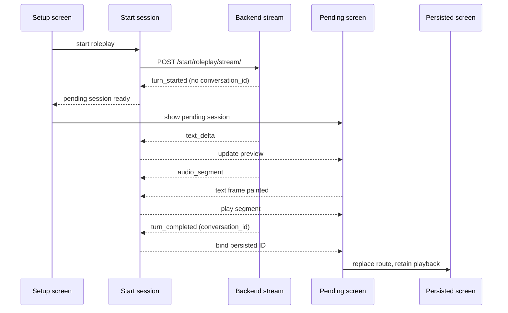

# Progressive Conversation Response - Plan

## Goal Capsule

**Objective:** 대화 시작 직후 AI의 생성 중인 텍스트를 화면에 보여 주고, 첫 문장의 음성이 남은 응답 생성 중에 준비되면 즉시 재생해요.

**Means:** 역할극에 영속 대화 ID가 없는 동안 사용할 임시 화면 상태를 도입하고, 문장 경계 처리와 구간별 지연 계측을 보강해요.

**Authority:** 이 문서의 제품 동작은 `docs/VOICE_STREAMING.md`와 `.agent/_contracts/VOICE_STREAMING.md`의 저장·실패·취소 규칙을 따라요. 충돌이 발견되면 구현 전에 계약을 먼저 갱신해요.

**Completion:** 앱과 서버의 동작·회귀 테스트, 실기기 및 실제 프록시 경로의 이벤트 도착 순서 확인, 관련 문서 동기화까지 끝내요.

## Product Contract

### Summary

역할극은 `turn_started` 이후 임시 대화 화면에 들어가 `text_delta`를 즉시 표시해요. 첫 문장 오디오는 그 문장 텍스트가 화면에 그려진 뒤 재생하고, 완료 시 영속 대화 화면에 자연스럽게 이어 붙여요. 기존 Free Chat과 주간 추천의 조기 화면 진입은 유지해요.

### Problem Frame

현재 역할극 시작 화면은 `startRoleplay()`가 대화 ID를 돌려줄 때까지 기다려요. 서버는 역할극의 첫 AI 인사를 완성한 뒤에야 대화를 저장하므로, 앱은 그동안 수신한 텍스트와 오디오를 사용자가 볼 수 없는 준비 화면 뒤에 쌓아요. Free Chat에서도 실제 첫 음성이 늦다면 LLM 문장 완성, TTS, 네트워크 청크 전달, 기기 재생 중 어디에서 기다리는지 현재 계측만으로는 분리하기 어려워요.

### Key Decisions

- **역할극은 임시 화면에서 생성 과정을 보여줘요.** 영속 대화가 확정되기 전에는 빈 대화를 만들지 않아요. Governs R1, R2, R4. (session-settled: user-approved — 완료 후 화면 진입보다 임시 화면을 선택: 생성 중인 답변을 즉시 보여주기 위해)
- **음성 출력 단위는 완성된 문장으로 유지해요.** 문장 내부 오디오 스트림은 별도 단계로 다뤄요. Governs R3, R8. (session-settled: user-approved — 오디오 바이트 단위 스트리밍보다 문장별 조기 재생을 선택: 현재 TTS·플레이어 계약을 유지하기 위해)

### Requirements

**화면과 재생**

- R1. 역할극 `turn_started`를 받으면 대화 ID 없이 임시 대화 화면으로 이동하고, 이후 `text_delta`를 순서대로 표시해요.
- R2. 역할극 `turn_completed`에서 받은 대화 ID로 영속 화면을 연결하면서 임시 텍스트·오디오 재생 위치를 중복 없이 유지해요.
- R3. 첫 `audio_segment`는 대응하는 텍스트가 한 프레임 이상 표시된 뒤 재생하고, 다음 문장을 생성 중이라면 그 작업을 기다리지 않아요.
- R4. 임시 단계에서 실패·연결 단절·뒤로 가기 시 부분 답변과 재생 큐를 정리하고, 기존 상태 조회·명시적 재시도·슬롯 해제 규칙을 지켜요.
- R5. Free Chat과 주간 추천의 시작 흐름 및 기존 대화 턴의 스트리밍 동작을 회귀시키지 않아요.

**서버와 관측**

- R6. LLM이 확정한 첫 문장을 전체 답변 완료 전에 TTS 큐에 넘기되, 약어·소수점·따옴표·한국어 문장부호와 최대 입력 길이를 안전하게 처리해요.
- R7. 첫 텍스트 델타, 첫 확정 문장, 첫 오디오 세그먼트, 앱의 첫 화면 표시와 실제 재생 시작을 동일한 요청 추적으로 비교할 수 있어야 해요.
- R8. 한 문장 답변은 그 문장이 확정되고 완성 오디오가 합성되기 전에는 음성을 시작할 수 없음을 UX와 성능 판정에 반영해요.

### Scope Boundaries

기존 NDJSON 이벤트 형식과 영속 turn 저장 시점은 유지해요. 실측에서 전송 버퍼링이 확인되면 실제 프록시 설정을 이 작업에서 바로 고쳐요. 문장 내부 TTS 바이트 스트리밍, 새 대화 스키마, 자동 답변 재생성은 범위 밖이에요.

### Acceptance Examples

- AE1. 역할극에서 `turn_started → text_delta("Hello. ") → audio_segment(0) → text_delta("How are you?") → turn_completed`가 오면, 첫 텍스트가 보인 뒤 첫 오디오는 뒤의 델타와 완료 이벤트를 기다리지 않고 재생돼요. Covers R1, R3, R6.
- AE2. `turn_error`가 첫 인사 생성 중 오면 임시 텍스트와 대기 중인 음성을 제거하고 기존 역할극 준비·재시도 상태로 돌아가요. Covers R4.
- AE3. `turn_completed`가 늦게 와도 이미 재생 중인 첫 세그먼트를 다시 재생하지 않고, 영속 화면은 저장된 메시지와 임시 메시지를 중복 표시하지 않아요. Covers R2.
- AE4. 답변이 `"Hello."` 한 문장뿐이라면 첫 음성이 답변 완료 후에 시작할 수 있어요. 이 경우 첫 텍스트 표시가 빨랐는지와 TTS 지연을 따로 판정해요. Covers R7, R8.

## Planning Contract

### Key Technical Decisions

- KTD1. **요청 단위 임시 시작 세션:** `request_id`와 `turn_id`를 연결한 앱 메모리 상태가 스트림 구독, 누적 텍스트, 세그먼트 큐, 취소를 소유해요. 역할극 화면은 이 세션 ID로 진입하고 대화 ID가 생기기 전에는 이력 API를 호출하지 않아요. Governs R1, R2, R4. (session-settled: user-approved — 완료 후 영속 ID로만 라우팅하는 방식보다 임시 세션을 선택: 역할극 첫 인사의 중간 상태를 화면에서 보여주기 위해)
- KTD2. **소유권을 유지한 화면 교체:** 준비 화면의 비동기 함수가 끝날 때까지 라우팅을 기다리지 않고, 시작 컨트롤러가 조기 진입 신호와 최종 대화 ID를 별도로 내보내요. 임시 화면에서 영속 화면으로 바뀌어도 같은 재생 세션을 유지하고, 임시 화면의 `dispose`가 이를 취소하지 않게 해요. Governs R2, R4.
- KTD3. **확정 문장만 합성:** `SentenceBuffer`가 구분자 뒤 공백이나 다음 토큰을 확인했을 때 첫 문장을 지체 없이 내보내고, 인용부호·약어 등 모호한 경계는 짧게 보류해요. 문장 끝 자체를 확정할 수 없는 단일 문장은 EOF에서 처리해요. Governs R6, R8.
- KTD4. **단계별 단조 시계 계측:** 서버와 앱은 기존 `trace_id`를 공유하고 각자의 단조 시계에서 단계 간 경과 시간을 기록해요. 두 기기의 절대 타임스탬프를 직접 빼지 않으며 발화 원문·오디오 Base64는 로그에 남기지 않아요. Governs R7.

### High-Level Technical Design

서버의 `stream_answer()`는 LLM reader와 TTS worker를 이미 병렬로 실행해요. 문장 경계 수정은 이 병렬성을 유지한 채 첫 문장을 큐에 넣는 시점만 조정해요. 계측 결과 첫 오디오가 이미 완료 전에 서버에서 나가는데 앱에 늦게 도착하면 분리기보다 전송 경로를 먼저 고쳐요.

## Implementation Units

### U1. 스트리밍 지연 기준선과 원인 분리

- **Goal:** 화면·서버·전송·재생의 첫 이벤트가 언제 발생하는지 확인해요.
- **Requirements:** R7, R8.
- **Dependencies:** 없음.
- **Files:** `backend/domains/conversation/stream_pipeline.py`, `backend/domains/conversation/stream_audio.py`, `mobile/lib/features/conversation/data/conversation_stream_api.dart`, `mobile/lib/features/conversation/application/start_conversation_controller.dart`, `mobile/lib/features/conversation/presentation/conversation_screen.dart`, `mobile/lib/core/diagnostics/latency_trace.dart`, `docs/VOICE_LATENCY.md`.
- **Approach:** `trace_id`·`turn_id`·`attempt_id`·첫 세그먼트 인덱스로 서버의 첫 델타/확정 문장/오디오 송출과 앱의 수신/첫 프레임/재생 시작을 연결해요. 우선 역할극과 Free Chat을 실제 프록시 경로에서 각 10회 이상 측정해 청크 묶임 여부와 주요 지연 구간을 판정해요.
- **Test scenarios:** 첫 오디오가 텍스트 완료 전 송출되는 경우와 완료 후 송출되는 경우에 각각 단계 로그가 한 번씩만 기록돼요. 사용자 텍스트와 Base64가 로그에 남지 않아요.
- **Verification:** 추적 한 건으로 첫 표시·첫 송출·첫 재생의 순서와 각 측의 경과 시간을 재구성할 수 있어요.

### U2. 역할극 임시 시작 화면과 세션 수명

- **Goal:** 역할극의 첫 델타를 완료 전에 표시하고 화면 이동 중에도 스트림을 유지해요.
- **Requirements:** R1, R2, R4, R5.
- **Dependencies:** U1.
- **Files:** `mobile/lib/features/conversation/application/start_conversation_controller.dart`, `mobile/lib/features/roleplay_setup/presentation/roleplay_setup_screen.dart`, `mobile/lib/app/router/app_router.dart`, `mobile/lib/features/conversation/presentation/conversation_screen.dart`, 역할극 임시 화면 파일, `mobile/test/features/conversation/application/start_conversation_controller_test.dart`, `mobile/test/features/conversation/presentation/conversation_screen_test.dart`.
- **Approach:** KTD1·KTD2에 따라 조기 진입과 최종 완료를 별도 신호로 만들어요. 임시 화면은 대화 ID가 없을 때 이력·접근 권한 API와 입력창을 비활성화하고, 완료 후 route replacement로 영속 화면에 연결해요. 중복 탭, 화면 이탈, 오류, terminal event 없는 종료는 기존 request/turn 상태 조회와 수동 재시도 흐름을 따라요.
- **Execution note:** 실제 비동기 이벤트 순서를 재현하는 컨트롤러 테스트에서 현재의 늦은 진입을 먼저 확인해요.
- **Test scenarios:** AE1의 `text_delta`가 `turn_completed` 전에 임시 화면에 보여요. AE2의 실패는 임시 상태를 정리하고 재시도를 남겨요. AE3의 완료 전환은 화면·메시지·오디오를 중복하지 않아요. 뒤로 가기 후 도착한 이전 `attempt_id` 이벤트는 새 화면을 열지 않아요.
- **Verification:** 역할극의 첫 글자가 나오기 위해 영속 대화 ID를 기다리지 않고, 완료·실패·이탈 후 활성 스트림이 남지 않아요.

### U3. 첫 문장 확정과 TTS 공급 시점 개선

- **Goal:** 확정된 첫 문장을 전체 생성 종료 전에 TTS에 전달해요.
- **Requirements:** R3, R6, R8.
- **Dependencies:** U1.
- **Files:** `backend/domains/conversation/stream_audio.py`, `backend/domains/conversation/stream_pipeline.py`, `backend/tests/domains/conversation/test_stream_audio.py`, `backend/tests/domains/conversation/test_stream_pipeline.py`.
- **Approach:** KTD3에 따라 델타 경계에 걸친 문장부호·공백·닫는 따옴표를 처리하고 `completed_sentences()`와 스트림 분리기의 결과를 일치시켜요. U1 계측에서 서버가 이미 첫 문장을 조기에 합성한다면 해당 사례의 parser 변경은 생략하고 실제 병목을 해결해요.
- **Test scenarios:** `"Hello."`와 뒤따르는 `" How are you?"`가 별도 델타여도 첫 문장이 종료 전에 TTS 큐로 가요. `Dr. Smith`, `U.S.`, `3.14`, 인용부호, 한국어 종결부호, 문장부호 없는 400자 초과 출력에서 부자연스러운 조기 절단이나 문장 누락이 없어요. 단일 문장 꼬리는 EOF에서 한 번만 합성해요.
- **Verification:** 가짜 LLM이 두 번째 문장을 늦게 보내는 테스트에서 첫 `audio_segment`가 마지막 `text_delta`보다 먼저 송출돼요.

### U4. 재생 연동과 실제 경로 검증

- **Goal:** 화면 첫 프레임 이후 첫 세그먼트를 조기에 재생하고 실환경 버퍼링을 확인해요.
- **Requirements:** R2, R3, R5, R7.
- **Dependencies:** U2, U3.
- **Files:** `mobile/lib/features/conversation/application/start_conversation_controller.dart`, `mobile/lib/features/conversation/presentation/conversation_screen.dart`, 역할극 임시 화면 파일, `mobile/test/features/conversation/application/start_conversation_controller_test.dart`, `mobile/test/features/conversation/presentation/conversation_screen_test.dart`, `deploy/nginx/`의 실제 적용 설정 파일(버퍼링 확인 시), `docs/VOICE_STREAMING.md`, `.agent/_contracts/VOICE_STREAMING.md`, `.agent/architecture.md`, `docs/VOICE_LATENCY.md`.
- **Approach:** 동일 세션의 프레임 준비 신호를 임시·영속 화면에 연결하고 첫 세그먼트의 중복 재생을 막아요. 실제 배포 경로에서 `text_delta`와 `audio_segment`가 완료 전에 도착하는지 확인하고, 버퍼링이 원인으로 확인되면 적용 중인 프록시 설정을 수정해요. 기존 문서의 역할극 완료 대기 설명을 새 흐름으로 교체하고 계약 상태는 실기기·프록시 검증 전까지 REVIEW로 둬요.
- **Test scenarios:** 텍스트 프레임 전 오디오가 와도 대기해요. 프레임 뒤 첫 오디오는 terminal event를 기다리지 않아요. 화면 교체·오디오 오류·사용자 이탈 시 중복 재생이나 늦은 재생이 없어요. Free Chat·주간 추천의 시작 동작이 유지돼요.
- **Verification:** iOS와 Android 실기기에서 역할극 및 Free Chat의 조기 텍스트 표시를 확인하고, 서버에서 첫 세그먼트가 마지막 델타보다 먼저 나온 사례에서는 앱도 뒤의 델타를 기다리지 않고 재생한 추적을 확보해요. 원인별 지연과 실패율을 이전 기준선과 비교해요.

## Verification Contract

| 검사 | 완료 신호 |
|---|---|
| `cd backend && uv run pytest tests/domains/conversation/test_stream_audio.py tests/domains/conversation/test_stream_pipeline.py` | 델타 경계·문장 순서·취소/오류 사례 통과 |
| `cd mobile && flutter test test/features/conversation/application/start_conversation_controller_test.dart test/features/conversation/presentation/conversation_screen_test.dart` | 역할극 조기 진입·프레임 게이트·완료 전환 및 기존 시작 흐름 통과 |
| `cd mobile && flutter analyze` | 변경 범위의 새 분석 오류 없음 |
| 실기기와 운영에 준하는 프록시 경로의 동일 `trace_id` 비교 | 첫 텍스트/첫 세그먼트/첫 재생 순서가 재구성되고, 서버가 조기 송출한 세그먼트를 앱이 늦추지 않음 |

## Definition of Done

- R1~R8 및 AE1~AE4가 테스트 또는 실기기 추적으로 확인돼요.
- 마지막 `text_delta` 전 재생 비율과 첫 재생 지연의 전후 측정값을 남기고, 한 문장 답변의 구조적 한계를 결과에 명시해요.
- 임시 역할극 진입과 실패·취소·영속 전환을 `docs/VOICE_STREAMING.md`, `.agent/_contracts/VOICE_STREAMING.md`, `.agent/architecture.md`에 동기화해요.
- 프로젝트 코디네이션 규칙에 따라 작업 상태와 변경 이력을 정리해요.
