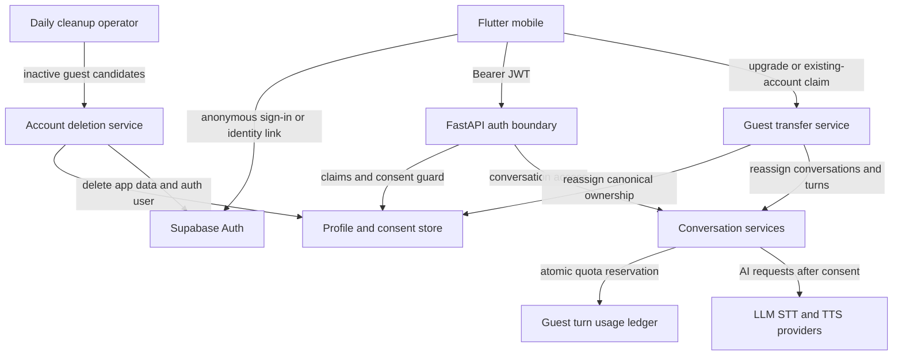
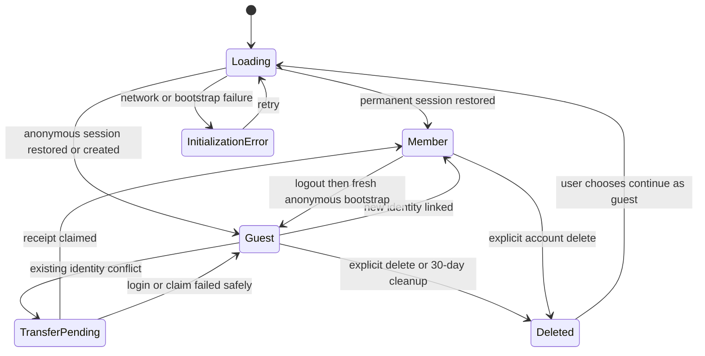
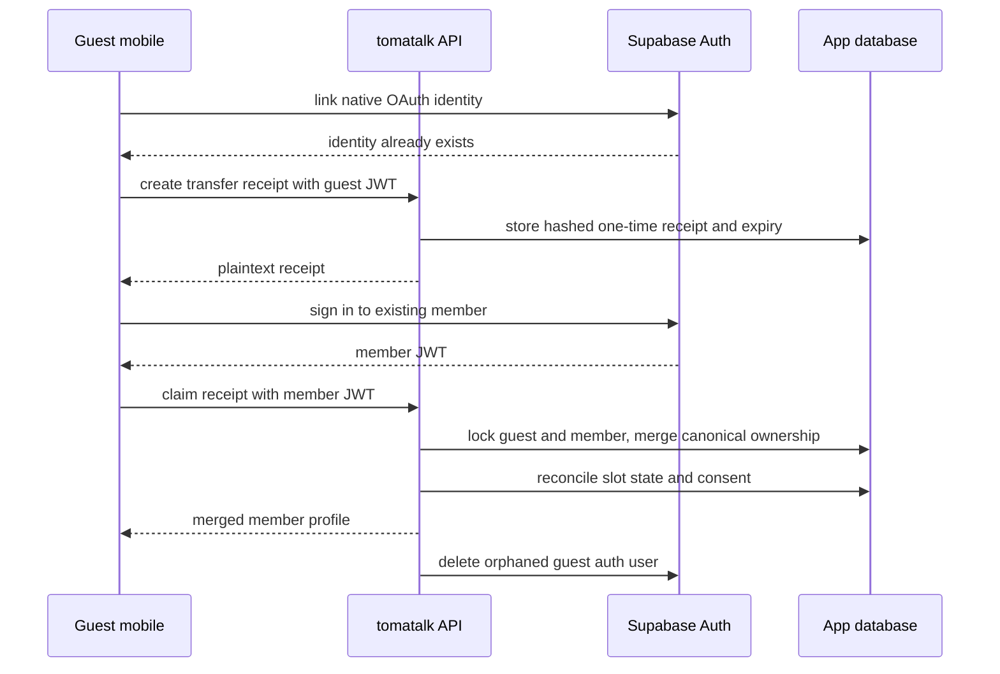
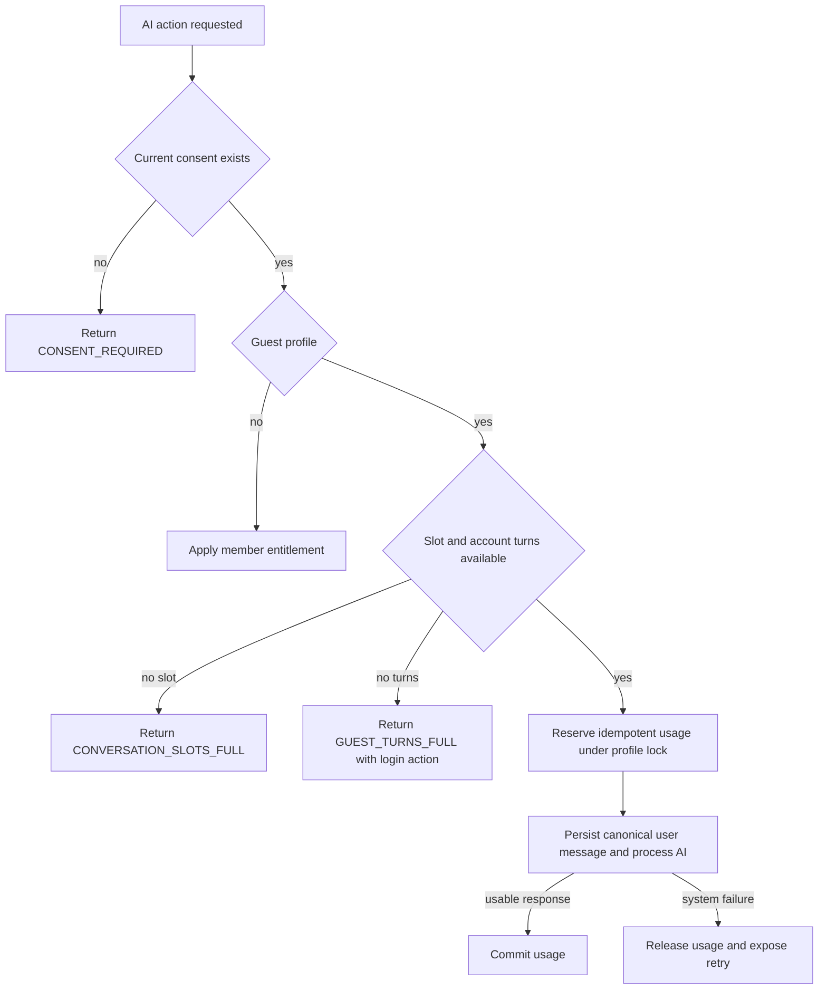

# Guest AI Chat and Account Continuity - Plan

## Goal Capsule

- **Objective:** 온보딩을 마친 사용자가 로그인 없이 Home과 핵심 AI 회화를 체험하고, 이후 회원으로 전환해도 게스트 시절의 대화와 동의 기록을 잃지 않게 해요.
- **Means:** Supabase 익명 사용자를 서버가 식별하는 게스트 계정으로 사용하고, 버전형 동의·계정 누적 발화 원장·신원 연결 및 기존 계정 이전 절차를 추가해요. (KTD1-KTD6)
- **Authority:** 이 문서의 Product Contract가 사용자 동작을, Planning Contract가 구현 방식을, 기존 `.agent/_contracts/`가 변경하지 않은 동작을 결정해요.
- **Execution profile:** 단일 PR로 구현하되 DB·백엔드와 Supabase 설정을 먼저 배포하고, 호환성 확인 뒤 모바일 앱을 출시해요.
- **Stop conditions:** 운영 Supabase 프로젝트에서 익명 로그인 또는 수동 신원 연결을 활성화할 수 없거나, 법무 검토가 R7의 명시적 AI 처리 동의와 다른 동의 모델을 요구하면 해당 결정을 확정하기 전 출시를 중단해요.
- **Completion owner:** 구현 담당자가 U1-U8과 검증 계약을 완료하고, Lead가 인증·데이터 이전·삭제 경계를 검토한 뒤 배포해요.

---

## Product Contract

### Summary

온보딩 이후 대화형 로그인을 강제하지 않고 백그라운드에서 게스트 계정을 만들어요.
게스트는 Home의 언어 스낵, 주간 추천 주제, 최근 대화와 핵심 AI 회화 기능을 사용할 수 있어요.
게스트 한도는 활성 대화 1개와 계정 전체 누적 학습자 발화 5회이며, 회원 전환 시 서버의 정식 플랜 규칙으로 바뀌어요.
로그인 여부와 관계없이 첫 AI 처리 전에 동의를 받고, 게스트 데이터는 가입 또는 기존 계정 로그인 뒤에도 보존해요.

### Problem Frame

현재 모바일 라우터는 온보딩을 마친 비로그인 사용자를 곧바로 Login으로 보내므로 Apple 심사에서 요구하는 로그인 없는 핵심 기능 체험과 맞지 않아요.
기존 서버도 이메일이 없는 Supabase 토큰을 거부하고 무료 발화 수를 대화별로 계산하므로, 화면 전환만 바꿔서는 안전한 게스트 회화를 제공할 수 없어요.
게스트를 공개·무인증 요청으로 처리하면 소유권, 삭제, 한도 집행, 회원 전환 시 데이터 승계가 각각 별도 예외가 되므로 계정 수명주기 전체를 함께 바꿔야 해요.

### Key Decisions

- **게스트에게 로그인 없는 핵심 회화를 제공하고 두 번째 탭은 `내 정보`로 유지해요.** 게스트가 `내 정보`를 누르면 Login으로 이동해요. (session-settled: user-directed — chosen over 온보딩 직후 로그인 강제와 탭 이름 변경: Home과 AI 체험을 먼저 제공하면서 기존 내비게이션 용어를 유지하기로 함) Governs R1-R4.
- **게스트의 주간 추천 주제 선택은 로그인 화면이 아니라 게스트 대화 시작으로 이어져요.** 이전의 선택 시 로그인 결정은 게스트 AI 채팅 요구로 대체됐어요. (session-settled: user-directed — chosen over 추천 주제 선택 시 로그인 요구: 게스트도 실제 AI 회화를 할 수 있어야 Apple 심사 목적을 충족함) Governs R3-R4.
- **게스트 한도는 계정 전체 누적 학습자 발화 5회와 활성 대화 1개예요.** (session-settled: user-directed — chosen over 대화별 5회와 무료 플랜의 대화별 15회: 게스트 비용을 더 강하게 제한하기로 함) Governs R5-R6.
- **게스트도 텍스트·음성, 자유 대화·롤플레이·추천 주제, 문법 피드백과 응답 재생을 포함한 핵심 회화 흐름을 사용해요.** (session-settled: user-approved — chosen over 축소된 데모 모드: 가입 전에도 제품의 실제 핵심 가치를 검증할 수 있어야 함) Governs R4-R6.
- **AI 처리 동의와 데이터 삭제는 게스트와 회원 모두에게 적용하고, 게스트의 정식 회원 전환 뒤에도 대화·동의·대화 슬롯을 보존해요.** (session-settled: user-directed — chosen over 가입 시 게스트 데이터 폐기와 회원만의 동의·삭제: 사용자가 만든 데이터와 개인정보 선택을 계정 전환 때문에 잃지 않게 함) Governs R7-R12.
- **전환하지 않은 게스트 계정과 데이터는 마지막 활동 30일 뒤 삭제해요.** (session-settled: user-approved — chosen over 무기한 보관: 복구 가능 기간과 개인정보 최소 보관을 균형 있게 유지함) Governs R9.

### Requirements

**Access and Home experience**

- R1. 온보딩을 마친 기기에 정식 회원 세션이 없으면 앱은 Supabase 익명 세션과 게스트 프로필을 만들거나 복원한 뒤 Home으로 이동해요. 명시적 계정 삭제 직후에는 이 자동 생성을 보류하고, 네트워크 실패는 Login 강제가 아닌 재시도 가능한 초기화 상태로 보여줘요.
- R2. 게스트의 하단 두 번째 탭은 `내 정보`로 표시하고 탭하면 Login으로 이동하며, 취소 또는 뒤로가기는 게스트 Home으로 돌아가요.
- R3. 게스트 Home은 인앱 언어 스낵, 주간 추천 주제, 게스트가 만든 최근 대화를 표시하고, 주간 추천 주제를 확인하면 게스트 대화를 시작해요.
- R4. 게스트는 자유 대화, 롤플레이, 직접 입력 Topic Prep, 추천 주제, 텍스트·음성 입력, 문법 피드백, AI 음성 응답을 사용할 수 있지만 구독 구매·복원과 iOS 스낵 위젯은 제공하지 않아요.

**Guest conversation limits**

- R5. 게스트 권한은 활성 대화 1개와 해당 게스트 계정 전체 누적 학습자 발화 5회이며, 대화를 삭제해도 이미 사용한 발화 수는 복구되지 않아요.
- R6. 텍스트와 음성의 canonical 학습자 메시지가 AI 응답 처리에 수락될 때 한 번만 차감하고, 중복 요청·시스템 첫 질문·저장 전 실패·사용 가능한 AI 응답을 만들지 못한 서버 실패는 차감하지 않아요. 다섯 번째 응답이 끝나면 기록과 오디오 재생은 유지하되 작성기를 잠그고 Login CTA를 보여줘요.

**Consent, deletion, and retention**

- R7. 게스트와 회원은 현재 개인정보처리방침 및 AI 데이터 처리 고지 버전에 명시적으로 동의하기 전에는 어떤 AI 입력도 전송할 수 없고, 서버도 모든 AI 진입점에서 현재 버전 동의를 검증해요.
- R8. 회원은 내 정보에서, 게스트는 Login 화면의 보조 동작에서 자신의 계정과 연관 데이터를 삭제할 수 있으며 기존 `DELETE /api/auth/me` 영수증·재시도 계약을 사용해요. 삭제 완료 뒤에는 새 게스트를 자동 생성하지 않고 `게스트로 계속`을 선택할 때 빈 익명 계정을 만들어요.
- R9. 회원으로 전환하지 않은 게스트는 마지막 앱 활동 후 30일이 지나면 대화, 메시지, 동의, 발화 원장, 음성 캐시, 시작 예약과 Supabase Auth 사용자가 멱등 삭제 절차로 제거돼요.

**Account continuity**

- R10. 게스트가 아직 다른 계정에 연결되지 않은 Google 또는 Apple 신원으로 가입하면 익명 Supabase 사용자에 그 신원을 연결하여 같은 사용자 ID와 모든 서버·기기 범위 데이터를 유지해요.
- R11. 이미 존재하는 계정으로 로그인하면 검증된 일회용 이전 영수증으로 게스트의 canonical 대화 데이터와 동의 기록을 기존 계정에 원자적으로 합쳐요. 기존 회원의 프로필·언어 설정이 우선하고, 슬롯이 찬 경우 가져온 게스트 대화는 삭제하지 않고 잠긴 읽기 전용 상태로 보존해요.
- R12. 같은 사용자 ID로 전환하는 신규 가입은 게스트의 로컬 스낵·주제 캐시를 유지하고, 기존 계정으로 합치는 로그인은 기존 회원 캐시를 우선하여 게스트 캐시를 지워요. 서버의 대화·동의·발화 기록은 두 경로 모두 보존해요.

**Security and compatibility**

- R13. 게스트 여부, 현재 동의, 슬롯과 누적 발화 한도는 서버가 권위 있게 판정해요. Supabase의 IP 기반 익명 가입 제한과 tomatalk API의 게스트 ID 기반 Topic Prep·STT·TTS·대화 시작·전송 제한 및 관측 지표를 함께 적용해 반복 계정 생성과 비용 남용을 탐지해요.
- R14. 백엔드는 기존 정식 회원 토큰과 구버전 모바일 계약을 계속 지원하고, 게스트 기능을 운영 플래그로 단계 활성화해 새 앱 출시 전후의 혼합 버전을 안전하게 처리해요.

### Actors

- A1. 게스트 학습자 — 익명 Supabase ID로 Home과 제한된 핵심 회화를 사용해요.
- A2. 정식 회원 — Google 또는 Apple 신원이 연결되고 Free·Advance·Plus 규칙을 사용해요.
- A3. 모바일 앱 — 세션 복원, 동의 UI, 이전 영수증 보관과 재시도를 조정해요.
- A4. tomatalk API — 소유권, 동의, 한도, 데이터 이전과 삭제를 집행해요.
- A5. Supabase Auth — 익명 사용자와 연결된 OAuth 신원, 세션을 관리해요.
- A6. 운영자 — 익명 가입 한도, 정리 작업, 실패·비용 지표를 운영해요.

### Key Flows

- F1. **온보딩에서 게스트 Home으로**
  - **Trigger:** 온보딩이 완료됐고 정식 회원 세션이 없어요.
  - **Steps:** 모바일이 익명 세션을 생성·복원하고 선택한 언어로 프로필을 bootstrap한 뒤 Home 데이터를 불러와요.
  - **Outcome:** Login을 거치지 않고 Home을 사용해요.
  - **Covered by:** R1-R4.
- F2. **첫 AI 상호작용과 5회 한도**
  - **Trigger:** 현재 버전 동의가 없는 사용자가 대화 시작 또는 발화를 시도해요.
  - **Steps:** 동의 고지를 승인한 뒤 서버가 동의와 권한을 다시 확인하고 발화를 처리하며, 성공한 게스트 발화를 계정 원장에 기록해요.
  - **Outcome:** 다섯 번째 발화까지 처리되고 이후에는 읽기 전용 화면과 Login CTA가 보여요.
  - **Covered by:** R5-R7, R13.
- F3. **게스트에서 신규 회원으로 전환**
  - **Trigger:** 게스트가 아직 사용되지 않은 Google 또는 Apple 신원으로 가입해요.
  - **Steps:** 모바일이 현재 익명 사용자에 OAuth 신원을 연결하고 bootstrap 응답이 회원 상태로 바뀐 것을 확인해요.
  - **Outcome:** 사용자 ID와 모든 데이터가 그대로 유지되고 Free 플랜 규칙이 적용돼요.
  - **Covered by:** R10, R12.
- F4. **게스트 데이터를 기존 회원에 합치기**
  - **Trigger:** 신원 연결이 기존 계정 충돌로 실패해요.
  - **Steps:** 게스트 세션으로 이전 영수증을 발급하고 기존 계정으로 로그인한 뒤 영수증을 claim하여 데이터를 합쳐요.
  - **Outcome:** canonical 게스트 데이터가 기존 계정에 속하고 슬롯 충돌 대화는 읽기 전용으로 남아요.
  - **Covered by:** R11-R12.
- F5. **명시적 삭제와 30일 정리**
  - **Trigger:** 사용자가 삭제를 요청하거나 게스트가 30일 비활성 상태가 돼요.
  - **Steps:** 기존 삭제 서비스가 앱 DB와 음성 캐시를 지우고 Supabase Auth 삭제를 완료하며, 실패 시 영수증 상태로 재시도해요.
  - **Outcome:** 이전 JWT로 데이터가 재생성되지 않고 삭제 완료 또는 처리 중 상태가 관측돼요.
  - **Covered by:** R8-R9.

### Acceptance Examples

- AE1. **Covers R1-R4.** 새 설치에서 온보딩 언어를 선택하면 Login 없이 Home이 열리고 스낵과 주간 주제가 보이며, 추천 주제를 확인하면 게스트 대화가 생성돼요.
- AE2. **Covers R5-R6.** 게스트가 3회 발화한 대화를 삭제하고 새 대화를 만들면 2회만 더 발화할 수 있고, 삭제로 한도가 5회로 복구되지 않아요.
- AE3. **Covers R5-R6, R13.** 남은 발화가 1회인 게스트가 두 전송을 동시에 시도하면 한 요청만 저장·차감되고 다른 요청은 `GUEST_TURNS_FULL`로 거절돼요.
- AE4. **Covers R6.** 음성 인식 실패, 중복 `turn_id`, AI 응답 생성 전 서버 실패에는 발화가 소모되지 않지만 성공한 음성 발화는 텍스트 발화와 동일하게 1회 소모돼요.
- AE5. **Covers R7.** 개인정보처리방침 또는 AI 처리 고지 버전이 바뀐 회원이 기존 대화를 열면 기록은 읽을 수 있지만 새 발화 전 재동의가 필요해요.
- AE6. **Covers R10.** 게스트가 새 Google 신원을 연결하면 사용자 ID, 대화 ID, 동의 시각이 바뀌지 않고 다음 발화부터 Free의 대화별 15회 한도가 적용돼요.
- AE7. **Covers R11-R12.** 활성 대화가 이미 1개인 Free 회원이 4회 발화한 게스트 대화를 합치면 기존 대화가 활성 상태를 유지하고 가져온 대화가 읽기 전용으로 표시되며 두 대화 모두 삭제되지 않아요.
- AE8. **Covers R8-R9.** 30일 경계 직전에 활동한 게스트는 정리 대상에서 제외되고, 경계 이전부터 비활성인 게스트는 삭제 영수증을 거쳐 앱 DB와 Supabase Auth에서 제거돼요.

### Success Criteria

- 신규 온보딩 사용자가 대화형 로그인 없이 Home과 첫 AI 응답까지 완료할 수 있어요.
- 서버 동시성 테스트에서 한 게스트 ID에 여섯 번째 canonical 발화가 저장되는 경우가 없어요.
- 신규 신원 연결과 기존 계정 합치기 모두에서 게스트 대화·동의가 보존돼요.
- 게스트·회원 삭제 및 30일 정리가 같은 삭제 재시도·JWT 차단 계약을 통과해요.
- 기존 로그인 회원의 로그인, 무료 15회, 구독, 계정 삭제 회귀 테스트가 유지돼요.

### Scope Boundaries

**In scope**

- iOS·Android Flutter 앱, FastAPI, PostgreSQL/Alembic, Supabase Auth 설정, 운영 cron과 관련 계약 문서예요.
- 게스트의 인앱 언어 스낵과 핵심 AI 회화, 계정 전환, 동의, 삭제, 30일 보존, 남용 방지가 포함돼요.

**Out of scope**

- 게스트의 구독 구매·복원, 유료 플랜 체험, 여러 기기 간 익명 계정 복구는 제공하지 않아요.
- iOS Home Screen 스낵 위젯은 정식 회원 전용을 유지해요.
- 기존 계정 합치기에서 게스트의 기기 로컬 스낵 진행을 기존 회원 진행 위에 덮어쓰지 않아요.
- 법률 문구 자체의 작성과 개인정보처리방침 법률 검토는 구현 범위가 아니며 출시 승인 조건으로 남겨요.

### Dependencies

- 운영 Supabase 프로젝트에서 익명 로그인과 수동 신원 연결을 활성화할 권한이 필요해요.
- `PRIVACY_POLICY_URL`의 공개 페이지와 AI 제3자 처리 고지 문구가 현재 앱·서버 동의 버전과 맞아야 해요.
- `.agent/_coordination/STATE.md`의 `인증 초기화 및 ID 전용 인증 분리`, `계정 삭제·구독 권한 복원`, `Vercel 공개 랜딩·지원·개인정보 페이지` 작업을 먼저 통합하거나 동일 변경을 재조정해야 해요.

### Sources and Research

- [Apple App Review Guidelines](https://developer.apple.com/app-store/review/guidelines/) — 계정이 핵심이 아닌 기능의 로그인 없는 사용, 앱 내 계정 삭제, 제3자 AI 데이터 공유 고지와 명시적 허가 요구를 출시 기준에 반영했어요.
- [Apple account deletion guideline reference](https://developer.apple.com/help/app-review/guideline-reference/5-1-1-account-deletion/) — 자동 생성 게스트 계정과 관련 데이터에도 삭제 선택지를 제공해야 한다는 근거예요.
- [Supabase Anonymous Sign-Ins](https://supabase.com/docs/guides/auth/auth-anonymous) — 익명 사용자도 `authenticated` 역할과 고유 ID를 가지며 `is_anonymous` claim으로 구분하고, 자동 정리 기능은 없어 별도 정리가 필요해요.
- [Supabase Identity Linking](https://supabase.com/docs/guides/auth/auth-identity-linking) — Flutter native OAuth 신원 연결과 기존 신원 충돌 처리의 기준이에요.
- [Supabase Auth rate limits](https://supabase.com/docs/guides/auth/rate-limits) — 익명 가입 IP 제한과 429 동작을 운영 설정에 반영해요.
- `mobile/lib/app/router/app_router.dart`, `mobile/lib/features/auth/application/auth_controller.dart` — 현재 비로그인 사용자를 Login으로 보내고 세션을 회원/비회원 두 상태로만 관리해요.
- `backend/domains/auth/supabase.py`, `backend/domains/auth/models.py` — 현재 인증 검증과 프로필이 이메일을 필수로 요구해 익명 사용자를 수용하지 못해요.
- `backend/domains/conversation/repository.py`, `backend/shared/subscription.py` — 현재 Free 발화 한도는 대화별 메시지 수로 계산돼 삭제 후에도 유지되는 게스트 계정 누적 한도와 달라요.
- `backend/domains/auth/deletion.py`, `docs/OPERATIONS.md` — 기존 삭제 영수증, Supabase Admin 삭제, 재시도 cron을 게스트 정리에 재사용할 수 있어요.

---

## Planning Contract

### Key Technical Decisions

- KTD1. **Supabase 익명 사용자를 게스트 신뢰 경계로 사용해요.** (session-settled: user-approved — chosen over 공개 무인증 대화 API: 기존 Bearer 소유권, FK, 스트리밍 경로와 삭제 계약을 재사용할 수 있음) `signInAnonymously()`가 발급한 `sub`를 모든 게스트 데이터의 소유자로 사용하고 `is_anonymous` claim을 서버와 모바일 상태에 전달해 R1-R4를 구현해요.
- KTD2. **프로필에 게스트 상태와 활동 수명을 영속화해요.** `profiles.email`을 nullable로 바꾸고 `is_guest`, `last_active_at`을 저장하여 토큰 claim이 없는 repository·cron 경로도 R9와 R13을 판정하게 해요. `last_active_at`은 앱 시작 bootstrap과 성공한 AI action에서 갱신하고, 회원 전환은 같은 ID 경로에서 `is_guest=false`와 신원 메타데이터를 갱신해요.
- KTD3. **계정 누적 한도는 대화 메시지 개수가 아닌 멱등 발화 원장으로 집행해요.** conversation 삭제와 무관하게 유지되는 `guest_turn_usages`를 사용자·요청 키로 유일하게 기록하고, 프로필 행 잠금 아래 수락·해제를 처리하여 R5-R6의 삭제·재시도·동시성 규칙을 보장해요.
- KTD4. **동의는 버전별 영속 기록과 공통 서버 guard로 관리해요.** `user_consents`가 고지 종류·버전·동의 시각·철회 상태를 보관하고, 모든 AI 라우터가 같은 dependency를 사용해 R7을 집행해요. 클라이언트 검사는 UX 최적화일 뿐 우회 가능한 권한 판정이 아니에요.
- KTD5. **신규 가입은 identity linking, 기존 계정 로그인은 일회용 이전 영수증을 사용해요.** (session-settled: user-approved — chosen over 게스트 데이터 폐기 또는 클라이언트 직접 복사: 동일 ID 유지가 가능한 경로와 ID 충돌 경로를 모두 안전하게 처리함) 연결 충돌 시 게스트 JWT로 짧은 만료의 hash 저장 영수증을 만들고 회원 JWT로 한 번만 claim하여 R10-R12를 트랜잭션으로 적용해요. claim transaction은 게스트 ID에 삭제 tombstone을 함께 만들어 이전 JWT가 profile을 재생성하지 못하게 한 뒤 Supabase Auth 삭제를 재시도해요.
- KTD6. **30일 정리는 기존 계정 삭제 파이프라인을 호출해요.** 별도 cascade SQL로 우회하지 않고 후보 선택 후 게스트 상태와 `last_active_at`을 잠금 아래 재확인하여 R8-R9의 음성 캐시·Auth 사용자 삭제·재시도·JWT 차단을 동일하게 유지해요.
- KTD7. **모바일 세션은 `loading`, `guest`, `member`, `initializationError`를 구분해요.** 라우터와 기능 provider는 단순 `isAuthenticated` 대신 기능 권한을 읽고, 회원 전용 닉네임·프로필·결제·위젯 부작용이 게스트에게 실행되지 않게 R1-R4를 구현해요.
- KTD8. **게스트 API 계약은 기존 회원 응답의 하위 호환 확장이에요.** entitlement에 `plan=guest`, `turn_scope=account`, `remaining_turns`, `limit_action=login`을 추가하되 기존 필드를 유지하고, 운영 플래그가 꺼져 있으면 구버전 로그인 흐름을 유지해 R14를 충족해요.
- KTD9. **남용 제어는 quota, 가입 속도 제한, 비용 경로 제한과 관측을 겹쳐 적용해요.** Supabase 익명 가입 IP 제한은 운영 시작값 5회/시간으로 낮추고, 앱 DB의 고정 window bucket으로 게스트 ID별 Topic Prep·STT·TTS·시작·전송을 제한해요. 정확한 비용 경로 임계값은 부하 검증으로 확정하되 R13의 5회 원장은 항상 최종 권한이에요.

### High-Level Technical Design

#### Component and data flow

#### Session lifecycle

#### Existing-account transfer protocol

#### Consent and quota decision path

### System-Wide Impact

- **Authentication:** 이메일 없는 JWT가 정상 입력이 되고, 회원 여부는 토큰 보유 여부가 아니라 `is_anonymous`와 프로필 상태로 결정돼요.
- **Authorization:** 게스트도 `authenticated` Postgres 역할을 사용하므로 RLS와 관리자 경로는 `is_guest`를 명시적으로 검사해야 해요.
- **Persistence:** profile, consent, transfer receipt, guest usage에 migration이 필요하고 계정 이전·삭제 cascade가 확장돼요.
- **Conversation:** 모든 대화 생성·텍스트·음성·스트리밍 경로가 동일한 consent와 guest quota guard를 사용해야 해요.
- **Mobile state:** 로그아웃은 무세션 Login 종착점이 아니라 새 게스트 초기화로 이어지고, 계정별 secure-storage scope를 전환해야 해요.
- **Operations:** Supabase Dashboard 설정, 일일 정리 cron, 익명 가입·AI 비용·이전 실패·삭제 적체 모니터링이 새 운영 표면이 돼요.
- **Analytics:** 전략의 첫 대화 활성화 분모를 `신규 계정`만이 아니라 게스트 ID와 회원 전환을 중복 제거한 신규 학습자로 계산해야 해요.

### Assumptions

- 현재 lockfile의 Supabase Flutter `2.16.0` native OAuth identity linking API를 사용하고, 실제 provider별 오류 코드는 구현 시 공식 SDK 동작을 고정하는 adapter 테스트로 캡슐화해요.
- 게스트가 신규 신원으로 전환하면 같은 Supabase 사용자 ID를 유지하므로 별도 DB 이전이 필요하지 않아요.
- 기존 계정 합치기에서 회원의 닉네임·언어·구독이 우선하고, 게스트 conversation의 언어 snapshot은 변경하지 않아요.
- 개인정보처리방침과 AI 처리 고지의 최초 버전 문자열은 배포 환경에서 정하고, 값이 바뀌면 재동의를 요구해요.
- 30일은 UTC `last_active_at` 기준의 엄격한 경계이며 정리 작업 직전 활동은 잠금 아래 재검사해 보존해요.

### Risks and Mitigations

| Risk | Impact | Mitigation |
|---|---|---|
| 기존 계정 로그인 중 게스트 JWT를 잃음 | 데이터 이전이 중단될 수 있어요 | 로그인 전에 1회용 영수증을 발급하고 Keychain/Keystore에 임시 저장하여 claim 완료 뒤 삭제해요 |
| 대화 삭제나 동시 전송으로 5회 한도가 우회됨 | 비용 한도가 무력화돼요 | 메시지 수와 분리된 idempotent usage 원장, 프로필 행 잠금, 동시성 통합 테스트를 사용해요 |
| 익명 사용자가 `authenticated` RLS를 그대로 통과함 | 회원 전용 데이터가 노출될 수 있어요 | RLS·관리자·결제·위젯 경로를 전수 감사하고 member-only guard를 추가해요 |
| cleanup과 회원 전환이 경합함 | 전환 중 데이터가 삭제될 수 있어요 | cleanup이 profile을 잠그고 `is_guest`와 활동 시각을 재확인하며 transfer와 같은 잠금 순서를 사용해요 |
| consent guard 누락 경로가 생김 | 동의 전 데이터가 AI 제공자에 전송될 수 있어요 | 공통 dependency를 사용하고 모든 AI router를 열거하는 계약 테스트를 추가해요 |
| 새 앱과 구버전 서버가 섞임 | 초기화 실패 또는 잘못된 CTA가 생겨요 | 백엔드 하위 호환 배포 후 원격 플래그를 켜고 최소 지원 API 버전을 확인한 뒤 앱을 출시해요 |
| 익명 계정 재생성으로 비용이 증가함 | 5회 한도를 반복 초기화할 수 있어요 | Supabase IP 제한, endpoint rate limit, 비용 지표와 emergency flag를 함께 운영해요 |
| 개인정보 페이지 작업과 동의 버전이 어긋남 | 심사·법무 리스크가 생겨요 | 공개 페이지 작업과 버전·URL을 같은 출시 체크리스트에서 검증해요 |
| 합치기 후 이전 guest JWT가 남음 | 옛 ID의 profile·데이터가 재생성될 수 있어요 | claim과 같은 transaction에서 삭제 tombstone을 만들고 모든 보호 API가 이를 거절한 뒤 Auth user 삭제를 완료해요 |

### Sequencing and Rollout

1. U1의 계약과 additive migration을 적용하고 기존 회원 행을 `is_guest=false`로 backfill해요.
2. U2, U4, U5, U6, U7의 백엔드를 플래그 비활성 상태로 배포하고 기존 앱 회귀를 확인해요.
3. 운영 Supabase에서 익명 로그인·수동 linking·익명 가입 rate limit을 설정하고 staging에서 end-to-end 흐름을 검증해요.
4. U3 모바일 앱을 TestFlight/내부 트랙에 배포하고 게스트 기능 플래그를 staging에서 활성화해요.
5. 삭제 cron과 대시보드를 먼저 활성화한 뒤 production 게스트 플래그를 점진적으로 켜요.
6. Apple 심사 노트에 로그인 없는 게스트 AI 회화, 5회 한도, 게스트 삭제 경로를 설명하고 검토용 동선을 제공해요.

---

## Implementation Units

### U1. Contracts and persistent guest model

- **Goal:** 게스트, 동의, 이전, 누적 발화와 보존 수명에 필요한 계약과 additive DB 구조를 먼저 확정해요.
- **Requirements:** R5-R14.
- **Dependencies:** 없음.
- **Files:** `.agent/_contracts/AUTH_BOOTSTRAP.md`, `.agent/_contracts/SUPABASE_AUTH.md`, `.agent/_contracts/MOBILE_NAVIGATION.md`, `.agent/_contracts/LANGUAGE_SNACKS.md`, `.agent/_contracts/CONVERSATION_ACCESS.md`, `.agent/_contracts/WEEKLY_CONVERSATION_TOPICS.md`, `.agent/_contracts/ACCOUNT_DELETION.md`, `.agent/_contracts/IOS_SNACK_WIDGET.md`, `docs/DSL.md`, `backend/alembic/versions/20261123_0001_guest_accounts.py`, `backend/domains/auth/models.py`, `backend/domains/auth/schemas.py`, `backend/domains/conversation/models.py`, `backend/tests/domains/auth/test_guest_models.py`, `backend/tests/shared/test_guest_rate_limit.py`.
- **Approach:**
  1. 계약 문서에서 guest/member 상태, API 오류, 승계·삭제·30일 정책과 widget 비대상을 먼저 정의해요.
  2. `profiles.email` nullable, `is_guest`, `last_active_at`, versioned consent, hash 저장 transfer receipt, guest usage ledger, guest rate-limit bucket과 필요한 unique/check/index를 한 migration에 추가해요.
  3. 기존 profile은 회원으로 backfill하고 downgrade가 nullable email·게스트 행 때문에 데이터를 잃을 수 있으면 명시적 방어 조건으로 중단해요.
- **Patterns to follow:** `backend/alembic/versions/20261101_0001_account_deletions.py`, `backend/alembic/versions/20261005_0001_stream_turns.py`, `.agent/_contracts/CONVERSATION_ACCESS.md`.
- **Test scenarios:**
  - 기존 회원 데이터가 있는 DB에 upgrade하면 모든 행이 `is_guest=false`이고 기존 email unique 제약이 유지돼요.
  - email이 null인 게스트 profile과 관련 consent·usage·receipt를 생성할 수 있어요.
  - 같은 사용자·idempotency key의 usage를 두 번 만들거나 만료·상태 제약을 위반하면 DB가 거절해요.
  - profile 삭제가 consent와 usage를 cascade하고 삭제 영수증 tombstone은 기존 규칙대로 남아요.
- **Verification:** PostgreSQL과 SQLite 테스트 스키마에서 migration head가 적용되고 기존 회원 fixture와 새 게스트 fixture가 모두 유효해요. 모델 테스트는 DB 제약을 직접 확인하지만 실제 Supabase 설정은 U2와 staging 검증이 맡아요.

### U2. Anonymous authentication and guest bootstrap

- **Goal:** 이메일 없는 Supabase 익명 세션을 안전한 게스트 profile과 API principal로 받아들여요.
- **Requirements:** R1, R3-R4, R9, R13-R14.
- **Dependencies:** U1.
- **Files:** `backend/supabase/config.toml`, `backend/domains/auth/supabase.py`, `backend/domains/auth/service.py`, `backend/domains/auth/repository.py`, `backend/domains/auth/dependencies.py`, `backend/domains/auth/router.py`, `backend/tests/domains/auth/test_supabase_local_verify.py`, `backend/tests/domains/auth/test_supabase_jwt_auth.py`, `backend/tests/domains/auth/test_language_preferences_router.py`, `backend/tests/domains/auth/test_guest_auth.py`.
- **Approach:**
  1. local JWKS와 remote user 검증 모두에서 `is_anonymous`를 읽고, 익명 claim에만 email 부재를 허용해요.
  2. bootstrap이 온보딩 언어로 게스트 profile을 멱등 생성하고 `UserProfile.is_guest`와 nullable email을 반환하게 해요.
  3. bootstrap과 성공한 AI action이 게스트 활동 시각을 갱신하고, 결제·관리자 등 회원 전용 경로에는 별도 member guard를 제공해요.
  4. local Supabase 설정은 anonymous/manual linking을 켜되 production Dashboard 적용을 U8의 운영 체크로 남겨요.
- **Execution note:** 기존 회원 인증 characterization 테스트를 먼저 고정한 뒤 익명 claim fixture를 추가해요.
- **Patterns to follow:** `SupabaseAuthVerifier`, `AuthRepository.get_or_create_profile()`, `POST /api/auth/bootstrap`.
- **Test scenarios:**
  - email 없는 `is_anonymous=true` ES256/remote 사용자는 bootstrap에 성공하고 guest profile을 한 번만 만들어요.
  - email 없는 정식 회원 claim과 `role!=authenticated` 토큰은 계속 거절돼요.
  - 기존 Google/Apple 회원 bootstrap 응답과 ID가 변경되지 않아요.
  - 앱 시작 bootstrap과 성공한 AI action은 활동 시각을 갱신하지만 캐시된 Home 콘텐츠 열람만으로는 불필요한 UPDATE를 만들지 않아요.
  - member-only dependency는 게스트의 결제·관리자 요청을 403으로 거절해요.
- **Verification:** auth 도메인 테스트가 익명·회원·삭제 tombstone 토큰을 구분하고, 기존 auth latency 테스트의 이벤트 루프 경계가 유지돼요.

### U3. Mobile guest session, navigation, and Home surfaces

- **Goal:** 모바일이 guest/member를 명시적으로 관리하고 온보딩 뒤 Login 없이 Home과 선택된 게스트 기능을 제공해요.
- **Requirements:** R1-R4, R12, R14.
- **Dependencies:** U2.
- **Files:** `mobile/lib/features/auth/domain/auth_session.dart`, `mobile/lib/features/auth/domain/user_profile.dart`, `mobile/lib/features/auth/data/supabase_auth_service.dart`, `mobile/lib/features/auth/application/auth_controller.dart`, `mobile/lib/app/router/app_router.dart`, `mobile/lib/app/navigation/main_shell.dart`, `mobile/lib/features/auth/presentation/login_screen.dart`, `mobile/lib/features/home/application/language_snacks_controller.dart`, `mobile/lib/features/home/application/daily_snack_basket_controller.dart`, `mobile/lib/features/home/application/weekly_topics_controller.dart`, `mobile/lib/features/home/presentation/home_screen.dart`, `mobile/lib/core/copy/app_copy.dart`, `mobile/test/features/auth/application/auth_controller_test.dart`, `mobile/test/app/app_test.dart`, `mobile/test/app/navigation/main_shell_test.dart`, `mobile/test/features/home/presentation/home_screen_test.dart`, `mobile/test/features/home/application/language_snacks_controller_test.dart`, `mobile/test/features/home/application/daily_snack_basket_controller_test.dart`.
- **Approach:**
  1. onboarding 완료 뒤 기존 영구 세션을 우선 복원하고, 없으면 `signInAnonymously()`와 bootstrap을 수행해 guest 상태로 전환해요.
  2. router는 guest에게 Home·대화 경로를 허용하고 profile branch 선택만 Login으로 가로채며, Login의 back/continue guest 동작을 Home에 연결해요.
  3. snack/topic/recent provider는 guest profile ID와 언어를 정상 scope로 사용하되 nickname dialog, billing, subscription, widget bridge는 member 상태에서만 실행해요.
  4. 회원 logout 뒤에는 새 guest bootstrap을 시작하고, 명시적 계정 삭제 뒤에는 로컬 보류 표식을 저장하여 사용자가 `게스트로 계속`을 선택할 때까지 자동 생성을 막아요.
- **Patterns to follow:** `AuthController._restoreSession()`, `StatefulShellRoute.indexedStack`, user/language-scoped secure-storage key.
- **Test scenarios:**
  - Covers AE1. 온보딩 완료 후 영구 세션이 없으면 익명 로그인·bootstrap이 한 번 실행되고 Home으로 이동해요.
  - 저장된 guest 세션을 복원하면 새 익명 계정을 만들지 않고 같은 recent/snack/topic scope를 사용해요.
  - guest가 `내 정보`를 누르면 Login이 열리고 뒤로가면 Home의 스크롤 상태가 유지돼요.
  - guest Home에서 스낵·주간 주제·최근 대화가 보이고 추천 주제 확인이 start API를 호출해요.
  - guest에게 nickname dialog, paywall, restore purchase, widget snapshot 쓰기가 실행되지 않아요.
  - 익명 로그인 네트워크 오류는 Login으로 redirect하지 않고 retry 가능한 초기화 오류를 표시해요.
- **Verification:** 관련 widget/controller 테스트와 `mobile/test/app/app_test.dart`가 guest/member routing을 검증하고, 실제 Supabase SDK 세션 복원은 staging smoke test로 보완해요.

### U4. Versioned AI consent gate

- **Goal:** 로그인 여부와 무관하게 현재 버전 동의 없이는 AI provider로 입력이 나가지 않게 해요.
- **Requirements:** R7-R8, R10-R11, R13.
- **Dependencies:** U1-U3.
- **Files:** `backend/config.py`, `backend/domains/auth/consent.py`, `backend/domains/auth/dependencies.py`, `backend/domains/auth/router.py`, `backend/domains/auth/schemas.py`, `backend/domains/conversation/router.py`, `backend/domains/conversation/topic_router.py`, `backend/domains/search/router.py`, `backend/domains/grammar/router.py`, `backend/tests/domains/auth/test_ai_consent.py`, `backend/tests/domains/conversation/test_topic_prep_handoff.py`, `backend/tests/domains/voice/test_multimodal_conversation_router.py`, `mobile/lib/features/auth/data/api_auth_repository.dart`, `mobile/lib/features/auth/application/ai_consent_controller.dart`, `mobile/lib/features/auth/presentation/ai_consent_dialog.dart`, `mobile/lib/features/conversation/application/start_conversation_controller.dart`, `mobile/lib/features/conversation/application/conversation_controller.dart`, `mobile/test/features/auth/presentation/ai_consent_dialog_test.dart`, `mobile/test/features/conversation/application/start_conversation_controller_test.dart`, `mobile/test/features/conversation/application/conversation_controller_test.dart`.
- **Approach:**
  1. status 조회와 명시적 accept API를 추가하고 서버 설정의 privacy/AI notice 버전을 응답해요.
  2. 공통 `current_ai_profile` guard를 Topic Prep, 추천 주제, 롤플레이, 새/기존 대화 전송, 음성 처리처럼 외부 AI에 데이터를 보내는 진입점에 적용해요.
  3. 모바일은 AI action 직전에 status를 확인하여 고지·정책 링크·동의 버튼을 보여주고 승인 후 원래 action을 한 번만 재개해요.
  4. 버전 변경은 기록 읽기와 삭제를 막지 않고 새 AI action만 `CONSENT_REQUIRED`로 거절해요.
- **Patterns to follow:** `get_current_profile` FastAPI dependency, `ApiAuthRepository`, 기존 start controller의 idempotent request 처리.
- **Test scenarios:**
  - guest/member가 current version을 accept하면 시각·버전이 저장되고 반복 accept는 멱등이에요.
  - Covers AE5. 이전 버전 동의 사용자는 기록을 읽을 수 있지만 Topic Prep, text, voice, suggested start가 모두 같은 오류로 거절돼요.
  - consent dialog 취소는 AI API를 호출하지 않고, 승인 뒤에는 원래 start/send를 정확히 한 번 재개해요.
  - 정책 URL이 없거나 버전 설정이 비어 있는 production 설정은 startup/배포 검증에서 실패해요.
  - 계정 삭제는 consent가 없어도 가능하고 consent row도 함께 삭제돼요.
- **Verification:** router 계약 테스트가 모든 AI 엔드포인트의 guard 적용을 열거하고, fake provider 호출 횟수 0으로 동의 전 외부 전송이 없음을 증명해요.

### U5. Global five-turn guest entitlement

- **Goal:** 모든 대화·입력 방식에서 게스트의 누적 5회와 1개 슬롯을 원자적으로 집행하고 한도 후 Login 전환 UX를 제공해요.
- **Requirements:** R4-R6, R13-R14.
- **Dependencies:** U1-U4.
- **Files:** `backend/shared/subscription.py`, `backend/shared/rate_limit.py`, `backend/domains/conversation/repository.py`, `backend/domains/conversation/service.py`, `backend/domains/conversation/router.py`, `backend/domains/conversation/schemas.py`, `backend/domains/conversation/stream_turns.py`, `backend/domains/conversation/stream_pipeline.py`, `backend/tests/shared/test_guest_rate_limit.py`, `backend/tests/domains/conversation/test_conversation_access.py`, `backend/tests/domains/conversation/test_stream_turn_transaction.py`, `backend/tests/domains/conversation/test_guest_conversation_access.py`, `backend/tests/domains/voice/test_multimodal_conversation_router.py`, `mobile/lib/features/conversation/domain/conversation_access.dart`, `mobile/lib/features/conversation/data/conversation_access_repository.dart`, `mobile/lib/features/conversation/presentation/conversation_access_dialog.dart`, `mobile/lib/features/conversation/presentation/conversation_entry_gate.dart`, `mobile/lib/features/conversation/presentation/widgets/chat_composer.dart`, `mobile/lib/features/conversation/application/conversation_controller.dart`, `mobile/test/features/conversation/domain/conversation_models_test.dart`, `mobile/test/features/conversation/presentation/conversation_entry_gate_test.dart`, `mobile/test/features/conversation/presentation/conversation_screen_test.dart`, `mobile/test/features/conversation/application/conversation_controller_test.dart`.
- **Approach:**
  1. entitlement resolver가 guest에는 account-scoped 5회·1 slot, member Free에는 기존 conversation-scoped 15회·1 slot을 반환하게 해요.
  2. 모든 canonical user-message 저장 경로가 같은 usage reservation API를 사용하고 `turn_id`/message key로 중복 차감을 막아요.
  3. provider 실패로 user message를 철회하는 기존 경로는 reservation도 release하고, conversation 삭제는 committed usage를 보존해요.
  4. DB-backed fixed-window limiter를 공통 dependency로 두고 R13의 비용 경로마다 guest ID bucket을 소비하되 회원의 기존 provider 429 처리와 분리해요.
  5. access 응답과 오류가 `limit_action=login`을 제공하면 모바일은 paywall 대신 Login CTA와 남은 횟수를 표시하고 composer를 read-only로 바꿔요.
- **Execution note:** repository 동시성 테스트를 먼저 추가하고 text·voice·new-conversation 경로를 같은 helper로 수렴해요.
- **Patterns to follow:** `ConversationRepository._locked_entitlement()`, `save_user_turn()`, `StreamTurnModel` idempotency, 기존 `CONVERSATION_TURNS_FULL` UX.
- **Test scenarios:**
  - Covers AE2. conversation을 삭제해도 committed guest usage가 남고 새 conversation은 남은 2회만 허용해요.
  - Covers AE3. 두 DB session의 동시 5·6번째 전송 중 하나만 commit되고 다른 요청은 `GUEST_TURNS_FULL`이에요.
  - Covers AE4. text와 voice 성공은 각각 한 번 차감하고 STT 실패·중복 turn·provider 실패 release는 차감하지 않아요.
  - 추천 주제의 assistant 첫 질문과 TTS replay는 발화 수를 올리지 않아요.
  - 서로 다른 guest ID는 rate-limit bucket을 공유하지 않고, 같은 guest ID의 window 초과 요청은 provider 호출 전에 429로 거절돼요.
  - 다섯 번째 AI 응답 뒤 history/audio는 접근 가능하고 composer와 새 conversation start는 Login CTA를 보여줘요.
  - member Free의 대화별 15회와 Advance/Plus 무제한 회귀 테스트가 그대로 통과해요.
- **Verification:** PostgreSQL 동시성 테스트와 API/mobile 테스트가 account scope와 conversation scope를 각각 증명하고 하드코딩된 `무료 15턴` 문구가 guest 오류에 노출되지 않아요.

### U6. Identity linking and existing-account transfer

- **Goal:** 신규 가입과 기존 계정 로그인 모두에서 게스트 canonical 데이터를 잃지 않고 회원으로 전환해요.
- **Requirements:** R10-R12, R14.
- **Dependencies:** U1-U5.
- **Files:** `backend/domains/auth/guest_transfer.py`, `backend/domains/auth/repository.py`, `backend/domains/auth/router.py`, `backend/domains/auth/schemas.py`, `backend/domains/conversation/repository.py`, `backend/tests/domains/auth/test_guest_transfer.py`, `backend/tests/domains/conversation/test_conversation_access.py`, `mobile/lib/features/auth/data/supabase_auth_service.dart`, `mobile/lib/features/auth/data/api_auth_repository.dart`, `mobile/lib/features/auth/application/auth_controller.dart`, `mobile/lib/features/auth/data/account_local_data.dart`, `mobile/lib/features/auth/presentation/login_screen.dart`, `mobile/test/features/auth/application/auth_controller_test.dart`, `mobile/test/features/auth/data/api_auth_repository_test.dart`, `mobile/test/features/auth/data/account_local_data_test.dart`.
- **Approach:**
  1. Google/Apple 로그인은 guest session이면 native identity linking을 먼저 시도하고 성공한 같은-ID 전환을 bootstrap으로 확인해요.
  2. existing-identity 오류일 때만 guest JWT로 짧은 만료의 receipt를 발급하고 안전한 로컬 저장소에 보관한 뒤 정식 sign-in과 member-authenticated claim을 수행해요.
  3. claim transaction은 guest/member profile을 고정 순서로 잠그고 conversation, stream turn/attempt, suggested start, consent, usage와 사용자별 서버 기록을 재할당·중복 조정해요.
  4. member profile·언어·구독을 보존하고 slot reconcile로 imported conversation의 active/locked 상태를 정한 뒤 receipt를 소비해요.
  5. 같은 transaction에서 guest 삭제 tombstone을 만들고, commit 뒤 빈 guest profile과 Auth 사용자를 기존 삭제 재시도 체계로 제거해요.
- **Patterns to follow:** account deletion receipt hash, `start_request_id` idempotency, `_reconcile_slots_locked()`.
- **Test scenarios:**
  - Covers AE6. 새 identity linking은 동일 user/conversation/consent ID를 유지하고 guest entitlement를 Free로 바꿔요.
  - Covers AE7. 기존 Free 계정의 1개 slot이 찬 상태에서 merge하면 기존 대화가 active이고 imported 대화가 locked예요.
  - 만료·재사용·다른 member의 receipt claim은 거절되고 guest 데이터 소유권은 바뀌지 않아요.
  - claim transaction 중 FK update가 실패하면 전체 merge와 receipt 소비가 rollback돼 재시도할 수 있어요.
  - claim 직후 옛 guest JWT로 bootstrap 또는 대화 API를 호출하면 tombstone 때문에 401이고 guest profile이 재생성되지 않아요.
  - 앱이 정식 sign-in 뒤 종료돼도 보관된 receipt로 다음 실행에서 claim을 재개하고 성공 후 secret을 지워요.
  - guest와 member의 언어가 다르면 member 설정이 유지되고 imported conversation snapshot은 그대로예요.
- **Verification:** auth integration 테스트가 두 전환 분기를 모두 통과하고, transfer 전후 모든 user-owned 테이블에 orphan 또는 guest/member 혼합 소유 행이 없는지 확인해요.

### U7. Guest deletion and 30-day retention

- **Goal:** 게스트의 명시적 삭제와 비활성 자동 정리를 기존 멱등 삭제·재시도 체계에 통합해요.
- **Requirements:** R8-R9, R12-R14.
- **Dependencies:** U1-U6.
- **Files:** `backend/domains/auth/deletion.py`, `backend/domains/auth/router.py`, `backend/scripts/cleanup_guest_accounts.py`, `backend/scripts/retry_account_deletions.py`, `backend/tests/domains/auth/test_account_deletion.py`, `backend/tests/scripts/test_cleanup_guest_accounts.py`, `mobile/lib/features/auth/application/auth_controller.dart`, `mobile/lib/features/auth/presentation/login_screen.dart`, `mobile/test/features/auth/application/auth_controller_test.dart`, `mobile/test/features/auth/presentation/login_screen_test.dart`, `deploy/cron/guest-cleanup.cron.example`, `docs/OPERATIONS.md`.
- **Approach:**
  1. Login 화면에 privacy link와 guest data delete 보조 동작을 제공하고 기존 delete receipt/status UI와 local cleanup을 재사용해요. 완료 뒤에는 무세션 Login 상태를 유지하고 사용자가 `게스트로 계속`을 누를 때만 새 guest를 만들어요.
  2. deletion service가 consent, usage, transfer receipt와 새 guest-owned 상태를 지우도록 확장하되 account deletion tombstone과 외부 Auth 실패 재시도를 유지해요.
  3. 일일 cleanup CLI는 30일 이전 후보를 페이지 단위로 읽고 profile 잠금 아래 guest·activity를 재확인한 뒤 같은 deletion service를 호출해요.
  4. cleanup과 transfer가 같은 profile 잠금 순서를 사용하고, 처리량·성공·재시도·제외 수를 PII 없는 구조화 로그로 남겨요.
- **Patterns to follow:** `AccountDeletionService`, `backend/scripts/retry_account_deletions.py`, `backend/scripts/cleanup_conversation_audio.py`.
- **Test scenarios:**
  - guest가 Login의 삭제를 승인하면 conversation·consent·usage·audio와 Auth user가 삭제되고 local cache/receipt/widget가 지워져요.
  - guest 삭제 완료 직후에는 새 익명 계정이 자동 생성되지 않고 `게스트로 계속`을 선택한 뒤에만 새 ID가 생겨요.
  - 회원의 기존 Apple token revoke와 subscription 안내 삭제 흐름은 변경되지 않아요.
  - Covers AE8. 30일 이전 비활성 guest만 후보가 되고 경계 직전 activity 갱신 또는 member 전환 행은 잠금 재검사에서 제외돼요.
  - Supabase Admin 삭제 실패는 `processing` 영수증으로 남아 retry script가 완료하고 중복 실행도 안전해요.
  - cleanup batch 하나가 실패해도 다른 후보는 계속 처리되고 종료 코드는 운영자가 부분 실패를 감지할 수 있어요.
- **Verification:** 삭제 integration 테스트가 app DB, 파일 캐시, Supabase Admin mock을 함께 확인하고 cron 예시를 staging dry-run과 소량 실제 guest fixture로 검증해요.

### U8. Compatibility, observability, and release documentation

- **Goal:** 혼합 버전 배포, 남용·비용·삭제 운영과 Apple 심사까지 완료 가능한 출시 절차를 문서화하고 검증해요.
- **Requirements:** R13-R14 및 전체 성공 기준.
- **Dependencies:** U1-U7.
- **Files:** `backend/config.py`, `.env.example`, `docs/ENVIRONMENT.md`, `docs/OPERATIONS.md`, `README.md`, `.agent/architecture.md`, `STRATEGY.md`, `.agent/_coordination/STATE.md`, `.agent/_coordination/CHANGELOG.md`, `backend/tests/shared/test_http_lifecycle_integration.py`, `mobile/README.md`.
- **Approach:**
  1. guest mode, consent version, transfer expiry, activity touch, cleanup batch와 endpoint rate-limit 설정을 환경·운영 문서와 config validation에 N-way sync해요.
  2. 익명 가입 수, guest bootstrap 실패, consent-required, 5회 차단, transfer 성공/실패, cleanup 적체, AI 비용을 PII 없는 지표·로그로 노출하고 alert 기준을 정해요.
  3. backend-first 배포, Supabase Dashboard 설정, staging flow, mobile rollout, rollback 플래그, cron 설치와 Apple review note 체크리스트를 운영 문서에 기록해요.
  4. 전략 지표가 guest→member를 한 학습자로 중복 제거하도록 첫 대화 활성화 정의를 보완하고 협업 상태 문서를 실제 통합 순서에 맞춰 갱신해요.
- **Patterns to follow:** 환경변수 N-way sync 등록부, `shared.logging_config`, `docs/OPERATIONS.md`의 account deletion/audio cron 형식.
- **Test scenarios:**
  - guest mode flag가 꺼진 서버에서 구버전 회원 앱의 bootstrap·대화·삭제가 기존처럼 동작해요.
  - production 설정에서 consent version/URL 또는 필요한 Supabase secret이 빠지면 명확한 validation 오류가 나요.
  - 구조화 로그에 email, raw JWT, receipt secret, 대화 본문이 포함되지 않아요.
  - backend 신버전과 mobile 구버전, backend 신버전과 mobile 신버전 조합의 smoke matrix가 모두 예상 routing과 오류를 보여줘요.
- **Verification:** 운영 문서의 명령과 설정 키가 실제 코드와 일치하고, staging에서 F1-F5와 AE1-AE8을 실행한 증적 및 Apple review 동선을 출시 체크리스트에 남겨요.

---

## Verification Contract

| Gate | Command or evidence | Proves | Units |
|---|---|---|---|
| Backend focused tests | `cd backend` 후 guest/auth/consent/transfer/conversation/deletion 관련 `uv run pytest -q ...` | claim, migration, 동의, 5회 동시성, 이전, 삭제 경계를 빠르게 검증해요 | U1, U2, U4-U7 |
| Backend full suite | `cd backend` 후 `uv run pytest -q` | 기존 회원 인증, Free 15회, 구독, 음성, 문법, 삭제 회귀가 없어요 | U1-U8 |
| Mobile analysis | `cd mobile` 후 `flutter analyze` | guest/member 상태 추가로 생긴 정적 오류가 없어요 | U3-U8 |
| Mobile focused tests | `cd mobile` 후 auth, app navigation, home, conversation 관련 `flutter test <paths>` | routing, consent modal, Login CTA, cache scope와 전환 재시도를 검증해요 | U3-U7 |
| Mobile full suite | `cd mobile` 후 `flutter test` | 기존 Home, Profile, billing, conversation UX 회귀가 없어요 | U3-U8 |
| Migration rehearsal | production 익명화 복제본에 `alembic upgrade head`와 backfill 검증 query 실행 | 기존 회원 보존, nullable email, index/constraint와 rollback guard가 안전해요 | U1 |
| Supabase staging | 실제 익명 sign-in, Google/Apple 신규 linking, 기존 계정 충돌 claim, session restore 실행 | SDK·Dashboard·provider별 동작을 mock 밖에서 확인해요 | U2, U3, U6 |
| Concurrency integration | PostgreSQL에서 5·6번째 text/voice 발화와 cleanup/transfer 경합을 반복 실행 | 한도 초과 저장과 전환 중 삭제가 없어요 | U5-U7 |
| Privacy boundary | 동의 전 각 AI API의 provider mock 호출 0, 삭제 후 이전 JWT 401 확인 | 명시적 동의와 삭제 차단이 서버 권위로 적용돼요 | U4, U7 |
| Release matrix | backend-first 배포 후 구/신 앱 조합, flag on/off, cron dry-run 확인 | 혼합 버전과 롤백이 안전해요 | U8 |
| App Review walkthrough | 새 설치 → Home → consent → 5회 chat → Login/삭제 경로 화면 녹화 | Apple reviewer가 로그인 없는 핵심 기능과 삭제 동선을 재현할 수 있어요 | U3-U8 |

정확한 focused test 파일은 각 U-ID의 `Files`를 사용해요.
SQLite 단위 테스트는 도메인 분기를 빠르게 잡지만 PostgreSQL 행 잠금과 Supabase provider 동작을 증명하지 못하므로 staging·PostgreSQL 통합 검증을 생략하지 않아요.

---

## Definition of Done

| Scope | Done signal |
|---|---|
| U1 | 계약 문서, DSL, migration과 모델이 guest/consent/transfer/usage 구조를 같은 의미로 표현하고 기존 회원 backfill이 검증돼요 |
| U2 | 익명·회원·삭제 토큰이 올바르게 구분되고 게스트 bootstrap과 활동 touch가 멱등이에요 |
| U3 | 온보딩 뒤 Login 없이 Home이 열리고 guest 전용 Home·탭·widget/billing 경계가 모바일 테스트와 staging에서 확인돼요 |
| U4 | 현재 동의 전에는 어떤 AI provider도 호출되지 않고 버전 변경 시 재동의가 필요해요 |
| U5 | account 누적 5회가 삭제·중복·동시성·text/voice 모든 경로에서 우회되지 않고 기존 Free 15회는 유지돼요 |
| U6 | 신규 identity linking과 기존 계정 receipt claim이 데이터를 보존하고 슬롯 충돌을 읽기 전용으로 해결해요 |
| U7 | guest 명시적 삭제와 30일 cleanup이 기존 삭제 재시도·JWT 차단·파일 삭제까지 완료해요 |
| U8 | 환경·운영·전략·아키텍처 문서가 코드와 동기화되고 지표, cron, rollout, rollback, App Review 절차가 staging에서 검증돼요 |
| Global | backend/mobile 전체 테스트와 정적 분석이 통과하고, privacy·migration·concurrency·Supabase 실제 흐름의 수동 증적이 남아요 |
| Cleanup | 실험용 플래그, 중복 helper, 임시 migration script, 로그의 민감정보와 실패한 접근의 dead code가 최종 diff에 남지 않아요 |
