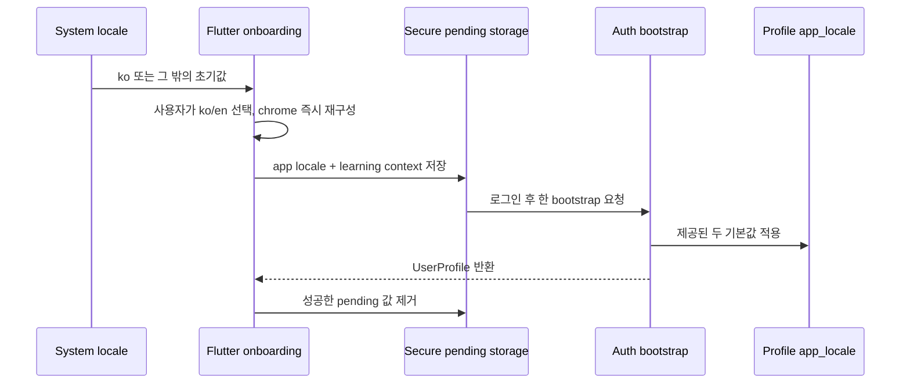
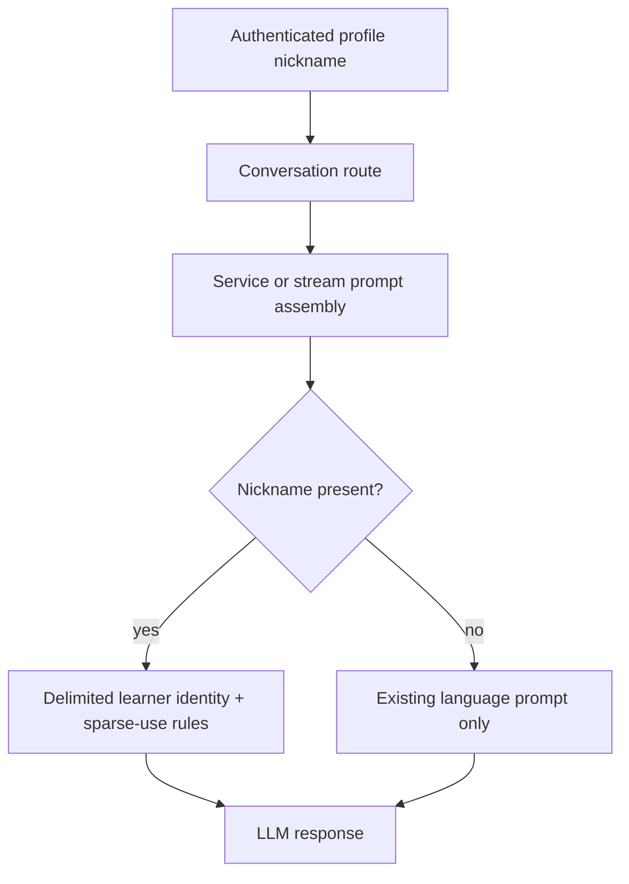

# Personalized Conversation and Onboarding Language - Plan

## Goal Capsule

- **Objective:** 학습자가 처음 선택한 앱 언어로 일관된 경험을 시작하고, AI가 설정한 닉네임을 부담스럽지 않게 활용하며, 내 정보에서 학습 방향을 문장형 버튼으로 명확히 이해하게 한다.
- **Means:** 온보딩 선택값을 인증 bootstrap에 합치고, 프로필의 앱 언어 변경 UI를 제거하며, 대화 프롬프트에 최신 닉네임과 절제 규칙을 전달한다. (KTD1, KTD3)
- **Authority:** Product Contract의 R-ID가 사용자 행동을, Planning Contract의 KTD-ID가 구현 방식을 결정해요.
- **Execution profile:** 하나의 PR로 백엔드 계약, Flutter 온보딩·프로필 UI, 대화 프롬프트, 문서와 테스트를 함께 동기화해요.
- **Stop conditions:** 온보딩 앱 언어가 프로필에 저장되고 이후 앱 chrome에 적용되며, 프로필에는 앱 언어 설정이 없고, 두 학습 언어 버튼의 부분 강조와 닉네임 프롬프트 정책이 자동 테스트로 고정되면 완료해요.

---

## Product Contract

### Summary

앱 표시 언어 선택을 내 정보에서 온보딩으로 옮기고 시스템 locale을 초기값으로 사용해요. 학습 언어 선택은 지원 중인 두 방향만 문장형 버튼으로 표시하고, AI는 현재 닉네임을 자연스러운 순간에만 간헐적으로 사용해요.

### Problem Frame

현재 앱 표시 언어는 첫 사용 경험이 끝난 뒤 내 정보에서 바꾸도록 되어 있어 로그인 전후 언어 선택의 책임이 분리돼 있어요. 학습 언어 버튼은 축약된 언어쌍이라 행동을 설명하지 못하고, 저장된 닉네임은 앱 chrome에서만 사용되어 실제 대화 경험에 연결되지 않아요.

### Key Decisions

- **앱 언어는 온보딩에서 한 번 선택해 프로필 기본값으로 저장해요.** (session-settled: user-directed — chosen over 시스템 locale을 계속 자동 추종하거나 내 정보에서 변경: 첫 사용자가 직접 기본 표시 언어를 확정하도록 요청함) Governs R3, R4, R5, R6.
- **이번 작업은 `ko→en`, `en→ko`만 유지해요.** (session-settled: user-directed — chosen over `en→en`을 함께 구현: 해당 학습 방향은 아직 지원 범위가 아니므로 명시적으로 제외함) Governs R7, R8.

### Requirements

**Conversation personalization**

- R1. 자유 대화와 롤플레이의 생성형 AI 응답은 인증 프로필의 현재 `nickname`만 사용자 식별 정보로 받아야 해요.
- R2. AI는 닉네임을 인사, 격려, 화제 전환처럼 자연스러운 순간에만 간헐적으로 사용하고 매 응답이나 어색한 문장에 반복하지 않아야 해요.

**Onboarding app language**

- R3. 온보딩은 한국어와 영어 중 앱 표시 언어를 고르는 별도 단계를 제공해야 해요.
- R4. 첫 진입 시 기기 system locale이 `ko`이면 한국어, 그 밖에는 영어를 초기 선택값으로 제안해야 해요.
- R5. 온보딩에서 앱 언어를 바꾸면 남은 온보딩과 로그인 화면의 chrome이 즉시 선택 언어로 표시되어야 해요.
- R6. 온보딩을 완료한 뒤 첫 인증 bootstrap은 선택한 앱 언어와 학습 언어를 함께 프로필에 저장하고, 성공한 값이 이후 앱 chrome의 기본값이 되어야 해요.

**Profile language controls**

- R7. 내 정보 화면은 앱 언어 제목, 선택 버튼, 설명, 저장 상태를 표시하지 않고 학습 언어 설정만 제공해야 해요.
- R8. 한국어 UI의 학습 언어 버튼은 `한국어로 영어 공부하기`, `영어로 한국어 공부하기`로 표시하며 두 언어 이름만 bold여야 해요.
- R9. 영어 UI는 R8의 의미와 부분 강조를 보존한 자연스러운 현지화 문구를 사용해야 해요.
- R10. 학습 언어 변경은 기존처럼 확인 후 새 대화부터 적용하고 기존 대화 snapshot을 바꾸지 않아야 해요.

### Scope Boundaries

**In scope**

- 기존 nullable `profiles.app_locale`과 `UserProfile.app_locale`을 온보딩 저장에 재사용해요.
- 구버전 클라이언트 호환을 위해 `PUT /api/auth/me/app-locale`는 유지해요.
- 닉네임은 응답 생성 prompt context에만 추가하고 메시지나 conversation row에 snapshot으로 저장하지 않아요.
- 이미 온보딩을 완료한 설치는 다시 온보딩시키지 않으며, 저장된 `app_locale`이 없으면 기존처럼 system locale을 사용해요.

### Deferred to Follow-Up Work

- `영어로 영어 공부하기`와 `en→en` 학습 컨텍스트
- 온보딩 완료 후 앱 언어를 다시 변경하는 UI
- 추천 주제의 사전 생성 첫 질문에 닉네임을 개인화하는 기능

---

## Planning Contract

### Key Technical Decisions

- KTD1. **Bootstrap이 pending 앱 언어와 학습 언어를 원자적으로 적용해요.** `BootstrapRequest`에 optional `app_locale`을 추가하고 기존 `get_or_create_profile` 경로가 제공된 값만 갱신해요. R3-R6을 구현하며 기존 profile 복원 시 값이 없으면 저장값을 유지해요.
- KTD2. **온보딩 locale은 인증 전 앱 상태와 secure storage pending 값으로 관리해요.** 선택 즉시 `MaterialApp.router.locale`에 반영하고, 앱 재시작 시 profile이 없으면 pending 값을 복원하며, bootstrap 성공 뒤 pending 값을 지워 서버 profile 값으로 수렴해요. R4-R6을 구현해요.
- KTD3. **닉네임은 최신 profile 값으로 매 생성 요청에 전달해요.** 대화 언어처럼 conversation snapshot으로 고정하지 않고 자유 대화 시작·후속 turn·재시도·롤플레이 시작의 prompt 조립 경로에 nullable nickname을 전달해요. R1-R2를 구현해요.
- KTD4. **닉네임을 prompt 명령과 분리된 최소 사용자 데이터로 인코딩해요.** 따옴표나 명령형 문구가 포함되어도 지시로 해석하지 않도록 데이터 경계를 표시하고, 자연스러운 경우에만 드물게 부르며 반복하지 않는 규칙을 자유 대화와 롤플레이 prompt에 공통 적용해요. 이메일과 OAuth 이름은 prompt나 새 로그에 추가하지 않아요. R1-R2를 구현해요.
- KTD5. **학습 언어 segmented control은 rich label을 받아요.** 전체 버튼을 bold 처리하지 않고 언어명 span만 강조하며 좁은 화면에서는 두 줄까지 허용해 R8-R9를 구현해요.

### High-Level Technical Design

### System-Wide Impact

- **API contract:** `/api/auth/bootstrap` request가 optional `app_locale`을 추가로 받지만 빈 객체와 language-only 요청은 계속 동작해요.
- **Authentication flow:** pending 설정은 Supabase 인증 성공 후 profile bootstrap이 성공해야 지워져 재시도 안전성을 유지해요.
- **Prompt context:** 후속 stream turn도 최신 nickname을 읽기 위해 profile dependency를 사용하므로 profile이 없는 인증 계정에는 기존 409 초기화 오류가 적용돼요.
- **External AI data:** 기존 대화 메시지와 함께 nickname이 LLM provider로 전달되지만 이메일, OAuth 이름, 다른 profile 필드는 전달하지 않아요.
- **Accessibility:** rich label은 시각적 span과 별개로 완전한 문장을 semantic label로 제공해야 해요.

### Risks and Dependencies

- 사용자 입력 닉네임을 system prompt에 직접 넣으면 prompt injection 경계가 흐려질 수 있어 KTD4의 데이터 인코딩과 공격형 문자열 테스트가 필요해요.
- 앱 locale 선택으로 `MaterialApp`이 재구성될 때 현재 온보딩 page와 선택한 학습 언어가 초기화되지 않아야 해요.
- bootstrap 실패 시 pending locale과 learning context를 모두 유지해야 다음 로그인 재시도에서 선택값이 사라지지 않아요.

---

## Implementation Units

### U1. Extend auth bootstrap with app locale

- **Goal:** 온보딩에서 선택한 앱 언어를 기존 프로필 locale 필드에 저장해요.
- **Requirements:** R4-R6
- **Dependencies:** 없음
- **Files:** `backend/domains/auth/schemas.py`, `backend/domains/auth/service.py`, `backend/domains/auth/repository.py`, `backend/tests/domains/auth/test_supabase_jwt_auth.py`, `backend/tests/domains/auth/test_profiles_repository.py`
- **Approach:** KTD1에 따라 bootstrap request와 profile upsert에 optional locale을 연결하고, 제공되지 않은 값은 기존 저장값을 덮어쓰지 않아요. 기존 PUT endpoint와 schema는 호환 표면으로 유지해요.
- **Execution note:** request/response 통합 테스트를 먼저 확장해 language와 app locale이 한 bootstrap에서 저장되는 증거를 만들어요.
- **Patterns to follow:** `BootstrapRequest.language`, `AuthRepository._apply_language`, existing app-locale validation enum.
- **Test scenarios:**
  1. 신규 profile bootstrap에 `language`와 `app_locale: ko`를 보내면 두 값이 함께 저장되고 응답에 `ko`가 포함돼요.
  2. 기존 profile에 `app_locale: en`을 보내면 locale만 갱신하고 닉네임과 기존 필드는 유지해요.
  3. restore bootstrap의 빈 객체는 기존 locale을 유지해요.
  4. 지원하지 않는 locale이나 extra field는 422를 반환해요.
- **Verification:** auth bootstrap·repository 테스트가 이전 요청 shape와 새 요청 shape를 모두 통과해요.

### U2. Move app language selection into onboarding

- **Goal:** system locale 기반 기본값과 즉시 미리보기를 가진 앱 언어 선택 단계를 온보딩에 추가해요.
- **Requirements:** R3-R6
- **Dependencies:** U1
- **Files:** `mobile/lib/app/app.dart`, `mobile/lib/core/copy/app_copy.dart`, `mobile/lib/features/onboarding/application/onboarding_controller.dart`, `mobile/lib/features/onboarding/data/onboarding_storage.dart`, `mobile/lib/features/onboarding/presentation/onboarding_screen.dart`, `mobile/lib/features/auth/application/auth_controller.dart`, `mobile/lib/features/auth/data/api_auth_repository.dart`, `mobile/lib/features/auth/domain/auth_repository.dart`, `mobile/test/app/app_test.dart`, `mobile/test/features/auth/application/auth_controller_test.dart`, `mobile/test/features/auth/data/api_auth_repository_test.dart`
- **Approach:** KTD2에 따라 앱 언어 page를 학습 언어 page 앞에 두고 `ko`/`en` 선택을 앱 locale provider와 pending storage에 연결해요. 로그인 bootstrap 성공 전에는 선택값을 보존하고, 성공 뒤에는 profile locale을 앱 source of truth로 사용해요.
- **Patterns to follow:** pending learning context 저장과 `_bootstrapProfile`의 성공 후 cleanup, `AppCopy`의 `ko`/fallback resolver.
- **Test scenarios:**
  1. Korean system locale의 첫 온보딩은 한국어를, English 및 기타 locale은 영어를 초기 선택해요.
  2. 영어 system locale에서 한국어를 선택하면 같은 page와 다음 page·로그인 copy가 한국어로 즉시 바뀌고 현재 page index와 학습 언어 선택은 유지돼요.
  3. skip과 마지막 완료 동작 모두 앱 locale과 학습 언어를 pending storage에 저장해요.
  4. 로그인 bootstrap은 두 pending 값을 한 body로 전송하고 성공 후 둘을 지워요.
  5. bootstrap 실패는 두 pending 값을 유지하고 인증 완료 상태를 게시하지 않아요.
  6. 온보딩 완료 후 로그인 전에 앱을 재시작하면 secure storage의 pending locale이 로그인 chrome에 다시 적용돼요.
  7. 이미 온보딩을 완료했고 profile locale이 null인 기존 사용자는 강제 온보딩 없이 system locale fallback을 유지해요.
- **Verification:** 전체 앱 flow 테스트에서 온보딩 선택부터 Home의 effective locale까지 이어지고 auth unit tests가 재시도 경계를 증명해요.

### U3. Simplify profile language controls

- **Goal:** 내 정보에서 앱 언어 설정을 제거하고 두 학습 방향을 부분 강조된 문장형 버튼으로 표시해요.
- **Requirements:** R7-R10
- **Dependencies:** U2
- **Files:** `mobile/lib/features/profile/presentation/profile_screen.dart`, `mobile/lib/core/copy/app_copy.dart`, `mobile/test/features/home/presentation/home_screen_test.dart`
- **Approach:** KTD5에 따라 app-locale save state와 handler를 삭제하고 language settings card에는 learning-language control만 남겨요. rich label은 화면 locale별 완전한 문장을 만들고 언어명 span만 bold 처리해요.
- **Patterns to follow:** 기존 `_ProfileSegmentedControl`의 44pt touch target, confirmation dialog, `AppTypography.caption`, 320px widget coverage.
- **Test scenarios:**
  1. 한국어 프로필은 두 문장형 버튼을 표시하고 각 언어명 span만 bold예요.
  2. 영어 프로필은 의미가 같은 현지화 문구와 동일한 강조 구조를 표시해요.
  3. 320px 폭에서 두 버튼은 잘리지 않고 같은 행 또는 허용된 줄바꿈으로 읽혀요.
  4. 앱 언어 제목·설명·Korean/English 선택 control과 저장 loading/error가 존재하지 않아요.
  5. 버튼 선택, 취소, 저장 성공·실패와 기존 conversation snapshot 안내는 기존 동작을 유지해요.
- **Verification:** profile widget tests가 문구, TextSpan weight, 접근성 label, 변경 흐름을 검증해요.

### U4. Add sparse nickname use to conversation prompts

- **Goal:** 모든 생성형 대화 경로가 최신 닉네임을 안전하게 받아 자연스러운 경우에만 활용하게 해요.
- **Requirements:** R1-R2
- **Dependencies:** 없음
- **Files:** `backend/domains/conversation/router.py`, `backend/domains/conversation/service.py`, `backend/domains/conversation/stream_flow.py`, `backend/tests/domains/conversation/test_topic_prep_handoff.py`, `backend/tests/domains/conversation/test_stream_turn_transaction.py`, `backend/tests/domains/conversation/test_stream_prepare_latency.py`
- **Approach:** KTD3-KTD4에 따라 prompt builder에 nullable nickname을 추가하고 ProfileModel을 이미 쓰는 시작·retry 경로와 후속 turn/message 경로에서 전달해요. weekly suggested first question은 사전 생성 콘텐츠이므로 변경하지 않고 이후 turn부터 적용해요.
- **Patterns to follow:** `get_current_profile`, `prepare_generation`의 explicit context 전달, language prompt unit tests.
- **Test scenarios:**
  1. 자유 대화와 롤플레이 prompt는 닉네임, 데이터-only 경계, 자연스러운 경우에만 드물게 사용하라는 규칙을 포함해요.
  2. nickname이 null이면 identity block을 생략하고 기존 prompt 의미를 유지해요.
  3. 따옴표와 명령형 문구가 포함된 nickname은 구분된 데이터로 표현되고 nickname 내부 지시를 따르지 말라는 규칙이 유지돼요.
  4. free-chat start, roleplay start, 기존 conversation turn, failed turn retry가 현재 profile nickname을 같은 prompt 경로에 전달해요.
  5. 닉네임 변경 뒤 기존 conversation의 다음 turn은 새 값을 사용해 snapshot이 아님을 증명해요.
  6. prompt와 새 진단 로그에는 email과 OAuth 원본 이름이 추가되지 않아요.
- **Verification:** prompt와 stream preparation 테스트가 각 경로의 nickname 전달을 검증하고 기존 language-context assertions가 계속 통과해요.

### U5. Synchronize contracts and project records

- **Goal:** 변경된 onboarding, profile, prompt 정책을 외부 계약과 내부 아키텍처에 같은 작업 단위로 반영해요.
- **Requirements:** R1-R10
- **Dependencies:** U1-U4
- **Files:** `docs/DSL.md`, `mobile/README.md`, `docs/design/DESIGN_SYSTEM.md`, `.agent/architecture.md`, `.agent/_contracts/AUTH_BOOTSTRAP.md`, `.agent/_contracts/NICKNAME.md`, `.agent/_coordination/CHANGELOG.md`, `.agent/_coordination/STATE.md`
- **Approach:** bootstrap request shape, 온보딩 locale source of truth, 프로필 UI, 닉네임 prompt 경계를 각각 owning 문서에 기록하고 기존 app-language profile 설명을 제거해요.
- **Test scenarios:** Test expectation: none — 문서·coordination 동기화만 수행하며 U1-U4의 자동 테스트가 동작을 검증해요.
- **Verification:** `app language`, `앱 언어`, nickname prompt 관련 문서 검색 결과가 새 정책과 모순되지 않고 STATE 항목이 CHANGELOG로 이동해요.

---

## Verification Contract

| Area | Command | Done signal |
|---|---|---|
| Backend auth | `uv run pytest tests/domains/auth/test_supabase_jwt_auth.py tests/domains/auth/test_profiles_repository.py` from `backend/` | bootstrap의 신규·복원 locale 계약이 통과해요. |
| Backend conversation | `uv run pytest tests/domains/conversation/test_topic_prep_handoff.py tests/domains/conversation/test_stream_turn_transaction.py tests/domains/conversation/test_stream_prepare_latency.py` from `backend/` | 모든 생성 prompt 경로의 nickname 전달과 기존 stream 계약이 통과해요. |
| Flutter targeted | `flutter test test/app/app_test.dart test/features/auth/application/auth_controller_test.dart test/features/auth/data/api_auth_repository_test.dart test/features/home/presentation/home_screen_test.dart` from `mobile/` | 온보딩 locale, bootstrap body, profile rich label 흐름이 통과해요. |
| Flutter language regression | `flutter test test/features/language` from `mobile/` | 기존 두 학습 언어 컨텍스트와 selector가 유지돼요. |
| Static analysis | `flutter analyze --no-pub` from `mobile/` | Dart 분석 오류가 없어요. |
| Backend regression | `uv run pytest tests/domains/auth tests/domains/conversation` from `backend/` | 관련 도메인의 회귀가 없어요. |
| Diff hygiene | `git diff --check` | 공백 오류와 충돌 표식이 없어요. |

---

## Definition of Done

- U1-U5의 요구사항과 테스트 시나리오가 구현되고 관련 검증 명령이 통과해요.
- 온보딩에서 선택한 앱 locale과 학습 언어가 한 bootstrap 요청으로 저장되며 실패 시 pending 값이 보존돼요.
- 내 정보에는 앱 언어 변경 UI가 없고 지원 중인 두 학습 방향만 부분 bold 문장으로 표시돼요.
- 자유 대화·롤플레이의 시작, 후속 turn, 재시도 prompt가 최신 nickname을 안전한 데이터로 받아 과사용 금지 규칙을 포함해요.
- API·모바일·계약·아키텍처 문서가 같은 정책을 설명하고 coordination 기록이 정리돼요.
- 실험 중 버린 코드, 사용하지 않는 app-locale UI copy·state·test fixture, dead helper가 최종 diff에 남지 않아요.
