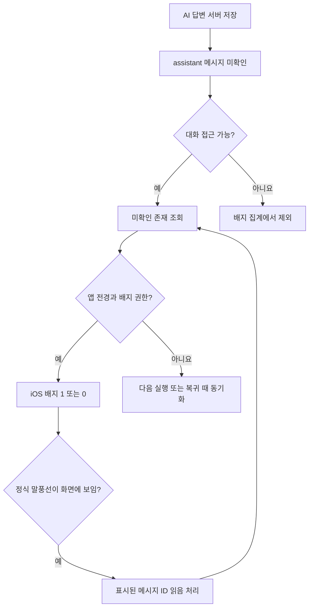

# iOS Unread AI Reply Badge - Plan

> 2026-11-25 개정: 회원의 슬롯 초과·대화권 소진과 게스트 잠금을 구분해 배지 집계·검증 기준을 갱신했어요.

## Goal Capsule

- **Objective:** iPhone 사용자는 열 수 있는 대화에 확인하지 않은 AI 답변이 있으면 앱 사용·복귀 시 아이콘에서 `1`을 확인하고, 마지막 미확인 답변을 보면 숫자가 사라져요.
- **Means:** 서버가 완료된 AI 메시지의 읽음 상태를 보관하고, 실행 중인 iOS 앱이 배지 값을 동기화해요(KTD1, KTD2, KTD3).
- **Authority:** 사용자와 합의한 범위 → `AGENTS.md`와 `.agent/rules.md` → 이 계획의 제품 요구사항 → 기술 결정과 구현 단위 순서예요.
- **Stop conditions:** 읽음의 소유권 검증, 회원 잔액 소진·게스트 잠금의 배지 집계, iOS 권한 흐름이 검증되지 않으면 출시 준비가 끝난 것으로 보지 않아요.

---

## Product Contract

### Summary

앱이 실행 중이거나 다시 열릴 때, 확인 가능한 대화에 읽지 않은 완료 AI 답변이 하나라도 있으면 앱 아이콘 배지를 `1`로 맞춰요. 마지막 미확인 답변을 보면 `0`으로 지워요.

### Problem Frame

현재 메시지에는 읽음 상태가 없고 홈 목록에도 미확인 정보가 없어요. 따라서 AI 답변이 저장된 후 사용자가 실제로 봤는지 구별할 수 없어요. 또한 앱의 대화 요청은 스트림 연결에 묶여 있어 앱을 중지한 뒤 답변 생성이 항상 완료되지는 않아요.

### Key Decisions

- **iOS 범위와 지원 버전:** iOS 16 이상에만 아이콘 배지를 제공해요. Android와 iOS 15.x의 배지 구현은 제외해요. (session-settled: user-directed — chosen over iOS·Android 및 iOS 15.x 지원: 현재 서비스는 iOS 앱만 운영하고 구버전 배지는 필요하지 않아요.) Governs R1.
- **배지만 사용하는 단계:** 기기 푸시·배너·소리는 이번 범위에서 제외해요. (session-settled: user-directed — chosen over push delivery: 현재 단계에서는 푸시를 고려하지 않기로 했어요.) Governs R2, R6.
- **온보딩 뒤 권한 요청:** 새 사용자는 게스트 초기화에 성공해 홈에 들어온 뒤 배지 권한을 요청해요. (session-settled: user-approved — chosen over onboarding 완료 버튼 직후 요청: 화면 전환과 초기화 실패를 피하고 기능 설명 뒤에 요청해요.) Governs R5.
- **개인정보 안내와 배지 선택의 같은 진입점:** 온보딩 완료 흐름에 개인정보처리방침·AI 데이터 처리 안내와 선택적 배지 설명을 함께 배치하되, 개인정보 처리에 대한 의사표시와 iOS 배지 시스템 권한은 독립된 단계로 다뤄요. 기존 설치는 홈 진입 시 같은 안내 흐름을 적용해요. (session-settled: user-requested — 현재 첫 AI 사용 시점에만 나타나는 동의 안내를 앞당기고 배지 권한과 같은 맥락에서 보이게 해요.) Governs R5, R7.

### Requirements

**배지와 읽음**

- R1. iOS 16 이상에서만 앱 아이콘 배지를 갱신해요.
- R2. 열 수 있는 대화의 미확인 완료 AI 답변이 하나 이상이면 배지는 항상 `1`, 없으면 `0`이에요. 회원은 대화창 슬롯 초과·대화권 소진과 무관하게 모든 소유 대화를 집계해요. 게스트 체험 소진도 열람 가능한 기록의 집계를 막지 않아요.
- R3. AI 답변은 서버 저장과 정식 메시지 ID 확정 후, 전체 답변이 공개된 말풍선을 앱 전경의 해당 대화 화면에서 실제로 보여줬을 때 읽음 처리해요.
- R4. 읽음 상태는 앱 재실행과 계정 전환 뒤에도 계정별로 보존하고, 기존 저장 답변은 출시 시 읽은 것으로 간주해요.

**권한과 생명주기**

- R5. 새 사용자는 온보딩 이후 배지 용도를 보고 선택할 수 있어요. 선택한 경우 게스트 홈이 준비된 뒤 Apple의 배지 전용 권한 창을 한 번 요청해요. 기존 사용자도 첫 적격 홈 진입 때 같은 선택지를 받고, 건너뛰거나 거부해도 앱을 계속 사용할 수 있어요.
- R6. 푸시 없이 앱 실행·복귀·답변 완료·확인·대화 삭제·계정 변경 시 배지를 서버 상태에 맞춰요. 앱 중지 중 즉시 갱신은 요구하지 않아요.
- R7. 새 사용자는 온보딩을 마친 직후 개인정보처리방침을 열 수 있고 AI 데이터 처리에 대한 선택을 별도로 확인해요. 기존 사용자에게 유효한 수락 기록이 있으면 다시 묻지 않고, 기록이 없거나 버전이 바뀌었으면 홈에서 안내해요. 배지 선택은 이 흐름에 함께 보이지만 독립적으로 건너뛸 수 있으며, 거부해도 AI 동의 여부와 앱 이용에 영향을 주지 않아요.

### Acceptance Examples

- AE1. 사용자가 AI 답변 완료 전에 다른 화면으로 이동했고 답변이 서버에 저장되면, 다음 앱 실행 또는 복귀에서 배지가 `1`이에요. Covers R2, R3, R6.
- AE2. 사용자가 마지막 미확인 AI 답변을 실제 화면에서 확인하면 배지가 `0`이에요. 다른 미확인 답변이 남아 있으면 `1`을 유지해요. 답변 말풍선 밖을 보고 있거나 앱이 배경에 있으면 읽음 처리하지 않아요. Covers R2, R3.
- AE3. 사용자가 권한을 거부하면 대화 기능은 계속 동작하고, 권한 창은 반복되지 않아요. Covers R5.
- AE4. 회원의 미확인 답변은 대화창 슬롯 초과나 대화권 소진 후에도 배지 `1`을 유지해요. 게스트 정책으로 잠긴 대화에만 미확인 답변이 있으면 `0`이며, 회원 전환으로 열 수 있게 되면 다시 집계해요. 게스트 체험 5회를 소진해도 열람 가능한 대화의 미확인은 계속 집계해요. Covers R2.
- AE5. 사용자가 답변 생성 중 과거 메시지로 스크롤하고 완료 답변이 화면 밖에 남으면, 앱을 벗어났을 때 아이콘은 `1`이에요. 돌아와 그 답변을 화면에 표시하면 `0`이에요. Covers R2, R3, R6.
- AE6. 새 사용자는 온보딩 완료 후 개인정보처리방침 링크와 AI 대화 데이터 처리 설명을 보고 AI 처리를 수락하거나 보류할 수 있어요. 배지를 건너뛰어도 AI 대화를 사용할 수 있고, AI 처리를 보류해도 배지 선택이 AI 처리 수락으로 기록되지 않아요. Covers R5, R7.
- AE7. 기존 계정에 현재 버전의 AI 처리 수락 기록이 있으면 중복 동의를 요구하지 않아요. 새 버전에 대한 수락이 필요하면 기존 AI API 차단 규칙을 유지하고 홈에서 별도 안내해요. Covers R7.

### Scope Boundaries

- 이번 작업은 iOS 앱 아이콘 배지와 그 읽음 상태만 다뤄요. 홈 카드의 별도 미확인 표시와 알림 센터 메시지는 포함하지 않아요.
- 답변 생성 작업을 앱 연결과 분리하는 변경은 포함하지 않아요. 연결 종료 전에 답변이 저장되지 않으면 새 미확인 답변도 생기지 않아요.

### Deferred to Follow-Up Work

- 앱이 종료된 동안의 즉시 배지 변경, 원격 푸시, 답변 생성의 연결 독립성은 별도 제품 범위로 검토해요.

---

## Planning Contract

### Key Technical Decisions

- KTD1. **메시지별 읽음 시각:** `messages`의 assistant 행에 nullable 읽음 시각을 두고, 기존 assistant 행은 마이그레이션에서 읽음으로 채워요. 새 답변은 기본 미확인 상태로 저장돼요. 메시지별 상태는 여러 대화와 기기에서 같은 의미를 유지해요. 미확인 존재 조회를 위한 인덱스도 추가해요. Governs R2–R4.
- KTD2. **명시적 메시지 ID로 읽음 처리:** `POST /api/conversations/{id}/read/`는 화면에 표시된 정식 assistant ID 묶음을 받아 소유권 검증 뒤 멱등하게 읽음 처리해요. `GET /api/conversations/unread/`는 접근 가능한 대화의 미확인 존재 여부만 반환해요. 읽음 응답에도 갱신된 전역 존재값을 포함해 중복 조회를 줄여요. 범위 전체를 읽음 처리하면 동시에 도착한 새 답변까지 지울 수 있어요. Governs R2, R3.
- KTD3. **iOS 배지 브릿지:** Flutter 상태 관리자와 iOS `UNUserNotificationCenter` 사이에 전용 브릿지를 두고, iOS 16 이상에서 권한 상태와 `setBadgeCount` 결과를 다뤄요. Apple은 배지 전용 권한 옵션과 iOS 16 이상 배지 설정 API를 제공해요([권한 API](https://developer.apple.com/documentation/usernotifications/unusernotificationcenter/requestauthorization%28options%3Acompletionhandler%3A%29), [배지 API](https://developer.apple.com/documentation/usernotifications/unusernotificationcenter/setbadgecount%28_%3Awithcompletionhandler%3A%29)). Governs R1, R5, R6.
- KTD4. **홈 안정화 뒤 선택적 권한 요청:** 온보딩 완료 저장만 보고 요청하지 않아요. 인증된 게스트 또는 회원 홈이 표시되고 개인정보·AI 처리 안내가 끝난 뒤, 사용자가 배지를 선택했고 권한 상태가 미결정일 때만 요청해요. 온보딩 마지막 화면과 Skip 경로에 배지 용도를 설명하고, 온보딩을 건너뛴 기존 설치에는 홈에서 같은 안내와 선택지를 보여줘요. Governs R5, R7.
- KTD5. **계정 유형별 열람 가능 범위:** 회원·관리자는 저장된 전체 소유 대화를 집계하며 `slot_active`·대화권 잔액·`can_send`로 제외하지 않아요. 게스트는 현재 접근 경로로 활성 슬롯 상태를 먼저 반영하고 `slot_active`인 대화만 집계해요. 게스트 제한은 회원 rollout 스위치와 무관하게 항상 적용해요. 잠긴 게스트 대화의 미확인 기록은 보존하고 회원 전환 후 다시 포함해요. Governs R2.
- KTD6. **화면 노출과 계정 세대:** 답변 전체가 화면 상태에 공개된 뒤, 정식 말풍선 높이의 절반 또는 80 논리 픽셀 중 작은 높이가 200ms 연속 화면에 보이고 앱·경로가 전경일 때 읽음 처리해요. 계정 변경 시 이전 요청 결과를 버리고 아이콘을 `0`으로 지운 뒤 새 계정 값으로 갱신해요. Governs R3, R6.
- KTD7. **개인정보 안내와 선택 분리:** `개인정보처리방침`은 온보딩과 프로필에서 쉽게 열 수 있는 고지 링크로 제공해요. 처리방침 전체를 일괄적으로 법정 필수 동의라고 표시하지 않아요. 외부 AI 처리에 대한 명시적 선택과 버전 기록은 유지하되, 현재 `POST /api/auth/me/ai-consent`가 `privacy_policy`와 `ai_data_processing`을 한 번에 수락하는 구조를 감사하고, 방침 확인 기록과 AI 처리 동의 기록의 의미를 분리해 UI 의사표시와 서버 기록이 일치하도록 계약을 조정해요. 온보딩 종료 시 방침과 AI 처리 내용을 보여주고, 게스트 초기화 성공 뒤 선택 결과를 서버에 저장해요. 초기화·저장 실패 시 수락 완료로 표시하거나 AI API를 열지 않아요. 배지 시스템 창은 홈이 안정화된 다음 별도 버튼/선택으로 요청해요. Governs R5, R7.

### High-Level Technical Design

안내 흐름은 온보딩 마지막 단계(또는 Skip) → 개인정보처리방침 링크와 AI 처리 선택, 배지의 선택적 용도 설명 → 게스트 초기화와 선택 결과 기록 → 홈 표시 → 배지를 선택한 경우에만 미결정 권한 상태 확인 및 시스템 창 요청 순서예요. 기존 설치는 홈에서 저장된 수락 상태를 확인해 필요한 안내만 보여줘요. 대화 화면은 스트리밍 임시 말풍선, 서버 저장 완료, 정식 ID 수신, 답변 전체 공개, 실제 화면 교차 확인, 읽음 API 호출의 상태를 구별해요.

### Risks and Assumptions

- 현재 역방향 `ListView`는 화면 밖 메시지 위젯도 만들 수 있어요. 위젯 생성이나 텍스트 프레임 콜백만으로 읽음을 판정하지 않고 뷰포트와 전경 상태를 확인해요.
- 구매·환불·대화권 소진 이후에도 회원의 기존 대화 열람과 배지 집계는 유지돼야 해요. 게스트에서 회원으로 전환할 때는 이전 슬롯 잠금값이 남아 있어도 새 회원 정책으로 집계하는지 확인해요.
- 읽음 API가 실패하면 미확인 상태를 유지하고 다음 화면 표시·앱 복귀에서 재시도해요. 배지 값을 성공 전 낙관적으로 지우지 않아요.
- 운영 DB의 기존 메시지 수를 배포 전에 확인해 읽음 시각 백필의 실행 시간을 판단해요.
- 서버의 스트림 연결이 답변 저장 전에 끊기면 해당 turn은 완료 답변이 아니며 배지 대상이 아니에요.
- 배지 집계는 열람 가능 여부를 기준으로 해요. 작성기 비활성화나 대화권 소진을 열람 불가로 취급하지 않으며, 잠금에 따른 제외는 게스트 정책에만 적용해요.
- 개인정보보호법은 처리방침 공개를 요구하며 모든 개인정보 처리에 일괄 동의를 요구하지는 않아요. 실제 수집 항목과 처리 근거, 외부 AI 전달의 제3자 제공·위탁 여부 및 국외 이전 경로를 출시 전 법무/개인정보 담당자가 검토해 고지와 별도 동의가 필요한 부분을 확정해요. 이는 배지 선택과 결합하지 않아요([개인정보 보호법 제15조](https://www.law.go.kr/LSW/lsLinkCommonInfo.do?chrClsCd=010202&lsJoLnkSeq=1029334879), [제22조](https://www.law.go.kr/lsLinkCommonInfo.do?chrClsCd=010202&lsJoLnkSeq=1034512973), [제28조의8](https://www.law.go.kr/LSW/lsLinkCommonInfo.do?chrClsCd=010202&lsJoLnkSeq=1029334953), [제30조](https://www.law.go.kr/lsLinkCommonInfo.do?lsJoLnkSeq=1006185717), [개인정보위 안내](https://pipc.go.kr/np/cop/bbs/selectBoardArticle.do?bbsId=BS074&mCode=C020010000&nttId=10566), [Apple 심사 지침 5.1](https://developer.apple.com/app-store/review/guidelines/)).

---

## Implementation Units

### U0. 개인정보 안내와 배지 선택 흐름 정리

- **Goal:** 새 사용자와 기존 사용자가 처리방침·AI 데이터 처리 내용을 확인하고 배지를 독립적으로 선택하게 해요.
- **Requirements:** R5, R7; AE3, AE6, AE7.
- **Dependencies:** 없음. U4 전에 완료해요.
- **Files:** `mobile/lib/features/onboarding/presentation/onboarding_screen.dart`, `mobile/lib/features/onboarding/application/onboarding_controller.dart`, `mobile/lib/features/auth/presentation/ai_consent_dialog.dart`, `mobile/lib/features/auth/application/ai_consent_controller.dart`, `mobile/lib/features/auth/data/api_auth_repository.dart`, `mobile/lib/features/profile/presentation/profile_screen.dart`, `mobile/lib/core/copy/app_copy.dart`, `backend/domains/auth/consent.py`, `backend/domains/auth/router.py`, `backend/domains/auth/schemas.py`, 관련 모바일·백엔드 테스트, `docs/DSL.md`, `docs/mobile-flow-spec.md`, `website/build.mjs`(고지 문구 변경이 필요한 경우).
- **Approach:** 현재 첫 AI 행동에서 실행되는 `ensureAIConsent`와 두 버전을 함께 수락하는 API를 기준으로 처리 항목·처리 근거·외부 AI 전달 고지를 검토해요. 새 사용자의 온보딩 종료 단계에 처리방침 링크, AI 처리 선택, 배지 선택을 같은 화면 흐름으로 제시하되 각각 별도 조작으로 구분해요. 게스트 계정이 필요한 서버 기록은 초기화 직후 저장하고, 저장 완료 전에는 AI 기능을 열지 않아요. 기존 사용자는 홈에서 서버의 현재 버전 수락 여부를 확인해 필요한 선택지만 표시해요. AI 처리 보류 시 기존 `CONSENT_REQUIRED` 경계를 유지하고 배지 선택 여부와 결합하지 않아요. 배지 선택을 건너뛰면 자동 시스템 요청을 하지 않고, 사용자가 나중에 설정에서 직접 요청할 수 있게 해요. API 계약의 수락 단위와 기록 의미를 실제 화면의 각 의사표시에 맞게 바꾸고 문서·테스트를 함께 갱신해요.
- **Test scenarios:**
  - 신규·Skip 경로에 처리방침 링크와 AI 처리 설명이 보이고 각 선택이 별도로 기록돼요.
  - 배지를 건너뛰어도 AI 처리를 수락할 수 있고 AI 처리를 보류해도 배지 선택이 AI 처리 수락으로 기록되지 않아요.
  - 수락 기록 저장 실패 또는 게스트 초기화 실패 시 AI API가 열리지 않고 재시도할 수 있어요.
  - 기존 동의 기록이 유효하면 다시 묻지 않고, 버전 변경 시 필요한 안내만 다시 보여줘요.
  - 처리방침 링크와 외부 AI 처리 문구가 앱·웹·API 계약에서 일치해요.
- **Verification:** 개인정보 담당자의 처리 근거 검토와 UI·서버 수락 기록 대조 후, 온보딩·기존 계정·실패 경로를 테스트해요.

### U1. 서버 읽음 상태와 기존 데이터 이관

- **Goal:** 계정별 AI 답변 읽음 상태를 영속화하고 기존 기록이 새 배지를 만들지 않게 해요.
- **Requirements:** R2, R3, R4.
- **Dependencies:** 없음.
- **Files:** `backend/domains/conversation/models.py`, `backend/alembic/versions/<new-unread-revision>.py`, `backend/domains/conversation/repository.py`, `backend/tests/domains/conversation/test_conversation_repository.py`, `backend/tests/domains/conversation/test_stream_turn_transaction.py`.
- **Approach:** KTD1을 적용해 새 assistant 메시지와 기존 행의 기본 상태를 구분해요. JSON 응답과 스트림 완료의 실제 저장 경로가 같은 읽음 기본값을 갖도록 확인해요.
- **Patterns to follow:** `backend/domains/conversation/stream_flow.py`의 완료 트랜잭션, 기존 Alembic revision 연쇄.
- **Test scenarios:**
  - 새 완료 assistant 메시지는 미확인이고 사용자 메시지는 집계되지 않아요.
  - 마이그레이션 이전 assistant 메시지는 읽음으로 채워져 최초 배지가 생기지 않아요.
  - 스트림이 저장 전에 실패하면 미확인 assistant 메시지가 생기지 않아요.
- **Verification:** 새·기존 데이터의 읽음 상태가 저장 경로와 마이그레이션 양쪽에서 일치해요.

### U2. 소유권이 검증된 읽음·미확인 API

- **Goal:** 앱이 표시한 메시지만 읽음 처리하고 배지의 서버 기준값을 조회해요.
- **Requirements:** R2, R3, R4; AE1, AE2, AE4.
- **Dependencies:** U1.
- **Files:** `backend/domains/conversation/schemas.py`, `backend/domains/conversation/repository.py`, `backend/domains/conversation/service.py`, `backend/domains/conversation/router.py`, `backend/tests/domains/conversation/test_unread_badge.py`, `docs/DSL.md`, `.agent/_contracts/IOS_UNREAD_BADGE.md`.
- **Approach:** KTD2와 KTD5에 따라 읽음 대상 ID를 소유 대화의 assistant 메시지로 제한해요. 집계 조회는 회원의 모든 소유 대화를 포함하고, 게스트에게만 현재 슬롯 상태에 따른 잠금 제외를 적용해요. 고정 `/unread/` 경로는 동적 대화 ID 경로보다 먼저 등록해요. API 계약은 `docs/DSL.md`와 새 계약 문서에 같은 작업 단위로 기록하고 DRAFT → REVIEW → ACTIVE 절차를 거쳐요.
- **Patterns to follow:** 기존 `GET /api/conversations/`의 소유권 경계와 응답 래퍼.
- **Test scenarios:**
  - 사용자가 자신의 완료 assistant ID를 제출하면 읽음 상태가 바뀌고 반복 요청도 같은 결과예요.
  - 다른 계정 메시지 ID 또는 사용자 메시지 ID는 읽음 처리되지 않아요.
  - 요청한 ID 이후 새로 저장된 답변은 미확인으로 남아요.
  - 회원은 슬롯 초과·대화권 0회·`can_send=false`여도 소유 대화에 미확인 답변이 있으면 존재 조회가 참이에요.
  - 게스트는 잠긴 대화에만 미확인이 있으면 거짓이며, 활성 대화는 누적 체험 5회 소진 후에도 집계돼요. 회원 제한 스위치가 꺼져도 게스트 잠금 제외는 유지돼요.
  - 게스트에서 회원으로 전환하면 보존된 모든 소유 대화의 미확인이 다시 집계돼요. 구매·환불·대화권 소진 뒤 앱 복귀에서도 회원 배지가 잘못 지워지지 않아요.
- **Verification:** API 응답, 실제 DB 상태, 문서 계약이 일치하고 계정 간 읽음 변경이 불가능해요.

### U3. 화면 표시 기준 읽음 처리

- **Goal:** 사용자가 실제로 본 정식 AI 답변만 서버에 읽음으로 알려요.
- **Requirements:** R3, R6; AE1, AE2.
- **Dependencies:** U2.
- **Files:** `mobile/lib/features/conversation/data/api_conversation_repository.dart`, `mobile/lib/features/conversation/domain/conversation_repository.dart`, `mobile/lib/features/conversation/application/conversation_controller.dart`, `mobile/lib/features/conversation/presentation/conversation_screen.dart`, `mobile/test/features/conversation/data/api_conversation_repository_test.dart`, `mobile/test/features/conversation/application/conversation_controller_test.dart`, `mobile/test/features/conversation/presentation/conversation_screen_test.dart`.
- **Approach:** KTD2와 KTD6을 따라 정식 assistant ID와 답변 전체가 공개되고 화면이 전경에 있으며 말풍선이 정해진 크기·시간 동안 보일 때 ID를 모아 전송해요. 역방향 목록의 화면 밖 위젯과 임시 스트림 텍스트는 읽음 대상에서 제외해요.
- **Patterns to follow:** `conversation_screen.dart`의 스크롤 컨트롤러와 `conversation_controller.dart`의 `turn_completed` 처리.
- **Test scenarios:**
  - 답변이 완료돼 현재 화면에 보이면 해당 ID가 한 번 읽음 처리돼요.
  - 답변이 화면 밖에 있거나 다른 경로가 위에 있거나 앱이 배경이면 읽음 처리되지 않아요.
  - 스크롤해 기존 미확인 답변이 화면에 들어오면 그 ID만 읽음 처리돼요.
  - 말풍선 가장자리만 걸친 경우에는 읽음 처리되지 않고, 화면보다 긴 답변에서 80 논리 픽셀이 연속으로 보이면 읽음 처리돼요.
  - 서버 저장 전에 표시된 임시 텍스트는 읽음 처리되지 않아요.
  - 서버 저장 후에도 음성 재생 때문에 일부 문장만 공개된 답변은 읽음 처리되지 않아요.
  - 읽음 요청 실패 후 화면 재진입에서는 다시 요청해요.
- **Verification:** 실제 스크롤·경로·앱 생명주기 조건에서 서버 읽음 상태와 보이는 말풍선이 일치해요.

### U4. iOS 권한 요청과 배지 동기화

- **Goal:** 적격 시점에 배지 권한을 요청하고 앱 아이콘 값을 서버 상태에 맞춰요.
- **Requirements:** R1, R2, R5, R6; AE1–AE4.
- **Dependencies:** U0, U2, U3.
- **Files:** `mobile/ios/Runner/AppDelegate.swift`, `mobile/lib/app/navigation/main_shell.dart`, `mobile/lib/features/onboarding/presentation/onboarding_screen.dart`, `mobile/lib/core/copy/app_copy.dart`, `mobile/lib/features/home/presentation/home_screen.dart`, `mobile/lib/features/profile/presentation/profile_screen.dart`, `mobile/lib/core/notifications/ios_badge_bridge.dart`, `mobile/test/app/navigation/main_shell_test.dart`, `mobile/test/features/home/presentation/home_screen_test.dart`, `mobile/test/core/notifications/ios_badge_bridge_test.dart`, `docs/mobile-flow-spec.md`, `.agent/architecture.md`.
- **Approach:** KTD3, KTD4, KTD6을 적용해 홈 표시 뒤 사용자가 배지를 선택했을 때 시스템 권한을 한 번 요청하고, 허용 상태에서 서버 미확인 존재값으로 `1` 또는 `0`을 설정해요. 앱 시작·복귀·정식 답변 완료·읽음 성공·대화 삭제·로그아웃·계정 전환 시 값을 다시 맞춰요. 계정 전환 시 배지를 즉시 지우고 계정 ID·요청 세대를 비교해 이전 계정의 늦은 응답을 버려요. 플랫폼·버전 확인과 권한 거부 시 앱 이용 지속을 포함해요.
- **Patterns to follow:** `AppDelegate.swift`와 기존 스낵 위젯 MethodChannel, `MainShell`의 필수 닉네임 팝업 조정.
- **Test scenarios:**
  - iOS 16 이상 신규 사용자가 배지를 선택하면 게스트 홈 준비 뒤 배지 권한만 한 번 요청받아요. 온보딩 Skip도 같아요.
  - 기존 설치에서 온보딩을 다시 보지 않아도 첫 적격 홈 진입 때 배지 선택지를 보고, 선택했을 때만 미결정 권한을 요청해요.
  - 온보딩 Skip과 기존 설치 경로에도 권한 창 전에 한 줄 설명이 노출돼요.
  - 게스트 초기화 실패 또는 닉네임 필수 팝업 중에는 시스템 권한 창이 뜨지 않아요.
  - 허용된 상태에서 미확인 존재값 참·거짓에 따라 각각 `1`·`0`을 설정해요.
  - 화면 밖에서 정식 답변이 완료되면 앱이 실행 중인 동안 배지가 `1`로 갱신돼요.
  - 거부·설정 해제·iOS 15.x에서는 앱 기능을 유지하고 배지 설정을 시도하지 않아요.
  - 온보딩에서 배지를 건너뛴 경우 자동 권한 창은 뜨지 않으며 프로필의 배지 설정에서 나중에 요청할 수 있어요.
  - 계정 전환 또는 로그아웃 뒤 이전 계정의 `1`이 남지 않아요.
  - A 계정의 미확인 조회 중 B로 전환하고 A의 응답이 늦게 도착해도 B의 배지에 A의 값이 반영되지 않아요.
- **Verification:** Flutter 브릿지 테스트와 iOS 16 이상 실기기에서 허용·거부·재실행·복귀·읽음·계정 전환 경로를 확인해요.

---

## Verification Contract

| 범위 | 실행 기준 | 확인할 결과 |
|---|---|---|
| 백엔드 | `backend/`에서 관련 conversation pytest 실행 | 읽음 이관·소유권·회원 잔액 소진/게스트 잠금 집계·동시 답변 보존 |
| Flutter | `mobile/`에서 해당 feature/widget 테스트와 `flutter analyze` 실행 | 화면 교차 판정·권한 시점·계정별 배지 동기화 |
| iOS 실기기 | iOS 16 이상 개발 빌드로 허용/거부 및 앱 복귀 확인 | 과거 메시지 스크롤 중 새 답변 완료 → 아이콘 `1` → 답변 화면 노출 → `0`을 포함해 확인 |
| 계약 | `docs/DSL.md`, `.agent/_contracts/IOS_UNREAD_BADGE.md`, `docs/mobile-flow-spec.md`, `.agent/architecture.md` 대조 | API·권한·읽음·범위 설명이 구현과 일치 |

---

## Definition of Done

- U0–U4의 테스트 시나리오가 통과하고 iOS 실기기 확인이 끝나요.
- 최초 설치와 기존 설치 모두 개인정보 안내와 선택적 배지 요청 순서가 맞고, 배지를 건너뛰거나 거부해도 대화가 정상 동작해요.
- 읽음 실패, 대화권 소진, 게스트 잠금, 삭제, 계정 전환 후 앱 아이콘이 실제 열람 가능한 미확인 답변의 존재와 일치해요.
- API 계약과 관련 기준 문서를 같은 작업 단위로 갱신하고, 구현 중 포기한 임시 코드와 문서를 제거해요. 구현이 끝나면 이 계획의 확정 사항을 기준 문서와 테스트에 흡수한 뒤 계획 파일도 정리해요.
