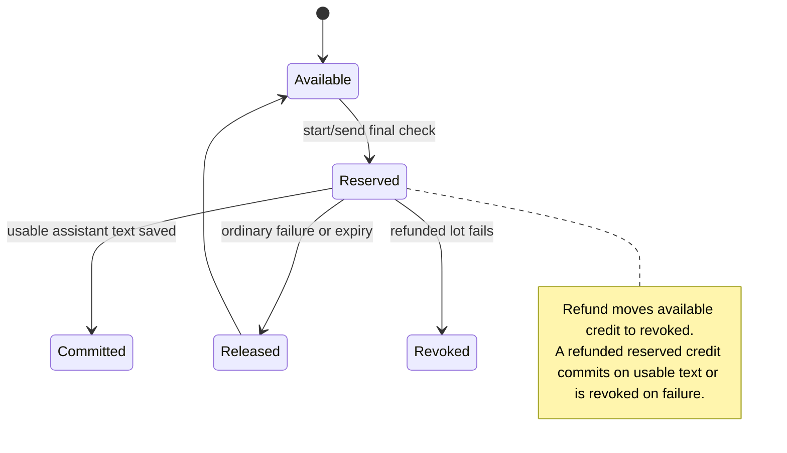
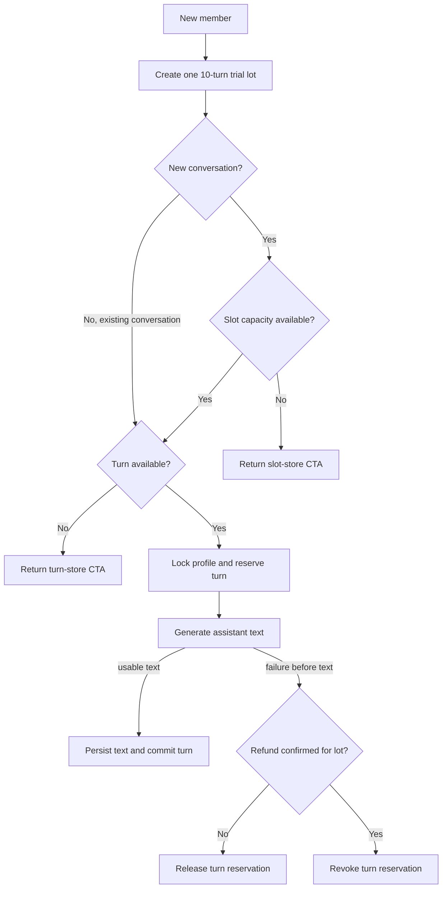

# Replace subscriptions with consumable conversation purchases - Plan

## Goal Capsule

- **Objective:** 회원이 정기 구독 없이 필요한 만큼 보관 가능한 대화 수와 AI 답변 횟수를 반복 구매하고, 무료 체험과 게스트 체험의 경계를 이해할 수 있어요.
- **Means:** 구독 entitlement를 반복 구매 가능한 소비성 한도 증가 거래와 서버 소유의 턴 lot 원장으로 교체해요. (KTD1, KTD2)
- **Authority:** 이 문서의 Product Contract와 사용자 대화에서 확정한 정책이 기존 구독 계약보다 우선해요. Apple의 현재 StoreKit 소비성 상품·거래·환불 규칙은 결제 구현의 외부 제약이에요.
- **Execution profile:** 결제·개인정보 삭제·DB migration·공개 API를 하나의 PR에서 함께 바꾸는 고위험 전환이에요. 백엔드 원자성 테스트를 먼저 갖추고 iOS Sandbox를 검증한 뒤 rollout해요.
- **Stop conditions:** 추가 대화 수 또는 턴이 중복 지급·누락·재전송될 가능성이 남거나, 삭제/환불/동시 요청의 원장 불변성이 증명되지 않으면 운영 활성화를 중단해요.

---

## Product Contract

### Summary

회원용 구독제를 폐기하고, 보관 가능한 대화 수를 영구적으로 늘리는 소비성 상품과 AI 답변 횟수를 충전하는 소비성 상품을 분리해 판매해요.
대화 삭제는 즉시 슬롯을 비우지만 어떤 무료·유료 턴도 돌려주지 않아요.

### Problem Frame

현재 Free/Advance/Plus 권한은 자동 갱신 구독, 만료 시 자동 잠금, 대화별 무료 15턴에 결합되어 있어요.
단품 구매로 바꾸려면 지속 비용이 발생하는 AI 응답을 계정 전역 턴 원장으로 제한하고, 같은 소비성 Apple 구매가 추가 대화 수 또는 턴 중 하나만 정확히 한 번 지급하도록 구분해야 해요.

### Key Decisions

- KD1. **게스트 체험은 유지해요.** (session-settled: user-directed — chosen over all trial policies: 기존 익명 사용자 전환 흐름을 보존하기 위해) 게스트는 활성 대화 1개와 계정 누적 5회 정책을 계속 적용해요. Governs R1.
- KD2. **회원 Free 체험은 계정 전역 10턴이에요.** (session-settled: user-directed — chosen over per-conversation free turns: 삭제·재생성으로 무료 사용량이 초기화되지 않게 하기 위해) 회원은 기본 슬롯 1개와 한 번만 발급되는 무료 체험 10턴을 받아요. Governs R2, R5.
- KD3. **추가 대화 수와 AI 답변 횟수는 모두 반복 구매 가능한 소비성 상품으로 판매해요.** (session-settled: user-approved — chosen over non-consumable slot expansions: 같은 상품을 반복 구매하고 두 상품군에 하나의 지급 흐름을 사용하기 위해) 추가 대화 수는 `+1`·`+3`, 턴 팩은 5·10·20회예요. Governs R3, R4, R6.
- KD4. **삭제는 유일한 일반 슬롯 해제 수단이에요.** (session-settled: user-directed — chosen over archive/reopen: 별도 보관 상태와 UX를 만들지 않기 위해) 보관/재활성화 기능과 자동 대화 잠금은 제공하지 않아요. Governs R3, R7.
- KD5. **계정 삭제는 대화·추가 대화 수·턴을 모두 소멸시켜요.** (session-settled: user-approved — chosen over non-consumable restore: 서버 계정 원장을 단일 기준으로 삼고 소비성 상품의 복원 경로를 만들지 않기 위해) 같은 tomatalk 계정의 재설치·기기 변경은 서버 잔액을 다시 읽지만, 삭제 후 재가입에는 어떤 과거 구매도 복원하지 않아요. Governs R8, R9.
- KD6. **운영자는 추가 슬롯과 턴 크레딧을 각각 수동 지급·회수할 수 있어요.** (session-settled: user-directed — chosen over removing manual grants: 고객 지원을 유지하기 위해) Governs R10.

### Requirements

- R1. 게스트의 활성 대화 1개·계정 누적 5회·로그인 유도 정책과 기존 예약/확정/반환 의미를 바꾸지 않아요.
- R2. 새 회원, 익명 계정을 정식 회원으로 연결한 회원, 게스트 데이터를 새 회원으로 이전한 회원은 각각 회원 체험 턴 10회를 정확히 한 번만 받아요. 게스트 사용량은 회원 체험 잔액에서 차감하지 않아요.
- R3. 일반 회원의 슬롯 한도는 기본 1개에 환불되지 않은 Apple 소비성 추가분과 관리자 수동 추가분을 더해 계산해요. 새 대화만 보존된 대화 수와 진행 중 시작 예약을 한도와 비교해 허용하고, 기존 대화 발화는 슬롯 검사를 하지 않아요. 삭제 완료 후 즉시 빈자리를 반영해요.
- R4. 서버는 아래 Apple Product Catalog의 제품 ID·`CONSUMABLE` 유형·지급량을 단일 기준으로 사용해요. 같은 슬롯 상품의 반복 구매는 서로 다른 Apple transaction ID마다 추가분을 누적하고, 목록 밖 상품이나 유형이 다른 거래는 지급하지 않아요.
- R5. 대화권 1회는 사용자의 메시지 1개와 그에 대한 AI 텍스트 답변 1개예요. 회원의 사용자 발화는 계정 전역 체험/유료 턴에서 한 턴을 예약하고, usable AI 텍스트가 저장된 경우에만 확정해요. 일반적인 LLM·저장·연결 실패와 만료 전 실패는 반환하고, 텍스트 생성 성공 뒤 TTS만 실패한 경우는 확정 상태를 유지해요. 단, R11에 따라 Apple 환불이 확정된 lot의 예약은 실패해도 반환하지 않고 `revoked`로 끝내요.
- R6. 일반 Apple 구매는 서버가 JWS 서명·앱·환경·상품·거래 ID와 현재 profile의 계정 토큰을 확인한 뒤 원자적으로 한 번만 지급해요. 동일 거래, 구매 스트림 재전송, 순서가 바뀐 알림은 추가 대화 수나 턴 잔액을 중복 변경하지 않아요.
- R7. 슬롯 초과·턴 부족은 서버에서 최종 판정하고 목적별 구매 CTA를 반환해요. 기존 잠긴 대화·자동 재활성화·구독 만료 흐름은 일반 회원 경험에서 제거해요.
- R8. 계정 삭제는 프로필, 대화, 추가 대화 수, 유료·체험 턴 원장과 수동 지급을 지워요. 재가입은 새 10턴 체험만 받으며, 삭제된 Apple 거래의 재지급과 삭제 후 도착한 거래의 지급을 막는 거래 ID HMAC·삭제 account token HMAC·terminal 상태·key version·감사 시각만 가명화된 tombstone으로 별도 보존해요. 원문 profile UUID·account token·transaction ID는 삭제 완료 후 남기지 않아요.
- R9. 완료된 소비성 구매는 Apple 복원 UI나 복원 API로 다시 지급하지 않아요. 재설치·기기 변경은 같은 tomatalk 계정의 서버 원장을 조회하고, 계정 삭제 후 도착한 미완료 거래는 지급 없이 terminal 처리하며, 재가입·다른 tomatalk 계정·다른 Apple 계정에는 과거 추가 대화 수와 턴을 이전하지 않아요.
- R10. 관리자 웹은 일반 회원에게 추가 슬롯과 턴 크레딧 lot을 지급·미사용분 회수하며, 각각의 변경 이력과 최종 잔액을 보여줘요. 관리자는 계속 무제한이에요.
- R11. 서비스 자체 지원 환불은 턴 팩에서 해당 lot의 확정 사용이 0회이고, 슬롯 상품에서 지급 이후 usable AI 텍스트가 저장된 대화가 0회일 때만 검토해요. 슬롯 지급 뒤 첫 usable AI 텍스트가 저장되면 그 시점 이전에 지급되어 아직 사용 표시가 없는 모든 슬롯 transaction에 `first_used_at`을 기록하고, 이후에는 자체 지원 환불을 제공하지 않아요. 이 기준은 Apple 환불 요청을 막지 않으며, Apple이 환불을 확정하면 사용 여부와 관계없이 동일 거래를 정확히 찾아 해당 추가 슬롯을 제외하거나 해당 턴 lot의 미사용분만 무효화해요. 환불 알림이 지급보다 먼저 와도 그 거래를 `refund-before-delivery` 상태로 기록해 이후 지급하지 않아요. 환불 당시 예약된 턴은 새 예약을 막고, 이미 생성 중인 응답은 완료 시 사용 확정·실패 시 무효화해 반환하지 않아요. 한도보다 많은 기존 대화는 잠그거나 삭제하지 않고 새 대화 생성만 막아요.

#### Apple Product Catalog

| Product ID | Apple 유형 | 서버 지급 |
|---|---|---:|
| `com.morethanhuman.curitalk.slots.plus.1` | `CONSUMABLE` | 추가 대화 수 +1 |
| `com.morethanhuman.curitalk.slots.plus.3` | `CONSUMABLE` | 추가 대화 수 +3 |
| `com.morethanhuman.curitalk.turns.5` | `CONSUMABLE` | AI 답변 5회 |
| `com.morethanhuman.curitalk.turns.10` | `CONSUMABLE` | AI 답변 10회 |
| `com.morethanhuman.curitalk.turns.20` | `CONSUMABLE` | AI 답변 20회 |

2026-11-25 사용자 확인 기준으로 위 다섯 Product ID는 App Store Connect에 모두 소비성 상품으로 생성 완료됐어요.

### Actors

- A1. 게스트와 회원 학습자
- A2. iOS StoreKit 및 App Store Server Notifications V2
- A3. FastAPI 결제·대화 서버
- A4. 고객 지원을 수행하는 관리자

### Key Flows

- F1. **회원 체험 및 턴 차감:** 새 대화 시작은 서버가 계정 잠금 아래 슬롯 용량을 확인하고, 기존 대화의 사용자 발화는 턴만 예약해 usable 텍스트 저장 시 확정해요.
- F2. **Apple 구매:** iOS 앱이 소비성 StoreKit 구매를 시작하고, 서버가 지급 또는 terminal 미지급 결과를 보존한 뒤에만 거래를 완료해요.
- F3. **재설치·기기 변경:** 사용자가 같은 tomatalk 계정으로 로그인하면 Apple 복원 없이 서버 entitlement를 조회해 추가 대화 수와 남은 턴을 다시 표시해요.
- F4. **삭제·환불:** 대화 삭제는 슬롯만 비우고, 계정 삭제는 추가 대화 수와 턴을 모두 지워요. 턴 팩은 해당 lot의 확정 사용 전, 슬롯 상품은 지급 뒤 첫 대화의 usable AI 텍스트가 저장되기 전에만 자체 지원 환불을 검토해요. Apple 환불 요청은 Apple 심사에 맡기고 확정된 환불만 해당 거래의 남은 권한을 조정해요.

### Acceptance Examples

- AE1. Free 회원이 첫 대화를 삭제하고 새 대화를 시작해도 사용한 무료 턴은 10턴 한도에서 돌아오지 않아요.
- AE2. 마지막 남은 턴을 두 요청이 동시에 사용하려 하면 하나만 예약되고 다른 요청은 턴 구매 안내를 받아요.
- AE3. 기본 1개와 `+1` 구매로 대화 2개를 보유한 사용자가 하나를 삭제하면 즉시 새 대화를 만들 수 있지만, 삭제한 대화의 턴은 반환되지 않아요.
- AE4. 유료 턴권을 구매한 뒤 앱이 거래 이벤트를 중복 수신해도 잔액은 한 번만 늘어요.
- AE5. 계정을 삭제하고 새 계정을 만든 사용자가 과거의 서명된 거래를 다시 제출해도 추가 대화 수와 턴이 재지급되지 않아요.
- AE6. 슬롯 환불 뒤 사용자가 이미 한도보다 많은 대화를 보존하고 있으면 기존 대화는 계속 읽고 이어가되 새 대화만 만들 수 없어요.
- AE7. 10턴 팩에서 1턴이 확정 사용된 구매는 자체 지원 환불 대상이 아니며, Apple이 별도로 환불을 확정하면 남은 9턴만 회수해요.
- AE8. 게스트에서 회원으로 전환한 사용자는 게스트 사용량과 별개인 회원 체험 10회 및 계정당 한 번 발급 조건을 잔액과 함께 안내받아요.
- AE9. 사용자는 슬롯·턴 구매와 계정 삭제를 확정하기 전에 같은 tomatalk 계정에서는 서버 잔액을 다시 읽지만 삭제·재가입·다른 계정에는 복원·이전되지 않는다는 안내를 봐요.
- AE10. 슬롯 상품을 구매한 뒤 사용자 메시지에 대한 usable AI 텍스트가 한 번 저장되면 해당 구매는 자체 지원 환불 대상이 아니에요. 그 대화 이후 새 슬롯 상품을 다시 구매하고 아직 대화하지 않았다면 새 transaction만 자체 지원 환불 검토 대상이에요.

### Scope Boundaries

- **In scope:** iOS Apple IAP, FastAPI 권한·원장·환불 처리, Flutter 상점과 CTA, 관리자 수동 슬롯/턴 처리, 계약·운영 문서 전환이에요.
- **Deferred to Follow-Up Work:** Android/Google Play 결제 UI와 상품 등록, 가격·세금·프로모션 설계, 슬롯/턴 소진 분석 대시보드는 별도 작업이에요.
- **Out of scope:** 기존 실제 구독자의 금액·기간 전환은 실제 구독자가 없으므로 처리하지 않아요. 대화 보관/다시 열기 기능과 자동 잠금 기반의 대화 정리도 만들지 않아요.

### Success Criteria

- 서버 테스트와 PostgreSQL 동시성 검증에서 거래·턴·슬롯이 중복 지급 또는 음수 잔액 없이 동작해요.
- iOS Sandbox에서 신규·반복 구매, 재전송, 환불/소비 정보 요청, 삭제 후 재가입의 계약이 확인돼요.
- 사용자는 부족한 자원에 맞는 구매 화면으로 이동하고, 삭제 직후 최신 슬롯/턴 상태를 봐요.
- 게스트에서 회원으로 전환한 사용자는 두 체험의 분리 기준을 보고, 구매자는 계정 삭제·변경 시 유료 잔액이 복원되지 않는 조건을 결제 전에 확인해요.
- 자체 지원 환불 판정은 턴 팩의 lot 사용 여부와 슬롯 transaction의 `first_used_at`을 사용해 재현 가능하게 결정돼요.

---

## Planning Contract

### Product Contract preservation

Changed: R3, R4, R6, R8, R9, R11 — 사용자 결정에 따라 슬롯도 반복 구매 가능한 소비성 상품으로 바꾸고 Apple 복원 계약을 제거했으며, 슬롯 구매 뒤 첫 정상 AI 응답 저장을 자체 지원 환불의 사용 시점으로 확정했어요.

### Key Technical Decisions

- KTD1. **턴 entitlement를 lot 기반 잔액으로 대체해요.** Apple 턴 팩·관리자 턴 지급·체험은 불변 credit lot으로 기록하고, 개별 발화 예약/확정/반환은 그 lot을 참조해요. 체험 lot을 먼저 사용하고, 이후 Apple 구매 lot과 관리자 수동 lot을 생성 시각 기준 FIFO로 사용해요. 환불은 같은 profile+lot 잠금에서 available credit을 revoked로 옮기고, 이미 reserved인 credit은 완료 시 committed·실패 시 revoked로 끝내 반환하지 않아요. (Governs R2, R5, R10, R11)
- KTD2. **두 상품군은 하나의 소비성 transaction delivery ledger를 사용해요.** (session-settled: user-approved — chosen over a separate non-consumable entitlement path: 반복 구매와 exactly-once 지급을 같은 경계에서 처리하기 위해) 슬롯 상품은 거래별 `slot_delta`를, 턴 상품은 거래별 credit lot을 만들어요. 환불된 거래는 delivery 이전에도 terminal revoked 상태를 남겨 이후 제출되어도 지급하지 않아요. (Governs R3, R4, R6, R11)
- KTD3. **프로필 행 잠금이 모든 잔액 변경의 직렬화 경계예요.** 구매 지급, 슬롯 검사, turn reservation, 삭제와 관리자 변경은 같은 회원 행 잠금 안에서 최종 확인해 stale 모바일 상태와 동시 요청을 막아요. (Governs R3, R5, R6, R10)
- KTD4. **삭제된 구매의 최소 tombstone은 재지급 방지에만 사용해요.** profile FK cascade와 분리한 transaction ID HMAC·삭제 account token HMAC·terminal 상태·key version·감사 시각으로 과거 서명 거래의 replay와 삭제 후 도착한 거래를 거절해요. HMAC은 서버 전용 버전형 keyring으로 계산하고, 조회 시 보존 중인 모든 key version을 확인해요. raw 거래 ID·profile UUID·account token·대화·구매 수량·credit은 삭제하고 tombstone으로 어떤 권한도 복원하지 않아요. (Governs R8, R9)
- KTD5. **StoreKit 완료는 서버가 최종 delivery 결과를 보존한 뒤 한 번만 수행해요.** 지급 성공과 삭제 계정의 terminal 미지급은 Flutter `completePurchase()`를 호출하고, 재시도 가능한 검증·계정 충돌·서버 오류는 거래를 완료하지 않아요. (Governs R6, R9)
- KTD6. **환불이 슬롯 한도보다 기존 대화 수를 낮춰도 자동 잠금하지 않아요.** 새 생성만 차단하고 기존 대화의 읽기·발화를 보존해 사용자가 삭제나 재구매로 정리하게 해요. (Governs R7, R11)

### Assumptions

- 초기 출시는 같은 `+1`·`+3` 상품의 반복 구매 횟수와 총 추가 대화 수에 별도 상한을 두지 않아요.
- 상품 가격과 현지 통화 표시는 코드에 저장하지 않고 StoreKit의 `ProductDetails`를 사용해요.
- 각 IAP에 자동 생성되는 Apple ID는 런타임 설정으로 사용하지 않아요. `APPLE_IAP_APP_ID`는 IAP Apple ID가 아니라 앱의 Apple ID예요.
- 로컬 `.env`에는 현재 `APPLE_IAP_*` 검증 값이 모두 있지만, 운영 배포는 별도 secret 저장소와 `production` 환경을 확인해야 해요. replay tombstone용 버전형 HMAC keyring과 현재 key ID는 Apple 값과 별개의 새 서버 secret으로 생성해야 하며, 운영에서 누락되면 결제·삭제 rollout을 fail closed해요.

### High-Level Technical Design

```mermaid
sequenceDiagram
  participant App as Flutter iOS app
  participant Store as StoreKit
  participant API as Billing API
  participant DB as Account ledger
  App->>Store: purchase slot expansion or turn pack
  Store-->>App: signed transaction
  App->>API: submit signed transaction
  API->>API: verify JWS, product, account token
  API->>DB: lock profile; record outcome once; grant when allowed
  DB-->>API: updated balances
  API-->>App: verified entitlement
  App->>Store: complete transaction
```





### Implementation Constraints and Sequencing

- 기존 `guest_turn_usages`는 게스트 전용으로 남기고 회원/유료 잔액과 합치지 않아요.
- 구독 전용 `AppleSubscriptionModel`, subscription group 상태 조회, 구독 reconcile script, Advance/Plus 수동 entitlement는 새 권한 계산에서 제거해요.
- Alembic migration은 기존 일반 회원 대화를 삭제하거나 잠그지 않아요. 출시 시점에 한도보다 많은 보존 대화가 있는 회원은 초과 상태로 표시하고 새 생성만 막아, 사용자가 삭제로 정리할 수 있게 해요.
- AI가 사용자 발화 전에 보내는 자동 인사말은 유료 생성으로 만들지 않아요. 고정 안내문을 쓰거나 사용자의 첫 메시지 뒤에 AI 답변을 생성해, 항상 “사용자 메시지 1개 + AI 텍스트 답변 1개 = 대화권 1회”를 지켜요. 음성 입력은 STT 전에 빠른 잔액 사전 검사하고 transcript 생성 뒤 최종 예약을 다시 수행해요.
- pending stream이 있는 대화의 삭제는 `TURN_IN_PROGRESS`로 거절해 예약 누수와 cascade 경쟁을 막아요.

### System-Wide Impact

- **데이터:** 소비성 결제 거래·credit lot·turn reservation·재전송 방지 tombstone과 관리자 지급 이력이 추가되고 구독 전용 표와 모델이 폐기돼요.
- **API:** billing entitlement, Apple verify/notification, conversation access와 오류 코드를 새 계약으로 바꾸고 restore endpoint를 제거해요.
- **클라이언트:** 월 구독 paywall은 추가 대화 수/AI 답변 상점으로 바뀌고, 구매·삭제·턴 종료마다 접근 상태를 재조회해요.
- **운영:** App Store Connect 상품, V2 notification endpoint, Sandbox 환불/소비 정보 시험 및 PostgreSQL 동시성 검증이 필요해요.
- **개인정보:** 계정 삭제 시 재식별 가능한 구매·학습 데이터와 원문 profile UUID·account token·transaction ID를 제거하고, 과거 거래 재전송 방지에 필요한 버전형 HMAC tombstone만 남겨요.

### Risks & Dependencies

- 제공된 다섯 Product ID는 모두 App Store Connect에 `CONSUMABLE`로 생성됐고 코드와 서버 허용 목록을 구현하기에 충분해요. 각 IAP에 자동 생성되는 Apple ID는 구현 입력이 아니에요. Product ID와 유형은 생성 뒤 바꿀 수 없으므로 이 카탈로그를 단일 기준으로 유지해요. [Apple IAP editing limits](https://developer.apple.com/help/app-store-connect/manage-in-app-purchases/view-and-edit-in-app-purchase-information)
- iOS Sandbox 검증 전 각 상품의 가격·판매 가능 지역·한국어/영어 현지화가 설정되어 있고 유료 앱 계약·세금·은행 정보가 유효한지는 별도로 확인해야 해요.
- 완료된 소비성 거래는 StoreKit의 현재 entitlement나 복원 대상이 아니므로, 재설치·기기 변경 뒤의 잔액은 서버 계정 원장만 복구해요. [Apple current entitlements](https://developer.apple.com/documentation/storekit/transaction/currententitlements)
- 초기 출시에서는 consumption-data 공유 동의를 수집하지 않아요. 따라서 `CONSUMPTION_REQUEST`는 서명 검증·감사 기록만 하고 Apple에 소비 정보를 보내지 않으며, Apple이 이후 확정한 `REFUND`만 처리해요. 추후 별도 opt-in 동의와 법무 검토를 마치면 12시간 내 응답 흐름을 추가할 수 있어요. [Apple consumption information](https://developer.apple.com/documentation/appstoreserverapi/send-consumption-information)
- `REFUND`는 소비성 상품에도 오므로 notification UUID 멱등성, refund-before-delivery record, 거래별 추가 대화 수 또는 lot 잔액 회수가 필요해요. [Apple refund notifications](https://developer.apple.com/documentation/storekit/handling-refund-notifications)
- StoreKit 완료 전에 서버 delivery 결과 저장이 실패하면 거래를 완료하지 않아 재시도 가능하게 하고, 결과 저장 뒤 앱 완료가 실패하면 재수신된 거래가 멱등적으로 같은 결과를 반환해야 해요. [Apple transaction completion](https://developer.apple.com/documentation/storekit/finishing-a-transaction)

### Sources & Research

- 기존 게스트 원장과 스트림 완료/실패 경계: `backend/domains/conversation/models.py`, `backend/domains/conversation/repository.py`, `backend/domains/conversation/stream_turns.py`, `backend/domains/conversation/stream_flow.py`.
- 구독 전용 결제 구현과 iOS 결제 클라이언트: `backend/domains/billing/apple.py`, `backend/domains/billing/service.py`, `mobile/lib/features/billing/billing_controller.dart`.
- App Store product types and server persistence: [Apple IAP types](https://developer.apple.com/help/app-store-connect/reference/in-app-purchases-and-subscriptions/in-app-purchase-types), [Apple purchase persistence](https://developer.apple.com/documentation/storekit/persisting-a-purchase).
- Product ID와 자동 생성 Apple ID의 역할: [Apple In-App Purchase information](https://developer.apple.com/help/app-store-connect/reference/in-app-purchases-and-subscriptions/in-app-purchase-information).

---

## Implementation Units

### U1. Replace subscription persistence with consumable purchase and credit ledgers

- **Goal:** 구독 표를 폐기하고 소비성 거래, credit lot, turn reservation, 재전송 방지 tombstone, 관리자 지급 이력을 보존할 스키마를 도입해요.
- **Requirements:** R2, R3, R4, R5, R6, R8, R9, R10, R11.
- **Dependencies:** None.
- **Files:** `backend/alembic/versions/<new_revision>_one_time_conversation_billing.py`, `backend/shared/subscription.py`, `backend/domains/conversation/models.py`, `backend/domains/auth/models.py`, `backend/main.py`, `backend/tests/alembic/test_one_time_conversation_billing_migration.py`.
- **Approach:** 구독/수동 entitlement 모델을 transaction delivery, credit lot, turn reservation, tombstone, manual grant history로 교체해요. delivery는 resource kind·quantity와 `pending/granted/refund-before-delivery/revoked` 상태를 보존하고, 슬롯 transaction에는 자체 지원 환불의 사용 시점을 나타내는 nullable `first_used_at`을 둬요. 슬롯 추가분은 delivery 합계에서 계산해요. tombstone은 raw 식별자 대신 transaction ID HMAC·삭제 account token HMAC·terminal 상태·key version·감사 시각만 보관해요. HMAC은 현재 key ID로 생성하고 보존 중인 모든 key version으로 조회하며, tombstone이 남아 있는 key는 폐기하지 않아요. 기존 대화는 그대로 보존한 채 더 이상 `slot_active`에 의존하지 않게 migration해요.
- **Patterns to follow:** `GuestTurnUsageModel`의 상태 제약과 `AppleNotificationModel`의 idempotency 키 패턴을 따르되 회원 원장은 별도 모델로 둬요.
- **Test scenarios:**
  - 10턴 trial lot과 5/10/20 paid lot, `+1/+3` Apple slot delivery가 허용된 상태·양으로만 생성돼요.
  - 슬롯 delivery의 `first_used_at`은 지급 당시 비어 있고 첫 usable AI 텍스트 저장 시 한 번만 기록돼요.
  - 같은 Apple transaction ID와 notification UUID를 두 번 삽입할 수 없어요.
  - profile 삭제 후 대화·delivery·lot·reservation은 제거되지만 raw 식별자 없는 재전송 방지 tombstone은 남아요.
  - tombstone key rotation 전후의 digest가 모두 조회되고, keyring이 없는 production 설정은 결제·삭제 rollout을 시작하지 않아요.
  - refund가 delivery보다 먼저 와도 해당 거래는 terminal 상태로 남아 뒤늦은 구매 제출이 credit 또는 slot을 지급하지 않아요.
  - 기존 대화가 슬롯 한도보다 많아도 migration이 대화를 삭제·잠그지 않아요.
- **Verification:** 새 migration의 upgrade/downgrade smoke test와 SQLite/PostgreSQL 제약 검증이 통과해요.

### U2. Build account entitlement and turn-reservation service

- **Goal:** 기본/구매/수동 슬롯과 체험/유료 턴을 한 권위 있는 서비스에서 계산하고, 생성·발화의 원자적 예약/확정/반환을 제공해요.
- **Requirements:** R1, R2, R3, R5, R7, R10, R11.
- **Dependencies:** U1.
- **Files:** `backend/shared/subscription.py`, `backend/domains/conversation/repository.py`, `backend/domains/conversation/stream_turns.py`, `backend/domains/conversation/stream_flow.py`, `backend/domains/conversation/service.py`, `backend/domains/conversation/schemas.py`, `backend/tests/domains/conversation/test_conversation_access.py`, `backend/tests/domains/conversation/test_stream_turn_transaction.py`, `backend/tests/domains/conversation/test_conversation_repository.py`.
- **Approach:** profile 행 잠금 아래 새 대화에 대해서만 보존 대화 수·pending start·slot capacity를 최종 검사하고, 기존 대화 발화에는 slot 검사를 하지 않아요. 회원은 trial 우선, 이후 Apple 구매 lot과 관리자 수동 lot의 생성 시각 FIFO로 turn reservation을 잡고, assistant text와 같은 트랜잭션에서 확정해요. usable AI 텍스트를 저장하는 같은 profile 잠금 경계에서 그 시점 이전에 지급된 `first_used_at IS NULL` 슬롯 delivery를 모두 현재 시각으로 표시해, 슬롯 구매 이후 첫 정상 대화를 transaction별 사용 시점으로 남겨요. account balance 조회와 새 reservation 직전에는 같은 profile 잠금 안에서 만료된 reservation을 일반 실패면 `released`, 환불된 lot이면 `revoked`로 먼저 정리해 프로세스 중단 뒤 잔액이 영구 점유되지 않게 해요. JSON, 스트림, free-chat, roleplay, 추천 시작, retry, text/audio 경로 모두 같은 서비스 경계를 사용해요.
- **Execution note:** 기존 게스트 단위·통합 테스트를 먼저 특성화한 뒤 회원 원장 시나리오를 추가해요.
- **Patterns to follow:** `reserve_guest_turn_locked`, `commit_guest_turn`, `release_guest_turn`, `StreamTurnStore.fail`과 `complete_generated_text`의 transaction boundary를 확장해요.
- **Test scenarios:**
  - Covers AE1. Free 회원의 10번째 usable 응답은 확정되고 11번째 시작/발화는 잔액 부족으로 거절돼요.
  - Covers AE2. 마지막 턴 또는 마지막 슬롯에 대한 병렬 요청은 정확히 하나만 성공해요.
  - LLM/DB/stream 만료 전 실패는 reservation을 반환하고, TTS만 실패한 usable text는 턴을 확정해요.
  - 프로세스 중단으로 callback이 실행되지 않은 reservation은 다음 balance 조회나 reservation 시 만료 정리되고, 환불된 lot의 reservation은 available로 돌아가지 않아요.
  - 슬롯 구매 뒤 실패한 LLM/저장 요청은 슬롯 delivery를 사용 처리하지 않고, 첫 usable AI 텍스트 저장만 해당 시점 이전의 미사용 슬롯 transaction을 사용 처리해요.
  - 첫 정상 대화 전에 슬롯 상품을 여러 번 구매했다면 한 번의 usable AI 텍스트 저장이 그보다 먼저 지급된 미사용 슬롯 transaction을 모두 사용 처리해요.
  - 슬롯 첫 사용 기록과 자체 지원 환불 판정이 경쟁하면 같은 profile 잠금에서 직렬화되어, 사용 확정 뒤 환불 승인이나 환불된 delivery의 재사용 표시가 발생하지 않아요.
  - retry는 실패한 논리적 turn에 대해 정확히 한 번만 다시 예약하며 중복 차감하지 않아요.
  - AI 자동 인사말은 유료 생성하지 않고, 사용자의 첫 메시지에 대한 AI 텍스트 답변부터 1턴을 예약·확정해요. 음성은 STT provider 호출 전에 거절돼요.
  - refund가 reserve 전·후·commit 직전에 와도 새 reservation은 막히고, reserved turn은 usable text가 있으면 commit·실패하면 revoke되어 반환되지 않아요.
  - 게스트의 5턴/삭제/전환 동작은 회원 trial과 독립적으로 유지돼요.
  - pending stream이 있는 대화 삭제는 거절되고 terminal 대화 삭제는 슬롯만 즉시 비워요.
- **Verification:** 모든 access 응답이 slot/turn 잔액과 CTA 목적을 일관되게 내고, 동시성 테스트가 PostgreSQL에서 통과해요.

### U3. Replace Apple subscription verification with consumable delivery

- **Goal:** JWS 거래로 추가 대화 수와 턴 팩을 안전하게 지급하고, 소비성 상품의 환불·소비 정보 요청을 처리해요.
- **Requirements:** R4, R6, R8, R9, R11.
- **Dependencies:** U1, U2.
- **Files:** `backend/domains/billing/apple.py`, `backend/domains/billing/service.py`, `backend/domains/billing/router.py`, `backend/tests/domains/billing/test_apple_gateway.py`, `backend/tests/domains/billing/test_billing_service.py`, `backend/tests/domains/billing/test_billing_router.py`, `backend/scripts/reconcile_apple_subscriptions.py` (remove or replace), `backend/tests/scripts/test_reconcile_apple_purchases.py`.
- **Approach:** R4의 product catalog로 상품 ID·소비성 유형·지급량을 허용하고 Apple JWS/notification 서명, 앱·환경·account token·transaction ID를 검증해요. 같은 슬롯 SKU의 반복 구매는 서로 다른 transaction ID마다 누적하고, 턴 팩은 거래별 lot을 적립해요. 활성 계정 지급은 인증된 기존 verify API에서만 허용해요. 삭제 후 도착한 미완료 거래는 Bearer profile 없이도 호출 가능한 terminalization 경로에서 Apple 서명 JWS를 검증한 뒤, app account token HMAC이 삭제 tombstone과 일치할 때만 terminal 미지급 결과를 멱등 저장·반환해 앱이 거래를 완료하게 해요. 다른 활성 계정의 token 불일치는 재시도 가능 오류로 유지해요. 기존 restore endpoint와 subscription status/group/expiry 조회는 제거해요. V2 notification은 `REFUND`를 멱등 처리하고, 초기 출시의 `CONSUMPTION_REQUEST`는 서명 검증·감사 기록만 하며 Apple 소비 정보 API는 호출하지 않아요.
- **Patterns to follow:** 기존 `AppleGateway` 서명 검증·`AppleNotificationModel` 중복 방지·billing service의 DB rollback 경계를 유지하되, subscription status/group/expiry 의존성은 제거해요.
- **Test scenarios:**
  - Covers AE4. 중복 JWS, 중복 purchase stream, 역순 notification이 slot/turn을 한 번만 변경해요.
  - 같은 `+1` 또는 `+3` SKU를 서로 다른 transaction ID로 반복 구매하면 추가분이 매번 한 번씩 누적돼요.
  - 5/10/20 credit pack은 정확히 누적되고 구매 취소·검증 실패는 지급하지 않아요.
  - Covers AE5. 삭제된 계정의 과거 거래를 같은 계정 또는 새 계정에서 다시 제출해도 tombstone이 재지급을 거절해요.
  - 결제 뒤 서버 지급 전에 계정이 삭제되면 해당 transaction은 지급 없이 terminal 처리되고, 앱은 거래를 완료해 purchase stream 반복을 끝내요.
  - 삭제 계정 terminalization 경로는 유효한 Apple JWS와 삭제 account token HMAC이 모두 일치할 때만 미지급 결과를 반환하며 어떤 활성 계정에도 권한을 지급하지 않아요.
  - 다른 활성 계정으로 전환된 상태에서 transaction이 도착하면 서버는 지급하지 않고 거래를 미완료로 남겨 원래 계정에서 재시도할 수 있게 해요.
  - Covers AE6. slot refund 뒤 초과 보존 대화는 유지하며 새 시작만 차단돼요.
  - 1턴 이상 committed된 pack은 자체 지원 환불 대상에서 제외되고, 미사용 pack의 자체 지원 환불 검토 결과와 Apple `REFUND` 결과가 혼동되지 않아요.
  - 슬롯 transaction은 `first_used_at`이 없을 때만 자체 지원 환불 검토 대상이고, 값이 기록된 뒤에는 대화를 삭제해도 다시 미사용 상태가 되지 않아요.
  - 슬롯 자체 지원 환불 판정은 서버의 `first_used_at`만 사용하고 앱 시각이나 로컬 상태를 신뢰하지 않아요.
  - 턴 pack refund는 해당 lot의 available turn만 revoke하며, reserved turn의 commit/revoke와 refund-before-delivery가 모두 직렬화돼요. 초기 출시의 consumption request는 소비 데이터를 전송하지 않아요.
  - invalid JWS, 다른 app/environment/product/type, token 불일치, Apple API 장애는 권한을 바꾸지 않고 계약된 오류로 반환해요.
- **Verification:** iOS Sandbox의 신규·반복 구매, 중복 전송, refund, consumption request와 서버 notification replay가 문서화된 결과를 보여요.

### U4. Preserve deletion, guest linking, and replay invariants

- **Goal:** 계정 lifecycle에서 체험 lot 발급·삭제·구매 재전송 차단·게스트 이전을 새 권한 원장과 일치시켜요.
- **Requirements:** R1, R2, R8, R9.
- **Dependencies:** U1, U2, U3.
- **Files:** `backend/domains/auth/repository.py`, `backend/domains/auth/transfer.py`, `backend/domains/auth/deletion.py`, `backend/domains/auth/models.py`, `backend/tests/domains/auth/test_profiles_repository.py`, `backend/tests/domains/auth/test_guest_transfer.py`, `backend/tests/domains/auth/test_account_deletion.py`.
- **Approach:** member profile 생성/guest-to-member 승격에서 정확히 한 번 10-turn trial lot을 만들어요. 기존 회원으로 guest 데이터를 옮길 때 guest usage를 회원 credit으로 전환하지 않아요. 계정 삭제는 Apple delivery를 포함한 사용자 연결 원장을 제거하기 전에 transaction ID·account token·user ID의 HMAC을 만들고 terminal deleted 상태로 남겨 재지급과 늦은 거래만 막아요. 삭제 처리 중에만 원문 user ID를 사용하고 완료 시 `AccountDeletionModel`을 user ID HMAC·account token HMAC·상태·key version·감사 시각만 남는 형태로 전환해요.
- **Patterns to follow:** `AccountDeletionModel`의 삭제 차단과 `GuestTransferService`의 대상 profile 잠금·한 트랜잭션 이전 방식을 따르세요.
- **Test scenarios:**
  - 새 회원과 anonymous-to-member 승격은 trial lot 하나만 받고 반복 bootstrap/login은 늘리지 않아요.
  - guest-to-existing-member 이전은 guest 5턴을 회원 trial/paid 잔액에 합산하지 않아요.
  - 계정 삭제 후 새 회원은 새 trial을 받고 과거 paid turns를 얻지 못해요.
  - 같은 tomatalk 계정으로 재설치·기기 변경하면 서버 entitlement가 유지되고 Apple restore를 호출하지 않아요.
  - 삭제 후 과거 slot/turn 거래를 다시 제출하면 tombstone으로 거절하고 어떤 구매도 새 계정에 연결하지 않아요.
  - 구매 직후 계정을 삭제한 뒤 아직 전달되지 않은 transaction이 도착해도 삭제 기록을 근거로 새 계정에 지급하지 않아요.
  - 삭제 완료 후 어떤 tombstone에도 원문 user ID·profile UUID·account token·transaction ID가 남지 않지만 과거 JWT와 늦은 Apple 거래는 계속 거절돼요.
- **Verification:** 계정 삭제와 두 guest 전환 경로가 purchase ownership·잔액·대화 데이터 누수를 만들지 않아요.

### U5. Convert administrator grants and entitlement management

- **Goal:** 관리자가 수동 추가 슬롯과 turn credit lot을 독립적으로 지급·회수하고 이력을 조회하도록 바꿔요.
- **Requirements:** R10.
- **Dependencies:** U1, U2.
- **Files:** `backend/domains/admin/service.py`, `backend/domains/admin/router.py`, `backend/domains/admin/schemas.py`, `backend/domains/web/templates/admin.html`, `backend/tests/domains/billing/test_admin_entitlements.py`, `backend/tests/domains/admin/test_admin_access.py`, `.agent/_contracts/ADMIN_ENTITLEMENTS.md`.
- **Approach:** Advance/Plus와 revoke-at 기반의 단일 manual entitlement를 추가 슬롯 grant와 credit lot grant/revoke history로 교체해요. 각 변경은 profile 잠금과 audit record 안에서 수행하고, 관리자 계정의 무제한 권한은 그대로 유지해요.
- **Test scenarios:**
  - 관리자가 추가 슬롯을 변경하면 member slot capacity가 즉시 갱신돼요.
  - 관리자가 지급한 turn lot은 purchase lot과 함께 FIFO로 사용되고, 미사용분 회수는 이미 확정된 turn을 되돌리지 않아요.
  - 같은 관리 요청의 멱등 처리와 잘못된 tier/음수 credit/대상 없음/CSRF 실패가 각각 안전하게 처리돼요.
  - 목록·상세·이력은 Apple, trial, manual의 slot/turn 출처를 혼동하지 않아요.
- **Verification:** 관리자 UI와 API가 구독 용어 없이 지원 업무에 필요한 현재 권한과 이력을 보여요.

### U6. Replace the iOS subscription paywall with a conversation store

- **Goal:** iOS 사용자가 추가 대화 수와 AI 답변 팩을 구분해 반복 구매하고, 구매·실패 뒤 최신 권한을 보게 해요.
- **Requirements:** R4, R6, R7, R9.
- **Dependencies:** U2, U3.
- **Files:** `mobile/lib/features/billing/billing_controller.dart`, `mobile/lib/features/billing/billing_repository.dart`, `mobile/lib/features/billing/paywall_screen.dart`, `mobile/lib/features/billing/billing.dart`, `mobile/lib/features/profile/presentation/profile_screen.dart`, `mobile/lib/core/copy/app_copy.dart`, `mobile/lib/core/config/app_config.dart`, `mobile/lib/app/router/app_router.dart`, `mobile/test/features/billing/paywall_screen_test.dart`, `mobile/test/features/profile/presentation/profile_screen_test.dart`, `mobile/test/core/copy/app_copy_test.dart`.
- **Approach:** StoreKit product query를 R4의 두 상품군으로 나누고 다섯 상품 모두 Flutter `buyConsumable` 경로로 구매해요. 하나의 상점 화면에서 현재 보존 대화 수/한도와 남은 AI 답변 수를 먼저 보여준 뒤 추가 대화 수와 AI 답변 상품을 별도 섹션으로 표시해요. 기본 진입은 두 섹션의 요약부터 보여주고, `buy_slots`/`buy_turns` route purpose는 맞는 섹션으로 스크롤하고 초점을 이동해요. 기본 1개와 서버가 반환한 현재 추가 대화 수를 표시하고 `+1`·`+3`을 반복 구매할 수 있게 해요. KTD5의 최종 delivery 결과 뒤에만 `completePurchase()`를 호출하고 restore UI와 구독 관리·월 가격·Advance/Plus copy를 제거해요. 프로필의 구독 섹션·관리 링크·반복 결제 경고도 상점 진입과 계정 삭제 시 유료 잔액 영구 소멸 안내로 교체해요. 상품 화면은 같은 tomatalk 계정에서는 서버 잔액을 다시 읽지만 계정 삭제·재가입·다른 계정에는 복원·이전되지 않음을 결제 전에 고지해요. 상품 설명에는 대화권 1회가 “사용자 메시지 1개와 AI 텍스트 답변 1개”이며 실패 반환·TTS 실패 확정 규칙을 포함해요. 자체 지원 환불은 턴 팩의 첫 확정 사용 전, 슬롯 상품의 구매 후 첫 usable AI 텍스트 저장 전까지만 검토한다고 구분해요.
- **Patterns to follow:** 현재 purchase stream의 `_processing` dedupe, 서버 verify 뒤 provider invalidate, StoreKit `applicationUserName` account binding을 보존해요.
- **Test scenarios:**
  - R4의 다섯 제품 ID만 올바른 상품군·StoreKit 가격·설명으로 표시돼요.
  - 기본 진입은 두 상품군의 잔액과 섹션을 보여주고, slot/turn 부족 CTA는 해당 섹션으로 이동·초점 처리돼요.
  - `+1` 또는 `+3`을 연속 구매하면 각 구매가 consumable로 시작되고 서버의 누적 추가 대화 수가 갱신돼요.
  - 서버 지급 실패에는 transaction을 완료하지 않고 재수신해도 중복 구매 UI가 깨지지 않아요.
  - 삭제된 계정의 terminal 미지급 응답은 잔액을 바꾸지 않고 transaction만 완료하며, 활성 계정 충돌 응답은 transaction을 미완료로 유지해요.
  - 재설치·기기 변경 뒤에는 로그인한 tomatalk 계정의 서버 잔액을 표시하고 복원 UI나 구독 관리 링크를 보여주지 않아요.
  - 상품 화면과 계정 삭제 확인 화면은 유료 추가 대화 수·턴의 계정 종속성, 삭제 시 영구 소멸, 다른 계정으로 이전 불가를 확정 전에 보여줘요.
  - Apple/account conflict/product unavailable/cancelled 상태는 현재 잔액을 거짓으로 바꾸지 않고 재시도 안내를 보여요.
- **Verification:** iOS Sandbox 구매 이후 entitlement와 conversation access provider가 즉시 갱신되고, Android에서는 기존처럼 결제 UI를 노출하지 않아요.

### U7. Update conversation access UI, errors, and delete refresh

- **Goal:** 홈·히스토리·대화 화면이 계정 전역 슬롯/턴 잔액을 표시하고 부족할 때 정확한 상점으로 이동하게 해요.
- **Requirements:** R2, R3, R5, R7.
- **Dependencies:** U2, U6.
- **Files:** `mobile/lib/features/conversation/domain/conversation_access.dart`, `mobile/lib/features/conversation/data/conversation_access_repository.dart`, `mobile/lib/features/conversation/application/start_conversation_controller.dart`, `mobile/lib/features/conversation/application/conversation_controller.dart`, `mobile/lib/features/conversation/presentation/conversation_screen.dart`, `mobile/lib/features/conversation/presentation/conversation_access_dialog.dart`, `mobile/lib/features/conversation/presentation/conversation_entry_gate.dart`, `mobile/lib/features/home/presentation/home_screen.dart`, `mobile/lib/features/history/presentation/history_screen.dart`, `mobile/lib/core/copy/app_copy.dart`, `mobile/test/features/conversation/application/start_conversation_controller_test.dart`, `mobile/test/features/conversation/presentation/conversation_screen_test.dart`, `mobile/test/features/conversation/presentation/conversation_entry_gate_test.dart`, `mobile/test/features/home/presentation/home_screen_test.dart`, `mobile/test/features/history/presentation/history_screen_test.dart`.
- **Approach:** plan/locked/per-conversation turn 모델을 account balances와 `buy_slots`/`buy_turns` 목적 모델로 교체해요. 대화권 1회의 사용자용 정의와 실패 반환 규칙은 상점·부족 안내·도움말에서 같은 문구를 사용해요. guest-to-member 전환 안내는 게스트 사용량이 회원 체험 10회에서 차감되지 않고 회원 체험은 계정당 한 번 발급됨을 잔액과 함께 보여줘요. 삭제 성공, purchase 성공, terminal turn, app resume와 409 응답에 access providers와 목록을 invalidate해 stale UI를 정정해요. 대화 화면의 구독 CTA와 locked 분기는 자원별 `buy_slots`/`buy_turns` CTA로 교체하고 정상 회원의 자동 unlock copy는 제거해요.
- **Test scenarios:**
  - 10턴 소진은 대화 기록을 유지하고 turn store CTA만 보여요.
  - 슬롯 한도 도달은 delete 또는 slot store CTA를 보여요.
  - 대화 삭제 뒤 access refresh가 빈 슬롯과 새 시작 가능 상태를 즉시 보여요.
  - 서버가 stale UI 요청을 거절하면 앱은 최신 balance를 재조회하고 올바른 CTA를 표시해요.
  - 게스트의 login CTA와 member의 slot/turn CTA가 서로 섞이지 않아요.
  - 게스트에서 회원으로 전환할 때 별도의 회원 10회 체험과 계정당 1회 조건을 잔액과 함께 안내해요.
- **Verification:** 새 API 응답과 오류 코드가 Home, History, Conversation의 모든 시작·계속하기 진입점에서 같은 의미로 표현돼요.

### U8. Replace contracts, operations, and rollout documentation

- **Goal:** 외부 API·환경·운영·모바일 UX 문서를 단품 결제 계약과 동일하게 맞춰요.
- **Requirements:** R1-R11.
- **Dependencies:** U1-U7.
- **Files:** `docs/DSL.md`, `.agent/_contracts/CONVERSATION_ACCESS.md`, `.agent/_contracts/ACCOUNT_DELETION.md`, `.agent/_contracts/ADMIN_ENTITLEMENTS.md`, `docs/ENVIRONMENT.md`, `docs/OPERATIONS.md`, `docs/mobile-flow-spec.md`, `mobile/README.md`, `.agent/architecture.md`, `README.md`, `.env.example`.
- **Approach:** 구독, Advance/Plus, 만료, 갱신, 구독 관리, 자동 잠금/재활성화 계약을 소비성 추가 대화 수/턴/refund/replay tombstone 용어로 대체해요. 계정 삭제 문서에는 대화·추가 대화 수·모든 턴의 영구 소멸과 구매 복원 불가를 고지하고, 개인정보 문서에는 HMAC tombstone의 재지급 방지 목적·최소 필드·보존 예외를 고지해요. 구매·도움말 문서에는 턴 팩은 해당 lot의 첫 확정 사용 전, 슬롯 상품은 구매 후 첫 usable AI 텍스트 저장 전까지만 자체 지원 환불을 검토하고 Apple 환불 요청은 Apple이 별도로 심사하며 확정 시 남은 권한을 회수한다는 정책을 고지해요. 초기 출시에는 Apple 소비 정보 공유 동의를 수집하거나 전송하지 않는다고 명시해요. 환경 설정에는 Apple 제품·V2 notification·rollout switch와 별도로 tombstone HMAC keyring/current key ID를 추가하고, 운영에서 누락되면 fail closed하며 보존 중인 digest의 key version은 폐기하지 않는 rotation·backup·recovery 절차를 문서화해요. README에는 실행에 영향 주는 요약과 상세 문서 링크만 유지해요.
- **Test scenarios:**
  - DSL의 entitlement/access/error 예시가 서버 schema와 Flutter decoder가 기대하는 필드·값을 모두 설명해요.
  - 운영 절차가 Sandbox의 신규·반복 purchase, duplicate delivery, refund-before-delivery, consumption request audit-only, deletion/re-registration replay, PostgreSQL concurrency 점검을 포함해요.
  - 운영 절차가 HMAC key rotation 전후 replay 차단, key backup/recovery, 누락 시 fail-closed 점검을 포함해요.
  - 문서 검색에서 폐기된 상품/구독 URL/자동 잠금 행동이 새 결제 표면에 남지 않아요.
- **Verification:** N-way 동기화 검토에서 API·환경·운영 표면과 실제 구현 계약이 일치해요.

---

## Verification Contract

| Scope | Verification | Done signal |
|---|---|---|
| Backend unit/integration | `cd backend && uv run pytest -q` | 결제, 대화 접근, 스트림, auth 이전/삭제, admin, migration 테스트가 통과해요. |
| Backend focused concurrency | PostgreSQL 격리 DB에서 마지막 slot/turn, 구매 delivery, 슬롯 첫 사용/환불 판정, 삭제 중 pending turn 경쟁을 병렬로 실행해요. | 하나의 승자와 일관된 lot/slot/`first_used_at` 상태만 남아요. |
| Mobile quality | `cd mobile && flutter analyze && flutter test` | Flutter 분석과 billing/conversation/home/history 테스트가 통과해요. |
| App Store Connect readiness | 소비성으로 생성 완료한 다섯 Product ID의 가격·현지화·판매 가능 지역과 유료 앱 계약 상태를 확인해요. | 모든 상품이 `CONSUMABLE`로 Sandbox 조회되고 StoreKit 가격을 반환해요. |
| iOS Sandbox | 실제 Apple Sandbox에서 상품군별 신규·반복 purchase/refund/refund-before-delivery/consumption notification audit-only를 검증해요. | 서버 ledger와 화면 잔액이 검증된 StoreKit 결과와 일치해요. |
| Documentation | API·환경·운영·UX 계약의 N-way review를 수행해요. | 폐기된 구독 설명 없이 동일 정책을 설명해요. |

---

## Definition of Done

- U1-U8의 기능·migration·문서·테스트가 완료되고, 기존 guest 정책 회귀가 없어요.
- 서버는 상품 허용 목록 밖의 거래, 중복 거래, token 충돌, 검증 실패에 권한이나 credit을 부여하지 않아요.
- Free 10턴, paid turn lots, manual credits, refund adjustments의 합계가 어떤 요청 순서에서도 음수가 되지 않아요.
- 슬롯 capacity는 새 대화에만 적용되고 삭제가 즉시 반영되며, 환불·기존 데이터 때문에 이미 보존된 대화를 서버가 삭제하거나 잠그지 않아요.
- 슬롯 구매 뒤 첫 usable AI 텍스트 저장은 해당 시점 이전의 미사용 슬롯 transaction에 `first_used_at`을 한 번만 기록하고, 대화 삭제로 되돌아가지 않아요.
- 계정 삭제는 사용자 데이터와 모든 구매 잔액을 지우고, 과거 거래를 다시 제출해도 어떤 추가 대화 수나 턴도 재지급하지 않아요.
- 삭제 완료 뒤 원문 사용자·account token·transaction ID가 tombstone에 남지 않고, HMAC key rotation 전후에도 replay가 계속 차단돼요.
- iOS Sandbox와 PostgreSQL 동시성 검증을 마친 뒤에만 회원 access rollout을 활성화해요.
- 구현 중 버려진 migration, compatibility shim, dead subscription copy와 테스트 fixture가 최종 diff에 남지 않아요.
