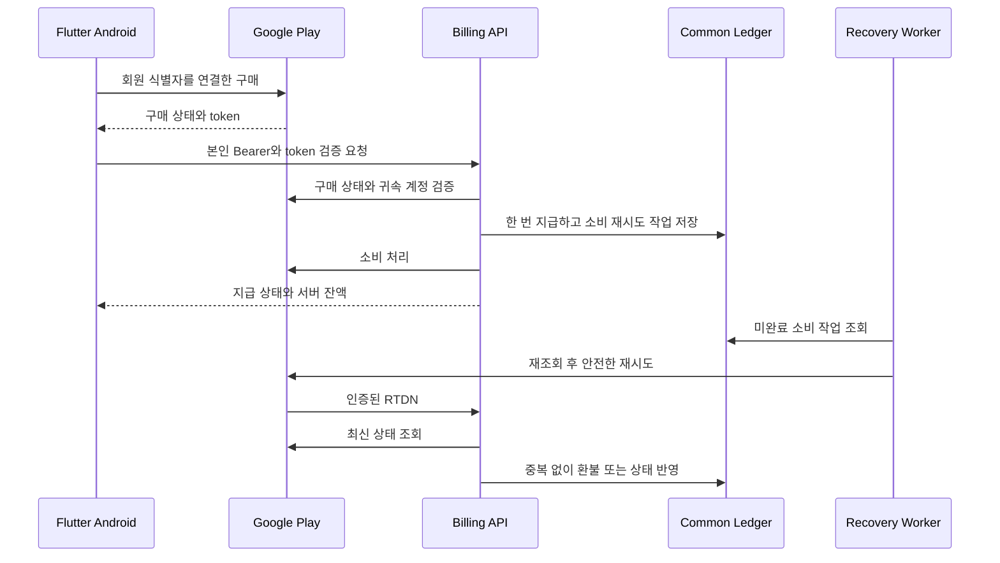
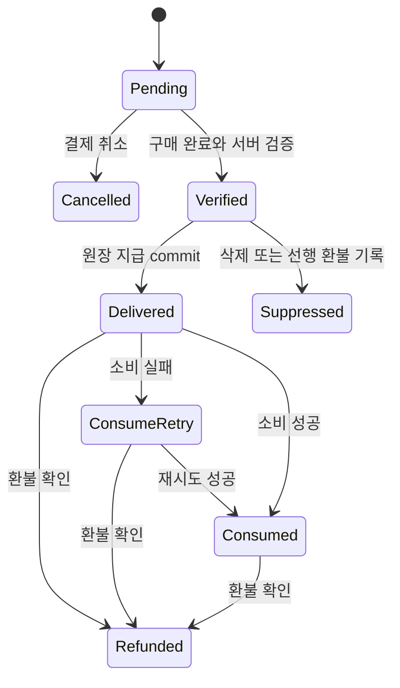
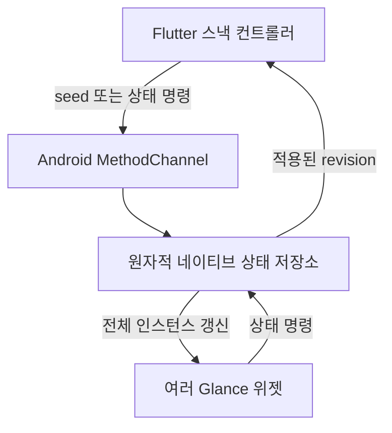

# Android 출시 준비와 기능 동등성 확보 - Plan

## Goal Capsule

- **목표:** Android 사용자가 tomatalk에 가입하거나 기존 계정으로 로그인하고, 대화·음성·결제·홈 화면 스낵 위젯을 사용할 수 있는 출시 후보를 만들어요.
- **접근:** 공통 Flutter 기능을 유지하면서 Android 배포 설정, 스토어 결제, OAuth, 네이티브 위젯을 보완해요.
- **사용자 지시:** Android는 아직 미배포 상태이므로 기존 Android 설치본과의 호환성을 위한 우회 코드나 데이터 이관을 만들 필요가 없어요. 개발용 설치 데이터 초기화가 필요한 변경도 허용되는 전제예요.
- **권한 범위:** 이 문서는 구현 계획이에요. 현재 요청은 문서 작성이며 앱 구현, 운영 DB 변경, 외부 콘솔 설정 변경, 스토어 공개는 실행하지 않아요.
- **기준:** 사용자 지시 → `AGENTS.md`·`.agent/rules.md` → 활성 계약 → 본 계획 순서로 적용해요. 여기서 제안하는 계약 변경은 해당 구현과 같은 작업 단위에서 반영해요.
- **검증 경계:** 공통 코드·백엔드 변경은 기존 iOS 계정과 구매 원장을 보존해야 해요. Android 미배포는 공통 운영 데이터 초기화 권한을 뜻하지 않아요.
- **외부 의존:** Play Console·Google Cloud·Apple·Supabase 설정과 실기기 검증은 해당 단계의 완료 조건이에요. 접근할 수 없으면 준비된 코드와 미검증 항목을 구분하며 출시 완료로 처리하지 않아요.

---

## Product Contract

### Summary

Android를 개발용 runner에서 실제 배포 가능한 앱으로 정리해요. 기존에 구현된 Flutter 대화·온보딩·스낵 기능은 재사용하고, iOS 전용인 구매·Apple 로그인·홈 화면 위젯의 Android 경로를 추가해요.

### Problem Frame

현재 Android에는 릴리스 디버그 서명과 Flutter 기본 아이콘이 남아 있어요. 구매 처리와 서버 검증은 Apple 중심이고, Android에서는 상점 진입과 충전 버튼을 숨겨요. 회원 이용 제한을 활성화하면 Android 사용자가 체험 소진 뒤 충전할 수 없어요. Apple만 연결한 기존 회원의 Android 로그인 경로와 Android 홈 화면 위젯도 없어요.

반면 Android용 AAC/M4A 녹음·마이크 권한 요청과 공통 Flutter 화면은 이미 있어요. 작업량은 화면 전체 재개발보다 외부 서비스 연동, 네이티브 기능, 릴리스 검증에 집중돼요.

### Baseline

| 영역 | 저장소에서 확인한 상태 | 계획상 처리 |
|---|---|---|
| 서명 | `mobile/android/app/build.gradle.kts`의 release가 debug 서명을 사용해요 | 업로드 키 기반 배포 설정으로 변경해요 |
| 브랜딩 | Android `ic_launcher.png`는 Flutter 기본 로고예요 | tomatalk 아이콘·시작 화면을 적용해요 |
| 빌드 | AGP 9.0.1, Gradle 9.1.0, Kotlin 2.3.20 설정이에요 | 오래됐다고 가정해 일괄 업그레이드하지 않고 호환 빌드를 먼저 확인해요 |
| 네트워크 | 메인 manifest에 INTERNET이 없지만 고정된 Google 로그인 플러그인이 선언해요 | 현재 통신 불가로 분류하지 않고 앱 소유 권한으로 명시해요 |
| 저장소 | `FlutterSecureStorage`를 쓰며 Android 백업 제외 정책이 없어요 | 백업·기기 이전 경계를 정해요 |
| 인증 | Google 공통 구현, iOS Apple 네이티브 구현이 있어요 | Google 배포 설정 검증과 Android Apple OAuth를 추가해요 |
| 결제 | iOS StoreKit 2와 `/billing/apple/*`만 구현돼 있어요 | Play 어댑터와 공통 원장 연동을 추가해요 |
| 음성 | Android AAC/M4A 분기와 단위 테스트가 있어요 | 실제 권한·인코딩·재생·생명주기를 확인해요 |
| 위젯 | `IosSnackWidgetBridge`는 iOS에서만 동작해요 | Android 위젯과 동기화 저장소를 구현해요 |

검토 당시 Flutter·Dart·adb 실행 도구를 찾지 못했어요. 이 표는 정적 검토 결과이며 Android 빌드 성공이나 실기기 동작을 입증하지 않아요.

### Requirements

**출시 기반**

- R1. 배포용 서명으로 APK/AAB를 생성하고 Play 내부 테스트 설치본에서 앱을 실행할 수 있어야 해요.
- R2. 앱 아이콘·OS 시작 화면·앱 표시 이름을 tomatalk으로 통일해요. 서비스 비밀과 업로드 키는 앱·저장소에 포함하지 않아요.
- R3. 백업 복원이나 기기 이전으로 사용할 수 없는 암호화 데이터가 돌아오지 않도록 해요. 서버 계정 데이터는 재로그인으로 복구하고 일일 스낵 진행은 기존처럼 기기 단위로 유지해요.

**인증과 공통 기능**

- R4. Google 로그인·게스트 회원 전환·로그아웃·재로그인이 Android 릴리스 설치본에서 동작해야 해요.
- R5. Apple만 연결한 기존 iOS 회원도 Android에서 같은 Supabase 계정으로 로그인할 수 있어야 해요. 게스트 이전과 계정 삭제의 기존 의미를 유지해요.
- R6. 대화·추천·문법 피드백·스낵·음성 녹음·문장별 재생이 Android에서 동작해야 해요. 권한 거절, 시스템 뒤로가기, 키보드, 앱 중단·복귀에서도 사용자가 복구할 수 있어야 해요.

**결제와 계정 원장**

- R7. 회원이 Google Play에서 기존과 같은 슬롯·대화권 다섯 상품을 반복 구매할 수 있어야 해요. 가격은 현재 스토어 조회 결과를 표시해요.
- R8. 검증된 구매에만 정확히 한 번 지급하고, 계정 변경·중복 요청·앱 종료·서버 재시작으로 중복 지급하거나 지급을 잃지 않아요. pending·취소 상태에서는 지급하지 않아요.
- R9. Play 환불·취소·계정 삭제 후 지연 요청이 원장에 일관되게 반영돼야 해요. 기존 Apple 원장·tombstone·환불 처리는 유지해요.
- R10. Android에서도 잔액과 상점 진입점을 제공해요. 회원 제한을 켠 상태에서 소진 안내부터 충전·대화 재개까지 검증해요.

**홈 화면 위젯**

- R11. 회원 전용 Android 스낵 위젯에서 토마토 꺼내기·한입 소비·카드 페이지 이동·닫기를 제공해요. 하루 12개, 토마토 3개 × 4입의 기존 규칙을 유지해요.
- R12. 앱·여러 위젯의 진행이 동일 기기에서 일치해야 해요. 계정·학습 언어·현지 날짜·운영 reset 변경 뒤 오래된 쓰기가 새 상태를 덮지 않아야 해요.

### Scope Boundaries

- 포함: R1–R12, 관련 문서·API 계약·테스트·출시 운영 절차예요.
- 제외: 구독 상품, 웹 결제, 푸시 알림, Android 미확인 답변 배지, 여러 기기 간 실시간 대화·스낵 진행 동기화, 전면 UI 재설계예요.
- [iOS 미확인 배지 계약](../../.agent/_contracts/IOS_UNREAD_BADGE.md)은 별도 구현 범위예요. iOS 전용 배지 기능을 Android 기능 동등성 기준에 포함하지 않아요. 실행 시 공통 인증·앱 복귀 파일의 변경 여부를 확인해 중복 구현을 피해야 해요.
- 기존 Android 테스트 설치 데이터의 마이그레이션은 제외하지만, 공통 서버와 iOS 데이터의 하위 호환은 유지해요.

---

## Planning Contract

### Assumptions

- 전체 업데이트 완료 범위에는 Play 결제·Apple 계정 이동·위젯을 포함해요. 먼저 내부 테스트 가능한 앱을 만들고 기능을 순서대로 추가해요. 공개 출시 범위를 임의로 줄이지 않아요.
- Android application ID는 우선 `com.morethanhuman.curitalk`을 유지해요. 미배포라 변경은 가능하지만 내부 식별자를 바꾸는 일은 사용자 기능 개선과 무관하고 OAuth·상품 설정 변경을 늘려요. 변경 요청이 생기면 최초 Play 등록 전에 일괄 반영해요.
- Android 최소 버전은 현재 문서의 API 23을 기준으로 시작해요. 선택한 Flutter·플러그인·Glance의 요구가 이를 높여야 한다면 지원 기기 범위 변경으로 기록하고 확정한 뒤 반영해요.
- 상용 배포용 계정·상품·가격·인증서·콜백 도메인의 실제 값은 문서에 만들거나 추측하지 않아요. 아래 설계는 이 값 없이 진행할 수 있고 외부 통합 검증 전에 운영자가 제공해야 해요.

### Key Technical Decisions

- KTD1. **Android 배포 설정을 명시해요.** R1–R3에 따라 개발·운영 공개 설정을 분리하고 release에서 debug 서명으로 되돌아가는 fallback을 제거해요. Flutter SDK와 Java/Gradle 조합은 실제 성공한 버전을 운영 문서에 고정해요. SDK 상향은 필요한 호환 변경만 수행해요.
- KTD2. **비밀 저장소와 기기 전용 상태를 백업에서 제외해요.** R3에 따라 cloud backup과 device-to-device transfer를 모두 다뤄요. 초기 정책은 앱 데이터 백업 비활성화와 해당 Android 버전의 추출 제외 규칙을 함께 적용하는 것이에요. 복원 시 서버 데이터와 로컬 진행의 차이를 안내해요. [사용 중인 보안 저장소의 안내](https://pub.dev/packages/flutter_secure_storage/versions/10.3.1)를 기준으로 검증해요.
- KTD3. **Apple의 Android 경로는 Supabase OAuth를 사용해요.** R5에 따라 iOS 네이티브 token 경로는 유지하고 Android는 브라우저 OAuth·PKCE와 앱 콜백을 연결해요. 게스트는 신원 연결을 우선하며 충돌 시 기존 이전 영수증 흐름을 재사용해요. 이메일만으로 계정을 병합하지 않아요. [Supabase 공식 안내](https://supabase.com/docs/guides/auth/social-sign-in/auth-apple)가 비 Apple 플랫폼에 권장하는 경로예요.
- KTD4. **스토어 검증과 자원 지급을 분리해요.** R7–R9에 따라 Apple/Play 검증 결과를 공통 입력으로 정규화하고 기존 `CreditLedger`의 잠금·지급 로직을 재사용해요. 새로운 결제 중계 SaaS는 도입하지 않아요. 상품 매핑을 Apple 모듈 밖으로 옮기고 스토어 상품 ID와 지급 자원을 분리해요.
- KTD5. **Play 소비 처리는 서버 한 곳이 소유해요.** R8에 따라 클라이언트 자동 소비를 끄고 서버 검증·원장 지급 commit 뒤 Play consume을 수행해요. 지급과 소비 사이 실패를 복구할 영속 작업을 함께 저장해요. Android에서 iOS `completePurchase` 흐름을 그대로 재사용하거나 양쪽이 중복 소비하지 않아요. [Play의 서버 검증·소비 권고](https://developer.android.com/google/play/billing/security)에 맞춰요.
- KTD6. **구매 식별자와 삭제 차단 기록을 스토어별로 구분해요.** R9에 따라 기존 Apple 거래를 보존하는 추가 migration을 사용해요. Play token을 기존 128자 transaction ID 칼럼에 넣지 않아요. `provider`와 검증 식별자의 충돌 없는 키를 정의하고 기존 Apple tombstone 조회도 계속 지원해요. 원본 token은 서버 재조회·소비에 필요한 동안만 접근이 제한된 저장소에 보관해요.
- KTD7. **Play 알림은 상태 재조회의 계기로 사용해요.** R8–R9에 따라 인증된 Pub/Sub 전달을 받아 Google API로 상태를 재확인해요. 구매 완료 알림이 앱 검증 요청보다 먼저 도착해도 검증된 귀속 계정으로 같은 멱등 지급 경로를 실행해요. 원장 반영·재시도 예약이 영속화되기 전에 성공 응답하지 않아요. RTDN 누락을 복구하는 Voided Purchases 재조회와 소비 재시도 작업을 운영해요. 알림 본문만으로 지급하거나 회수하지 않아요.
- KTD8. **Android 위젯은 Kotlin·Jetpack Glance로 구현해요.** R11–R12에 따라 Flutter MethodChannel로 앱과 연결하고 앱 전용 저장소에서 위젯 상태를 원자적으로 갱신해요. iOS App Group 구현은 유지해요. 단순 화면 링크가 아니라 위젯 안에서 학습하는 동작을 제공해요. [Glance 상태 관리](https://developer.android.com/develop/ui/compose/glance/glance-app-widget)를 따르되 앱 도메인의 상태 규칙은 계약으로 별도 정의해요.
- KTD9. **Android에서는 네이티브 저장소가 위젯과 앱의 당일 진행 변경을 직렬화해요.** R12에 따라 초기 콘텐츠 seed 이후 앱도 소비·닫기·reset을 명령으로 전달하고 적용된 스냅샷을 받아요. Flutter의 전체 스냅샷 덮어쓰기로 두 쓰기 주체를 만들지 않아요. 명령은 scope generation·revision·재전송 식별자로 중복과 오래된 이벤트를 구분해요.

### High-Level Technical Design

**결제 경계와 처리 순서**

**Play 구매 상태**

`Suppressed`는 검증된 거래를 지급 없이 종료한 결과예요. 삭제·환불 상태별 스토어 처리 여부는 U6에서 확정한 규칙을 따르며, 소유권을 검증하지 못한 token은 소비하지 않아요. 소비 재시도 실패가 이미 지급한 잔액을 다시 지급하는 이유가 되지 않아요.

**위젯 상태 소유권**

위젯 저장소에는 인증 토큰을 넣지 않아요. scope는 계정·학습 언어·현지 날짜·reset 세대를 포함해요. 로그아웃은 세대를 먼저 폐기하고 데이터를 지워 지연 명령을 거절해요. 날짜 rollover는 다음 갱신·사용자 동작에서도 검사하며, OS가 자정 작업을 정확한 시각에 실행한다고 가정하지 않아요.

### Sequencing

1. U1로 빌드·설치 기반을 확보하고 U2에서 공통 기능을 검증해요.
2. U3 인증, U4 결제 원장, U7 위젯은 U1 기반에서 각각 진행할 수 있어요. 공통 auth·home·app 파일 변경은 순서를 정해 충돌을 피해야 해요.
3. U4 이후 U5 클라이언트와 U6 복구·환불을 연결해요. U5만 완료한 상태를 결제 출시 준비 완료로 보지 않아요.
4. U8에서 모든 흐름과 iOS 회귀를 검증해요. 공개 배포는 별도 실행 지시를 받아 수행해요.

---

## Implementation Units

### U1. Android release foundation

**목표·요구사항:** 배포용 빌드와 브랜드·저장소 설정을 확보해요. R1–R3, KTD1–KTD2를 구현해요. 선행 의존성은 없어요.

**대상 파일:** `mobile/android/app/build.gradle.kts`, `mobile/android/settings.gradle.kts`, `mobile/android/gradle.properties`, `mobile/android/gradle/wrapper/gradle-wrapper.properties`, `mobile/android/app/src/main/AndroidManifest.xml`, `mobile/android/app/src/debug/AndroidManifest.xml`, `mobile/android/app/src/main/res/`, `mobile/.gitignore`, `mobile/lib/core/config/app_config.dart`, 새 `mobile/scripts/build_android_bundle.ps1`, `mobile/README.md`, `docs/OPERATIONS.md`예요.

**접근:**

1. 현재 의존성으로 debug와 release 빌드를 먼저 확인하고 호환 문제가 입증된 도구만 조정해요. Kotlin 플러그인 명시 여부만으로 빌드 오류를 단정하지 않아요.
2. 업로드 키와 Play App Signing을 구분해 운영 절차를 만들어요. 필수 서명·운영 공개 설정 누락은 빌드 실패로 처리해요. 버전명과 versionCode를 명시적으로 전달하도록 해요.
3. 메인 INTERNET·RECORD_AUDIO 권한과 최소 SDK를 확인해요. 로컬 HTTP 예외가 필요하면 debug 범위에만 두고 release는 HTTPS를 사용해요.
4. 기존 iOS 원본을 이용해 Android 레거시·적응형·단색 아이콘을 만들고 Android 12 이상 시작 화면과 이전 버전의 배경을 맞춰요. Flutter 스플래시와 겹쳐 보이는 과정도 확인해요.
5. 백업·추출 규칙을 Android 버전별로 적용하고 release에서 사용되는 약관·개인정보 URL을 확인해요. Android에 Apple EULA를 기본 약관으로 노출하지 않도록 배포 설정을 분리해요.

**검증:** 설정을 그대로 복제하는 단위 테스트는 추가하지 않아요. 서명된 설치본의 인증서·패키지명·권한·SDK·네이티브 라이브러리를 확인하고 아이콘·시작 화면을 실제 launcher에서 확인해요. 재설치·백업 복원·기기 이전에서 로컬 암호화 상태가 잘못 복원되지 않는지 확인해요. 배포 시점의 Play target API·Billing Library·16KB 페이지 크기 요구는 공식 문서와 최종 AAB로 확인해요.

### U2. Google authentication and core Android flows

**목표·요구사항:** Google 로그인과 공통 회화 기능의 Android 릴리스 동작을 확보해요. R4·R6을 구현해요. **의존성:** U1.

**대상 파일:** `mobile/lib/features/auth/data/google_identity_service.dart`, `mobile/lib/features/auth/application/auth_controller.dart`, `mobile/lib/features/conversation/application/conversation_audio_services.dart`, `mobile/lib/features/conversation/presentation/conversation_screen.dart`, `mobile/lib/app/router/app_router.dart`, `mobile/lib/app/app.dart`, `mobile/lib/core/widgets/`, `mobile/README.md`예요. 테스트는 기존 `mobile/test/features/auth/application/auth_controller_test.dart`, `mobile/test/features/conversation/application/conversation_audio_services_test.dart`, `mobile/test/features/conversation/presentation/conversation_screen_test.dart`와 새 `mobile/integration_test/android_core_flows_test.dart`에 배치해요.

**접근:** Google Cloud에 패키지명과 debug·업로드 키·Play 앱 서명의 필요한 SHA를 구분해 등록해요. Web OAuth ID와 Supabase 설정을 일치시키고 `google-services.json` 도입을 필수로 만들지 않아요. 기존 Android AAC/M4A 경로는 유지해 실제 문제를 재현한 부분만 수정해요. 녹음 중 앱이 비활성화되면 녹음을 취소하고 복귀 후 재입력을 안내하는 정책으로 정리해요. 재생·전송의 중단은 기존 서버 상태 조회와 재시도 흐름을 사용해요.

**테스트 시나리오:**

1. 첫 설치 → 온보딩 → 게스트 대화 → Google 회원 전환에서 게스트 기록을 보존해요.
2. 로그인 취소·네트워크 오류·기존 회원 충돌 이후 재시도로 정상 진입해요.
3. 마이크 최초 허용·거절·반복 거절·설정에서 허용을 각각 처리하고 잘못된 빈 파일을 전송하지 않아요.
4. 녹음 → STT → 문장별 TTS → 다시 듣기가 이어지고 화면 이탈 후 녹음·재생 자원이 정리돼요.
5. 시스템 뒤로가기·제스처·키보드 열기·닫기·큰 글꼴·화면 회전에서 입력과 하단 버튼에 접근할 수 있어요.
6. 앱 중단·네트워크 단절·프로세스 종료 후 이미 확정된 대화를 중복 전송하지 않고 서버 상태로 복구해요.

**완료 증거:** Play 내부 테스트 설치본의 Google 로그인과 두 종류 이상의 Android 실기기에서 음성·내비게이션 시나리오 결과를 남겨요. mock 단위 테스트 통과만으로 완료하지 않아요.

### U3. Apple OAuth and account continuity

**목표·요구사항:** Android에서 기존 Apple 계정 복귀와 게스트 전환·탈퇴를 지원해요. R5, KTD3을 구현해요. **의존성:** U1·U2.

**대상 파일:** `mobile/lib/features/auth/data/supabase_auth_service.dart`, `mobile/lib/features/auth/data/apple_identity_service.dart`, `mobile/lib/features/auth/application/auth_controller.dart`, `mobile/lib/features/auth/presentation/login_screen.dart`, `mobile/lib/features/profile/presentation/profile_screen.dart`, `mobile/lib/app/router/app_router.dart`, `mobile/lib/core/config/app_config.dart`, Android manifest, `backend/domains/auth/apple_revoke.py`, `website/build.mjs`, `website/vercel.json`, 새 `website/.well-known/assetlinks.json`, `docs/WEBSITE.md`, 인증·삭제 계약이에요. 테스트는 기존 `mobile/test/features/auth/data/apple_identity_service_test.dart`, `mobile/test/features/auth/application/auth_controller_test.dart`, `backend/tests/domains/auth/test_guest_transfer.py`, `backend/tests/domains/auth/test_apple_revoke.py`, `backend/tests/domains/auth/test_account_deletion.py`와 새 `mobile/test/features/auth/data/apple_oauth_flow_test.dart`를 사용해요.

**접근:**

1. Apple Services ID를 기존 앱과 연결하고 Supabase의 웹·네이티브 허용 client ID를 함께 설정해요. 콜백은 기존 공개 사이트의 `/auth/callback`을 신규 경로로 만들고 검증된 Android App Link로 연결해요. 사이트 빌드가 `/.well-known/assetlinks.json`을 출력하도록 하며 Play 앱 서명의 SHA-256을 등록해요. 운영·개발 callback 허용 목록을 분리하고 앱 미설치·링크 검증 실패에는 안전한 안내를 제공해요. 웹 페이지가 OAuth 코드를 로그·분석 도구에 보내지 않게 해요.
2. OAuth 시작 직전에 최소한의 pending 작업과 게스트 이전 정보를 저장해요. SDK의 검증된 인증 완료 이벤트를 기준으로 bootstrap·이전 claim을 한 번 실행하고 임의 딥링크의 user ID나 token을 신뢰하지 않아요.
3. 신규 연결과 기존 회원 충돌을 구분해 현재 게스트 이전 정책을 유지해요. 취소·만료·앱 재시작·중복 콜백 뒤에도 다른 세션의 데이터를 옮기지 않아요.
4. Supabase OAuth의 앱 복귀 코드와 Apple 승인 코드를 혼동하지 않아요. 기존 `apple_revoke.py`는 네이티브 코드 전용이므로 Android에서 존재하지 않는 Apple 코드를 전달하도록 설계하지 않아요. Android 탈퇴는 기존 `apple_disconnect_required`와 수동 연결 해제 안내를 사용하고 계정 데이터 삭제는 계속 진행해요. 자동 폐기 경로를 추가한다면 서버가 확보한 실제 Apple 자격 증명과 검증된 audience에 한정해요.

**테스트 시나리오:**

1. 기존 iOS Apple 회원이 Android에 로그인해 같은 Supabase user ID·대화 기록·구매 잔액을 확인해요.
2. Apple 이메일 비공개 계정도 이메일 기반 신규 계정으로 분리되지 않아요.
3. 게스트의 새 신원 연결과 기존 회원 충돌 후 이전이 각각 한 번만 적용돼요.
4. 브라우저 취소·콜백 재수신·다른 계정 로그인·앱 종료 후 복귀에서 오래된 pending 작업을 적용하지 않아요.
5. Android Apple 회원 탈퇴 시 불필요한 네이티브 호출 없이 데이터 삭제와 연결 해제 안내를 완료해요. iOS 재인증·자동 폐기 흐름은 유지돼요.

**완료 증거:** 실제 Apple·Supabase 설정에서 기기 이동을 입증해요. 계정 ID가 달라지면 자동 병합으로 우회하지 않고 Services ID 그룹·identity 설정을 바로잡아요.

### U4. Store-neutral ledger and Google Play verification

**목표·요구사항:** Play 구매를 안전하게 검증하고 기존 원장에 한 번 지급해요. R7–R9, KTD4–KTD6을 구현해요. **의존성:** U1의 패키지명 확정.

**대상 파일:** `backend/domains/billing/service.py`, `router.py`, `schemas.py`, `apple.py`, 새 `google_play.py`·`products.py`, `backend/shared/billing_models.py`, `credit_ledger.py`, `billing_tombstones.py`, `backend/config.py`, 새 `backend/alembic/versions/*_google_play_billing.py`예요. 테스트는 기존 `backend/tests/domains/billing/`와 새 `test_google_play_gateway.py`, `backend/tests/alembic/test_google_play_billing_migration.py`에 배치해요.

**접근:**

1. provider별 거래·알림·tombstone 식별 규칙을 계약에 먼저 정의해요. 기존 Apple 데이터에는 Apple provider를 채우고 잔액·FK·중복 방지 효력을 보존해요. `credit_lots.source`에 Play 출처를 추가해요.
2. 회원 Bearer로 구매 귀속 식별자를 발급하고 Play의 obfuscated account 식별자에 연결해요. 앱 구매 시작 전에 서버에 식별자·키 버전과 회원의 매핑을 보관해 RTDN만으로도 귀속 계정을 찾을 수 있게 해요. 앱 요청이 있으면 그 회원과도 비교하며 raw user ID를 스토어에 보내지 않아요. 키 회전 후 기존 매핑을 유지하고 삭제 때는 회원 연결을 제거한 뒤 재지급 방지용 HMAC 기록만 남겨요.
3. 제안 API `POST /api/billing/google/verify/`는 token을 받아 서버 자격 증명으로 Google 구매 상태를 조회해요. 앱 패키지·상품·구매 상태·수량·귀속 계정을 확인하고 클라이언트 가격·상품 주장만으로 지급하지 않아요. 초기 Play 상품은 다중 수량 구매를 끄고 허용 수량을 서버에서도 검증해요.
4. 기존 profile 잠금과 원장 트랜잭션 안에서 중복 확인·지급·소비 작업 저장을 수행해요. 외부 API 호출은 DB 잠금을 잡은 채 기다리지 않아요. 조회 이후 상태 변화는 U6의 환불 경로로 정정해요.
5. 서버 consume 성공 여부와 지급 여부를 별도 상태로 반환해요. 지급이 완료됐다면 소비 재시도 중에도 같은 구매를 다시 지급하지 않아요. Apple API 응답 계약은 유지해요.

**테스트 시나리오:**

1. 다섯 상품이 각각 정확한 슬롯·대화권을 지급해요.
2. 같은 token의 동시 요청·재시도·서로 다른 API 요청 ID에서 한 번만 지급돼요.
3. 게스트·다른 회원·잘못된 패키지·상품·수량·pending·취소 구매는 지급하지 않아요.
4. Google 조회 실패·DB rollback·응답 유실에서 원장과 소비 작업이 모순되지 않아요.
5. 기존 Apple 데이터가 있는 DB의 migration 전후 잔액·거래·환불 방지 효력이 같아요. Apple/Play 외부 식별자가 같아도 충돌하지 않아요.
6. PostgreSQL에서 구매·발화·계정 삭제 경쟁을 검증해요. SQLite 테스트로 잠금 검증을 대체하지 않아요.

**완료 증거:** 기존 Apple 회귀 테스트와 Play 어댑터·migration 테스트가 통과하고 Play 테스트 구매를 서버에서 검증할 수 있어요.

### U5. Android store UI and purchase recovery

**목표·요구사항:** Android에서 구매부터 충전 후 대화 재개까지 연결해요. R7·R8·R10, KTD4–KTD5를 구현해요. **의존성:** U2·U4.

**대상 파일:** `mobile/lib/features/billing/billing_controller.dart`, `billing_repository.dart`, `paywall_screen.dart`, 새 `store_purchase_service.dart`, `mobile/lib/features/profile/presentation/profile_screen.dart`, `mobile/lib/features/conversation/presentation/conversation_access_dialog.dart`, `conversation_screen.dart`, `mobile/lib/app/app.dart`, `mobile/pubspec.yaml`·`pubspec.lock`예요. 테스트는 새 `mobile/test/features/billing/billing_controller_test.dart`·`store_purchase_service_test.dart`와 기존 `paywall_screen_test.dart`에 배치해요.

**접근:** 플랫폼 조건을 제거하는 대신 StoreKit/Play 구매 어댑터를 분리해요. 현재 `in_app_purchase`를 유지하고 직접 사용하는 Android API 패키지는 명시적 의존성으로 선언해요. 앱 시작·복귀에 미처리 Play 구매를 조회하고 서버 결과로 잔액을 갱신해요. 구매 시작 계정과 현재 세션을 구분하며 서버가 귀속을 최종 판단해요. Android 상점·잔액·한도 초과 CTA를 활성화하고 스토어를 사용할 수 없는 기기에는 구매 불가 이유와 재시도를 보여줘요.

**테스트 시나리오:**

1. 슬롯 부족·대화권 소진에서 해당 상품으로 이동하고 구매 후 바로 대화를 재개해요.
2. pending·사용자 취소·상품 조회 실패·Play 미지원 기기에서 지급 완료로 표시하지 않아요.
3. 결제 승인 직후 종료·서버 지급 직후 응답 유실·소비 재시도 후 복귀에도 잔액이 한 번만 늘어요.
4. 구매 중 로그아웃하거나 다른 회원으로 바꾸면 그 회원에게 지급·성공 알림을 전달하지 않아요.
5. 같은 소비성 상품을 두 번 정상 구매하면 두 거래를 각각 지급해요. 소비가 끝난 상품의 재설치 복구는 스토어 재지급이 아니라 서버 잔액 조회예요.
6. iOS에서 기존 StoreKit 미완료 거래 처리와 terminal 이후 완료 규칙이 그대로 동작해요.

**완료 증거:** Play 내부 테스트 트랙에서 다섯 상품과 장애 복구를 검증해요. U6까지 완료하기 전에는 유료 출시 준비 완료로 처리하지 않아요.

### U6. Play notifications, refunds and deletion

**목표·요구사항:** 앱 실행 여부와 무관하게 결제 수명주기를 복구해요. R8–R9, KTD5–KTD7을 구현해요. **의존성:** U4.

**대상 파일:** `backend/domains/billing/google_play.py`, `service.py`, `router.py`, `backend/domains/auth/deletion.py`, 공통 결제 모델·tombstone, 새 `backend/scripts/reconcile_google_play_purchases.py`, 운영 실행 스크립트예요. 테스트는 새 `backend/tests/domains/billing/test_google_play_notifications.py`, `backend/tests/scripts/test_reconcile_google_play_purchases.py`, 기존 billing concurrency·account deletion 테스트를 사용해요.

**접근:**

1. 제안 RTDN 경로 `/api/billing/google/notifications/`에서 Pub/Sub OIDC의 서명·issuer·audience·허용 서비스 계정을 검증해요. 반복·역순 알림은 provider별 식별자로 처리해요.
2. 구매 완료 RTDN은 검증된 귀속 매핑으로 U4의 공통 지급 경로를 실행해 앱 미재실행 상태에서도 처리해요. 귀속을 찾지 못하면 추측해 지급·소비하지 않고 보류해요. 환불은 해당 거래의 슬롯 전체와 대화권 lot의 미사용분을 회수해요. 슬롯 초과는 새 생성만 제한하고 기존 대화의 열람과 잔여 대화권을 이용한 발화는 유지해요. 지급 전 환불은 차단 기록을 남겨 이후 앱 검증이 지급하지 않도록 해요.
3. 미완료 소비 작업과 Voided Purchases 조회를 주기 작업으로 복구해요. 성공한 조회 범위만 cursor를 전진시키고 중첩 조회·중복 제거로 재시작을 처리해요. 마지막 성공 시각·재시도 횟수·장기 미완료 작업을 관측해요.
4. 삭제 전에 provider별 구매·계정 차단 기록을 남겨요. 삭제 뒤 원본 계정/token을 영구 보관하지 않아요. 진행 중 스토어 종료에 필요한 최소 자료는 삭제 작업과 수명주기를 연결해 제한적으로 보관하고 종료 후 제거해요. 삭제 후에도 이미 받은 token으로 새 계정에 지급하지 않아요.
5. 타 계정 token을 임의로 소비하는 공개 API를 만들지 않아요. 삭제된 거래의 지급 없는 종료도 Google 검증과 기존 귀속·삭제 기록이 일치할 때만 처리해요.

**테스트 시나리오:**

1. 위조·잘못된 audience의 알림은 거절하고 정상 중복 알림은 한 번만 반영해요.
2. 환불이 지급 전·지급 후·소비 재시도 중 도착해도 최종 잔액과 회수량이 일치해요.
3. 소비 실패 뒤 서버 재시작·작업 중복 실행으로 추가 지급하지 않아요.
4. 알림 누락·Google API 장애 뒤 재조회가 빠진 환불을 복구해요.
5. 삭제와 구매 검증이 동시에 실행되거나 HMAC 키가 회전해도 재지급하지 않아요.
6. 삭제 후 지연 요청에서 다른 계정 정보를 노출하지 않고 최소 감사 기록만 남겨요.
7. 구매 승인 직후 앱이 종료돼 검증 요청이 없더라도 구매 완료 RTDN으로 한 번 지급·소비해요. 뒤늦은 앱 요청은 같은 결과를 반환해요.

**완료 증거:** 테스트 구매의 소비·환불과 작업 재시작을 실제 테스트 환경에서 확인해요. 재시도 주기·경보·수동 복구 절차를 `docs/OPERATIONS.md`에 기록해요.

### U7. Android snack widget

2026-11-26 연동 기준: [스낵 계약](../../.agent/_contracts/LANGUAGE_SNACKS.md)의 여섯 유형과 단일 관용 표현 payload를 지원해야 해요. 모든 카드가 items 두 개라는 가정을 두지 않아요.

**목표·요구사항:** 앱과 같은 하루 진행을 사용하는 Android 홈 화면 위젯을 제공해요. R11–R12, KTD8–KTD9를 구현해요. **의존성:** U1·U2. 결제 구현과 독립적이에요.

**대상 파일:** `mobile/lib/core/storage/snack_widget_bridge.dart`, `mobile/lib/features/home/application/daily_snack_basket_controller.dart`, `mobile/lib/features/auth/data/account_local_data.dart`, `mobile/android/app/src/main/kotlin/com/morethanhuman/curitalk/MainActivity.kt`, 새 `.../snackwidget/`의 Glance 위젯·receiver·store, Android manifest·위젯 리소스·Gradle 설정, 새 `.agent/_contracts/ANDROID_SNACK_WIDGET.md`예요. 테스트는 기존 `mobile/test/features/home/application/daily_snack_basket_controller_test.dart`, 새 `mobile/test/core/storage/snack_widget_bridge_test.dart`, `mobile/android/app/src/test/kotlin/com/morethanhuman/curitalk/snackwidget/SnackWidgetStoreTest.kt`, `mobile/android/app/src/androidTest/kotlin/com/morethanhuman/curitalk/snackwidget/SnackWidgetIntegrationTest.kt`를 사용해요.

**접근:**

1. iOS 스낵 위젯 계약의 콘텐츠·회원 경계를 재사용하되 Android 크기와 갱신 제한을 새 계약에 명시해요. 중간·큰 크기에 대응하는 반응형 레이아웃을 제공하고 launcher별 최소 크기를 검증해요.
2. 앱과 위젯의 모든 진행 명령을 같은 네이티브 저장소에서 원자적으로 적용해요. 여러 위젯이 한 스냅샷을 공유하며 화면의 오래된 revision에서 온 탭은 재적용하지 않고 최신 화면으로 갱신해요. Flutter 저장은 복귀·재시작용 mirror로만 사용해요.
3. 콘텐츠 seed는 동일 scope의 진행을 덮지 않아요. 날짜·계정·언어 전환은 새 세대를 만들고 운영 reset ID가 바뀌면 명시적으로 진행을 초기화해요. 단순한 소비 수 최댓값 병합은 사용하지 않아요.
4. 앱이 열리지 않은 새 날짜에는 기존 마지막 콘텐츠를 재사용하고, 앱이 이미 당일 묶음을 준비했다면 그 묶음을 유지해요. 로그아웃·삭제·게스트 전환은 모든 위젯을 비활성화하고 지연 쓰기를 폐기해요.
5. 자정·기기 재시작·시간대 변경과 사용자 탭에서 날짜를 재확인해요. 위젯 전용 이미지 크기를 제한하고 iOS 모션을 프레임 단위로 복제하지 않아요.

**테스트 시나리오:**

1. 최초 로그인 전·게스트·회원 상태에서 각각 비활성·비활성·활성 경계를 지켜요.
2. 꺼내기에는 소비가 늘지 않고 4·8·12입과 닫기 이후 바구니가 올바르게 바뀌어요.
3. 두 위젯 연속 탭·앱 동시 소비·동일 명령 재전송에서 중복 소비나 진행 rollback이 없어요.
4. 앱 미실행 자정·시간대 변경·프로세스 종료 후에도 계약에 맞는 당일 상태로 복원돼요.
5. 로그아웃·계정/언어 변경·운영 reset 직전의 지연 명령이 새 상태를 오염시키지 않아요.
6. 위젯 렌더링·갱신 실패는 앱 소비를 막지 않아요. 공통 상태 저장소 적용이 실패하면 마지막 정상 상태를 표시하고 소비 재시도를 제공해요. Flutter가 별도로 소비를 확정하지 않으며 오류 복구 뒤 같은 명령을 중복 적용하지 않아요. iOS 기존 bridge 테스트도 통과해요.

**완료 증거:** Pixel 계열과 Samsung 계열 launcher에서 크기 변경·다중 인스턴스·앱 복귀·자정 경계를 확인해요. Android와 iOS의 화면이 동일할 필요는 없지만 소비 규칙과 계정 경계는 같아야 해요.

### U8. Release validation and documentation

**목표·요구사항:** R1–R12의 검증 결과와 운영 절차를 갖춘 출시 후보를 만들어요. **의존성:** U1–U7.

**대상 파일:** `mobile/integration_test/`, `mobile/README.md`, `README.md`, `docs/OPERATIONS.md`, `docs/ENVIRONMENT.md`, `docs/DSL.md`, `docs/mobile-flow-spec.md`, `.agent/architecture.md`, 관련 `_contracts/`와 빌드·운영 스크립트예요. 새 회귀 테스트는 발견한 결함을 소유하는 기존 test 경로에 배치해요.

**접근:**

1. 서명된 내부 테스트 AAB를 설치해 신규 사용자와 기존 iOS 회원의 전체 흐름을 검증해요. 회원 제한을 켠 격리 테스트 환경에서 결제·소진·충전·대화 재개를 연결해요.
2. release의 축소·난독화 조건에서도 플러그인과 callback이 동작하는지 확인해요. Play 사전 출시 보고서·SDK 요구·페이지 크기 호환·지원 기기 목록을 확인해요.
3. iOS 로그인·StoreKit·위젯과 서버 원장 회귀를 검증해요. 서버 migration은 기존 데이터 복사본으로 검증하고 Android 구매 유입 뒤 단순 스키마 downgrade로 되돌리지 않아요.
4. API·환경변수·운영 변경의 문서와 changelog/version을 해당 기능 단위에서 함께 갱신해요. U8까지 문서 갱신을 미루지 않아요. README에는 실행에 필요한 요약과 상세 문서 링크만 남겨요.
5. 출시 담당자가 실제 지원 URL·약관·개인정보·계정 삭제 안내·스토어 정보를 확인해요. Play 등록·정책 요구의 실제 충족 여부는 배포 시점에 재확인해요.

**완료 증거:** 아래 검증 표의 환경·빌드 번호·결과·미해결 항목을 운영 문서나 출시 기록에 남겨요. 운영 설정 변경과 공개 배포는 이 계획 작성으로 실행되지 않아요.

---

## Verification Contract

| 검증 영역 | 실행 시점과 방법 | 통과 기준 |
|---|---|---|
| Flutter 정적 검사 | `mobile/`의 `flutter analyze` | 수정 영역의 오류가 없어요 |
| Flutter 회귀 | 각 U의 명시된 `mobile/test/` 파일, 최종 후보에서 `flutter test` | iOS 조건과 Android 조건을 모두 검증해요 |
| Android 패키징 | debug 설치와 서명된 release APK/AAB, Play 내부 트랙 설치 | debug 키·개발 URL이 release에 섞이지 않아요 |
| 네이티브 위젯 | Kotlin store 테스트·Android 계측 테스트·두 launcher 실기기 | scope·revision·중복·reset 경계가 유지돼요 |
| 결제 서버 | `backend/`의 `uv run pytest`로 billing·auth 삭제·새 migration·복구 스크립트 테스트 | 지급·소비·환불·삭제가 재시작 가능하고 중복 지급이 없어요 |
| DB 경쟁 | 격리 PostgreSQL에서 billing concurrency와 신규 경쟁 테스트 | Apple/Play·삭제·발화 경쟁에도 잔액 불변식을 지켜요 |
| 외부 인증 | Play 설치본 Google 로그인, iOS 계정의 Android Apple 로그인 | 같은 회원 ID와 기록·잔액을 유지해요 |
| 외부 결제 | Play 테스트 계정과 다섯 상품, pending·종료·재시도·환불 | 로컬 mock 결과와 실제 스토어 처리가 일치해요 |
| 기기 UX | API 23 또는 확정된 최저 버전, 최신 지원 버전, Pixel·Samsung 실기기 | 음성·뒤로가기·키보드·큰 글꼴·재시작 흐름이 가능해요 |
| iOS 회귀 | macOS/Xcode 환경에서 기존 앱·위젯과 Apple Sandbox | Android 추가 때문에 기존 기능이 깨지지 않아요 |

현재 문서 작성에서는 위 검사를 실행하지 않았어요. 테스트 계정·서명·실기기·SDK가 없으면 해당 행은 미검증으로 남기고, 수동 검증을 자동 테스트 통과로 대체하지 않아요.

### Risks and Release Gates

- **스토어와 인증 설정:** 앱 서명 SHA, Services ID, Supabase redirect, Play 상품·서비스 계정·Pub/Sub·실제 가격은 외부 설정이에요. U2·U3·U5·U6의 실제 검증 전에 준비해요.
- **OAuth 취소와 앱 복귀:** 외부 브라우저를 사용하는 U3는 iOS 네이티브 로그인과 완료 방식이 달라요. SDK 이벤트와 pending 작업의 계정 귀속을 검증하지 못하면 회원 전환을 활성화하지 않아요.
- **공통 원장:** Android 미배포를 이유로 Apple 원장을 초기화하지 않아요. migration 전후 잔액 비교와 삭제 차단 기록 회귀가 U4의 필수 조건이에요.
- **지급 후 consume 장애:** 앱이 종료돼도 서버 작업이 복구해야 해요. 소비 완료 기한과 재시도 운영을 검증하고, 미처리 작업이 쌓이면 신규 Play 구매 진입을 중단하되 재처리·환불 수신은 유지해요.
- **제한 활성화:** 공통 `CONVERSATION_ACCESS_ENABLED`를 Android 편의를 위해 운영 전체에서 임의 변경하지 않아요. Android 회원의 소진 후 복구 경로가 준비된 뒤 출시 설정을 결정해요.
- **롤백:** 신규 Play 구매 진입과 상품 노출을 중단할 수 있어야 해요. 이미 받은 거래의 지급·소비 재시도·환불 처리와 Apple 기능은 계속 유지해요. 새 거래가 생긴 뒤 원장 migration을 되돌리는 방식은 사용하지 않아요.
- **도구 요구:** Flutter SDK, Android SDK/JDK, Play 테스트 기기, iOS 회귀용 macOS가 필요해요. 새 Glance 의존성을 추가할 때 빌드 호환·최소 SDK를 다시 확인해요.

### Documentation Ownership

| 변경 | 같은 작업 단위에서 갱신할 기준 문서 |
|---|---|
| 새 결제 API·원장·상품 매핑 | `docs/DSL.md`, `.agent/_contracts/CONVERSATION_ACCESS.md`, `.agent/architecture.md` |
| OAuth·게스트 이전·삭제 | `.agent/_contracts/SUPABASE_AUTH.md`, `.agent/_contracts/AUTH_BOOTSTRAP.md`, `.agent/_contracts/ACCOUNT_DELETION.md`, `docs/mobile-flow-spec.md`, `docs/WEBSITE.md` |
| Android 위젯 | 새 `.agent/_contracts/ANDROID_SNACK_WIDGET.md`, `mobile/README.md`, `.agent/architecture.md` |
| 새 환경변수 | `.env.example`, `docs/ENVIRONMENT.md`, `backend/config.py` |
| 빌드·배포·재처리 작업 | `README.md`의 요약, `mobile/README.md`, `docs/OPERATIONS.md`, 관련 스크립트 |

공유 파일은 `AGENTS.md`에 따라 편집 전 claim해요. 계획 전용 인덱스는 현재 없으므로 이번 계획을 위해 별도 인덱스나 README 중복 목록을 만들지 않아요. 구현 완료 후 결정과 검증 결과를 기준 문서·테스트에 흡수하고 프로젝트의 임시 문서 정리 규칙에 따라 이 계획을 제거해요.

---

## Definition of Done

- U1–U8의 완료 증거가 있고 검증되지 않은 핵심 외부 흐름을 완료로 표시하지 않아요.
- Android에서 Google·Apple 회원 전환, 음성 회화, Play 반복 구매, 소진 후 충전, 스낵 위젯 소비가 실제 설치본으로 확인돼요.
- Play 구매의 중복·종료·환불·삭제 경계와 기존 Apple 데이터 보존이 검증돼요.
- Android 새 기능 때문에 iOS 로그인·결제·위젯 계약이 깨지지 않아요.
- 구현과 기준 문서·버전·변경 이력이 함께 갱신되고 폐기한 실험 코드·임시 설정·테스트 키가 남지 않아요.
- 출시 후보 생성과 스토어 공개를 구분하고, 공개 배포 여부는 실제 실행 지시와 출시 검증 결과에 따라 결정해요.

---

## Appendix

### Sources

조사 기준일은 2026-11-25예요. 외부 문서는 구현 착수와 공개 출시 시 다시 확인해요.

- 저장소 기준: `AGENTS.md`, `.agent/rules.md`, `.agent/architecture.md`, `mobile/README.md`, `docs/DSL.md`, `docs/OPERATIONS.md`, `.agent/_contracts/CONVERSATION_ACCESS.md`, `.agent/_contracts/IOS_SNACK_WIDGET.md`, `.agent/_contracts/ACCOUNT_DELETION.md`예요.
- [Flutter Android 배포](https://docs.flutter.dev/deployment/android): 서명·빌드 설정의 기준이에요.
- [Google 로그인 Android 7.2.13](https://pub.dev/packages/google_sign_in_android/versions/7.2.13): 현재 고정 버전의 패키지·서명·serverClientId 설정 기준이에요.
- [동일 버전 INTERNET 선언](https://raw.githubusercontent.com/flutter/packages/google_sign_in_android-v7.2.13/packages/google_sign_in/google_sign_in_android/android/src/main/AndroidManifest.xml): 권한 누락을 확정 장애로 분류하지 않은 근거예요.
- [Flutter Secure Storage 10.3.1](https://pub.dev/packages/flutter_secure_storage/versions/10.3.1): 백업 제외 정책의 근거예요.
- [Supabase Apple 로그인](https://supabase.com/docs/guides/auth/social-sign-in/auth-apple): Android OAuth와 iOS token 경로를 분리하는 근거예요.
- [Play 일회성 구매 수명주기](https://developer.android.com/google/play/billing/lifecycle/one-time), [서버 검증](https://developer.android.com/google/play/billing/security), [RTDN](https://developer.android.com/google/play/billing/rtdn-reference), [Voided Purchases](https://developer.android.com/google/play/developer-api#voided-purchases-api): 검증·소비·복구·환불 설계의 기준이에요.
- [Glance](https://developer.android.com/develop/ui/compose/glance), [위젯 상태 갱신](https://developer.android.com/develop/ui/compose/glance/glance-app-widget): Android 위젯 구현 방식의 기준이에요.

관련 Android 과거 해결책은 `.agent/_lessons/`와 `docs/solutions/`에서 발견하지 못했어요. 따라서 실제 Android 배포 경험이 이미 축적돼 있다고 가정하지 않아요.
