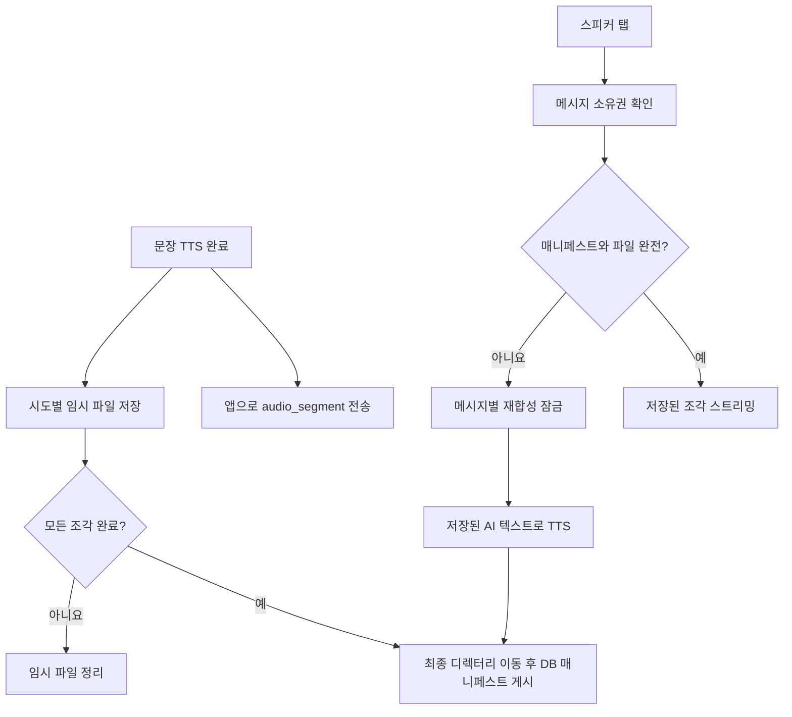

# Host FS Conversation Audio Cache - Plan

## Goal Capsule

- **Objective:** 사용자는 스트리밍이 끝난 AI 답변을 대화에 다시 들어와서도 스피커 버튼으로 빠르게 들을 수 있어요. 저장 파일이 만료됐더라도 같은 답변 텍스트의 음성을 다시 받을 수 있어요.
- **Means:** Hetzner 호스트의 영속 디렉터리에 문장별 TTS 결과를 캐시하고 DB에는 메시지별 파일 목록과 캐시 상태를 기록해요(KTD1–KTD4).
- **Authority:** 이 대화에서 선택한 호스트 FS와 파일 누락 시 재생성 정책, `AGENTS.md`, `.agent/_contracts/VOICE_STREAMING.md`, `docs/DSL.md` 순서로 적용해요.
- **Stop condition:** 새 스트림, 대화 재진입, 캐시 적중, 파일 만료 후 재생성, 동시 재생, 저장 실패, 재배포가 검증되면 완료해요. 운영 서버에 실제 마운트를 생성하거나 정리 작업을 켜는 것은 배포 절차에서 별도로 확인해요.

---

## Product Contract

### Summary

현재 스트림의 음성 조각은 앱으로 보내 즉시 재생하지만, 완료된 메시지는 재생 가능한 음성 참조를 보유하지 않아요. 생성 시 음성 조각을 호스트 디스크에 보관하고, 이후 재생은 저장된 조각을 사용해요. 오래되어 삭제된 파일은 저장된 AI 텍스트를 다시 합성해 채워요.

### Requirements

**재생 경험**

- R1. 스트리밍 중 첫 음성 재생을 유지하고 저장 작업 때문에 눈에 띄는 지연이 생기지 않아야 해요.
- R2. 완료된 스트림 AI 메시지는 대화 재진입 후에도 스피커 버튼이 보여야 해요. 재생은 저장된 음성을 우선 사용해요.
- R3. 파일이 실제로 없거나 캐시가 없는 과거 메시지라면 같은 AI 텍스트로 음성을 한 번 재합성해 저장하고 재생해요. 이미 완료된 파일을 읽은 경우 TTS를 호출하지 않아요.
- R4. 음성 생성·저장·재생이 실패해도 완성된 AI 텍스트와 사용자 발화는 보존해요. 앱은 오류와 다시 시도할 수 있는 동작을 표시해요.

**보관과 접근**

- R5. 음성 파일은 API 컨테이너 재생성 후에도 유지되는 Hetzner 호스트 디렉터리에 저장하고, DB에는 메시지별 메타데이터만 저장해요.
- R6. 인증된 대화 소유자만 음성을 받을 수 있어요. 클라이언트는 임의 파일 경로를 요청할 수 없고, 파일 서버의 공개 경로도 만들지 않아요.
- R7. 운영자가 정한 보관 기간이 지난 파일은 주기적으로 삭제해 디스크 사용량을 제한해요. 텍스트와 메시지 ID는 유지해 재생성을 지원해요.
- R8. 동시 재생 요청과 정리 작업이 겹쳐도 한 메시지에 대한 TTS 재합성이 중복 실행되거나 부분 파일이 정상 캐시로 노출되지 않아야 해요.

### Acceptance Examples

- AE1. 새 답변의 음성 조각이 생성되면 앱은 곧바로 듣고, 답변 완료 후 스피커를 누르면 저장 파일을 재생해요. **Covers:** R1, R2.
- AE2. 앱을 종료했다 다시 같은 대화를 열어도 스피커가 보이고, 파일이 남아 있으면 TTS 호출 없이 들려줘요. **Covers:** R2, R3, R5.
- AE3. 보관 기간이 지나 파일이 삭제된 뒤 스피커를 누르면 한 요청만 재합성하고 다른 동시 요청은 같은 결과를 기다려요. **Covers:** R3, R7, R8.
- AE4. 디스크가 가득 차거나 파일이 손상되어도 AI 텍스트는 남고, 앱에는 음성 오류가 표시돼요. **Covers:** R4, R8.
- AE5. 다른 사용자의 메시지 ID로 요청하면 파일 존재 여부를 알 수 없는 404가 반환돼요. **Covers:** R6.

### Scope Boundaries

- AI 응답의 스트리밍 음성만 영속 캐시 대상으로 해요. 사용자의 STT 업로드 녹음 파일과 기존 JSON 응답 형식은 바꾸지 않아요.
- 첫 구현은 단일 Hetzner 서버에서 동작해요. 여러 API 호스트 간 파일 공유, CDN, 객체 저장소 이전은 후속 작업이에요.
- 최초 보관 기간은 30일로 제안하며, 배포 전 실제 디스크 용량과 일일 생성량으로 조정 가능하게 설정해요. 오래된 AI 메시지의 스피커를 숨기는 정책은 두지 않아요.

---

## Planning Contract

### Key Technical Decisions

- KTD1. **호스트 FS를 캐시의 원본으로 사용해요.** (session-settled: user-directed — chosen over object storage: 현재 Hetzner 서버의 디스크를 활용해 반복 재생 지연과 추가 저장소 비용을 줄여요.) `docker-compose.yml`의 API 서비스에 전용 호스트 디렉터리를 마운트하고 경로는 서버 설정으로 주입해요. 컨테이너 계층에 저장하지 않아요. Governs R1, R5, R7.
- KTD2. **문장별 파일과 메시지별 매니페스트를 사용해요.** 스트림에서 이미 생성한 완성 MP3 조각을 원본 그대로 저장해요. 서로 다른 MP3 파일을 단순 바이트 연결하지 않아요. DB 매니페스트에는 메시지 ID, 세대 ID, 조각 순서·상대 경로·크기·형식, 텍스트 해시, 저장 시각을 기록해요. Governs R2, R3, R5, R8.
- KTD3. **파일 기록과 DB 게시를 분리해요.** 스트림 조각은 최종 저장 경로와 같은 파일 시스템의 시도 ID별 임시 디렉터리에 기록하고, 모두 완성된 뒤 메시지 ID와 새 세대 ID의 최종 디렉터리로 원자적으로 이동해요. 이어서 DB 매니페스트를 게시해요. 실패한 임시 파일과 참조되지 않는 이전 세대는 유예 기간 뒤 정리해요. 캐시 저장 실패는 텍스트 성공을 뒤집지 않아요. 저장 작업은 제한된 큐로 분리해 첫 음성 이벤트를 불필요하게 기다리게 하지 않아요. Governs R1, R4, R8.
- KTD4. **기존 음성 전용 스트림 경로를 캐시 우선 재생 경로로 확장해요.** 요청자의 메시지 소유권을 확인하고 캐시가 완전하면 기존 `audio_segment` 이벤트로 저장 파일을 보내요. 캐시가 없거나 파일 하나라도 사라졌다면 기존 TTS 재합성 흐름을 사용해 새 세대를 만들어요. 여러 API 워커에 걸친 메시지별 재합성 점유권은 DB의 조건부 상태 전이로 한 요청만 획득해요. 나머지 요청은 완료를 기다리거나 진행 중 오류를 명확히 반환해요. `stream_turns.audio_status`는 생성 시도 결과로 두고 캐시 존재 여부와 혼동하지 않아요. 기존 실패 음성 재시도 의미와 충돌하지 않도록 캐시 적중 시에는 재시도 상태 전이를 실행하지 않아요. Governs R2, R3, R4, R6, R8.
- KTD5. **보관 정리는 파일 기준, DB는 추적 기준으로 운영해요.** 파일 나이를 기준으로 완료된 세대를 삭제하고 DB 매니페스트는 누락을 허용해요. 재생 요청은 실제 파일 열기에서 누락을 확인하고 재합성해 새 세대 참조를 게시해요. 디스크 사용량과 남은 용량을 감시해요. 운영 환경에서 전용 마운트가 없거나 쓰기 불가라면 API 시작을 거부해 컨테이너 계층에 파일이 쌓이지 않게 해요. 권한 오류와 일시적 I/O 실패는 파일 누락으로 취급하지 않아요. Governs R3, R5, R7, R8.

### High-Level Technical Design

아래 흐름은 설계 방향이에요. 세부 함수와 트랜잭션 경계는 구현 시 기존 스트림 상태 전이를 보존하면서 확정해요.

재생 상태는 `ready → missing → regenerating → ready`와 `regenerating → failed`를 구분해요. 캐시 누락은 음성 합성 실패와 다른 상태예요. 파일 삭제가 DB 삭제와 동시에 일어나지 않아도 재생 흐름이 복구할 수 있어야 해요. 파일이 사라진 순간과 읽는 순간이 경합할 수 있으므로 재생은 `exists` 검사만 믿지 않고 실제 열기 실패를 처리해요.

### Sequencing and Compatibility

1. 새 DB 테이블과 설정을 먼저 배포해요. 기존 메시지는 매니페스트가 없어도 텍스트를 정상 조회해요.
2. 호스트 디렉터리와 컨테이너 마운트, 권한을 준비하고 저장 경로를 검증해요. 현재 `docker-compose.yml`의 API 서비스에는 음성용 볼륨이 없어요.
3. 새로 생성되는 음성의 저장·게시를 켜고, 캐시 우선 재생 경로를 배포해요. 기존 음성 전용 스트림의 이벤트 형식을 유지해 구버전 앱과 호환해요.
4. 모바일 스피커 표시·재생 호출을 연결한 뒤 정리 작업을 활성화해요. 최초 정리 전에 저장·재생·재합성 관측값을 확보해요. API 롤백 시 새 매니페스트는 구버전 코드가 무시할 수 있어야 하며, 마운트와 파일은 유지해요.

---

## Implementation Units

### U1. 저장 계약과 영속 데이터

- **Goal:** 캐시 매니페스트와 설정을 추가하고 기존 메시지 계약을 확장해요. **Covers:** R2, R5, R6.
- **Files:** `backend/domains/conversation/models.py`, `backend/domains/conversation/schemas.py`, `backend/alembic/versions/`, `backend/config.py`, `.env.example`, `docs/ENVIRONMENT.md`, `docs/DSL.md`, `.agent/_contracts/VOICE_STREAMING.md`.
- **Execution note:** 공유 파일인 `backend/config.py`와 `.env.example`은 `.agent/_coordination/HANDOFF.md`에 claim한 뒤 편집해요. 현재 진행 중인 스트림 변경과 통합할 때 최신 파일을 다시 읽어요.
- **Test scenarios:** 기존 메시지 목록에 매니페스트가 없어도 역직렬화되고, 새 AI 메시지의 음성 가능 상태가 노출되며, 잘못된 순서나 형식의 매니페스트는 거부돼요. 마이그레이션 업그레이드와 다운그레이드를 빈 DB와 기존 데이터에서 확인해요.

### U2. 안전한 파일 캐시와 운영 마운트

- **Goal:** 문장별 저장, 원자적 게시, 임시·오래된 파일 정리, 디스크 한계 관측을 구현해요. **Covers:** R1, R4, R5, R7, R8.
- **Files:** `backend/domains/conversation/stream_audio.py` 인접 캐시 모듈, `backend/domains/conversation/stream_pipeline.py`, `backend/domains/conversation/router.py`, `docker-compose.yml`, `docs/OPERATIONS.md`, 운영 정리 스크립트.
- **Test scenarios:** 두 조각이 순서대로 저장되고 완료 전에는 매니페스트가 보이지 않아요. 중단·디스크 부족·쓰기 예외 시 텍스트와 스트림 재생은 보존되고 임시 파일만 남지 않아요. 재시작 뒤 마운트 파일을 다시 읽고, 정리는 보관 기간이 지난 완료 파일만 삭제해요. 첫 음성 지연은 변경 전 계측값과 비교해요.

### U3. 캐시 우선 음성 재생과 누락 복구

- **Goal:** 저장 음성을 우선 반환하고 파일 누락 시 같은 답변을 한 번 재합성해요. **Covers:** R2, R3, R4, R6, R8.
- **Files:** `backend/domains/conversation/router.py`, `backend/domains/conversation/stream_turns.py`, `backend/domains/conversation/stream_audio.py` 인접 캐시 모듈, `backend/tests/domains/conversation/`.
- **Test scenarios:** 캐시 적중은 TTS 호출 0회, 한 조각 누락은 전체 답변 재합성 1회, 동시 두 요청도 재합성 1회예요. 저장소 읽기 오류는 누락으로 오인하지 않아요. 다른 사용자의 메시지 ID는 404이며, 성공·실패·취소 이벤트와 기존 재시도 상태 전이가 일치해요.

### U4. 모바일 스피커와 대화 재진입

- **Goal:** 스트림으로 완료된 AI 메시지의 스피커를 표시하고 캐시 우선 경로의 조각을 재생해요. **Covers:** R2, R3, R4.
- **Files:** `mobile/lib/features/conversation/domain/conversation_models.dart`, `mobile/lib/features/conversation/application/conversation_controller.dart`, `mobile/lib/features/conversation/data/conversation_stream_api.dart`, `mobile/lib/features/conversation/presentation/widgets/conversation_message_tile.dart`, `mobile/test/features/conversation/application/`, `mobile/test/features/conversation/presentation/`.
- **Test scenarios:** 새 대화와 재진입 화면 모두 AI 스피커가 보이고, 탭하면 문장 순서대로 재생돼요. 중복 탭·화면 이탈·네트워크 오류에서 재생 큐가 안전하게 정리되고 재시도 UI가 보여요. 기존 JSON 인라인 오디오 재생도 유지돼요.

---

## Verification Contract

| 검증 | 대상 | 완료 신호 |
|------|------|-----------|
| 백엔드 단위·라우터 테스트 | U1–U3 | 캐시 적중, 누락, 동시 요청, 인증, 정리, 마이그레이션 경계가 통과해요. |
| Flutter 단위·위젯 테스트 | U4 | 스피커 표시, 재진입 재생, 오류·취소가 통과해요. |
| 로컬 Compose 재생성 검사 | U2–U4 | API 컨테이너 재생성 뒤 저장 파일이 남고 같은 메시지 재생에 TTS가 호출되지 않아요. |
| 운영 배포 전후 관측 | U2–U4 | 디스크 여유, 캐시 적중률, 재합성 횟수, 저장 실패, 첫 음성 지연을 비교해요. |

---

## Definition of Done

- 스트리밍·재진입·스피커 재생이 같은 AI 메시지 ID로 연결되고 캐시 적중 시 TTS가 재호출되지 않아요.
- 파일 만료 또는 누락 시 단일 재합성으로 복구되고, 오류가 AI 텍스트나 대화 진행을 손상시키지 않아요.
- 영속 마운트·정리 주기·디스크 경고 기준·복구 절차가 `docs/OPERATIONS.md`에 있으며, API·환경 계약과 문서가 같은 변경 단위에서 갱신돼요.
- 진행 중인 다른 음성 스트림 수정과 충돌 없이 통합하고 기존 JSON/스트림 계약 테스트가 통과해요.
